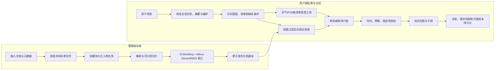

# TripPilot：旅游 Agentic RAG 对话助手

TripPilot 是一个面向旅游需求的企业式 Agentic RAG 项目。管理员可以在网页中拖入 PDF、DOCX、Markdown 和 TXT，系统保存原文件并异步完成解析、切片、索引与发布；用户通过多轮对话查询交通、景点、线路、美食和酒店资料，也可以生成、修改、校验并恢复行程方案。

详细产品与技术需求见 [旅游 Agentic RAG 项目需求大纲](./旅游Agentic_RAG项目需求大纲.md)，测试前需要先填写 [配置填写清单](./docs/测试前配置填写清单.md)。

## 总体调用流程



## 代码结构

```text
backend/trippilot/
├── ingestion/                         # 存库主包
│   ├── module1_document_storage.py    # 文件校验、本地/MinIO 原文存储
│   ├── module2_parse_and_chunk.py     # PDF/DOCX/MD/TXT 解析和可引用切片
│   ├── module3_index_and_publish.py   # 异步索引与版本原子发布
│   └── module4_admin_api.py           # 知识库、上传、版本、预览、停用和删除接口
├── retrieval/                         # 检索与对话主包
│   ├── module1_model_gateway.py       # 对话模型 JSON/流式调用边界
│   ├── module2_knowledge_search.py    # 权限过滤、Hybrid Search、RRF、Rerank
│   ├── module3_context_memory.py      # 历史、摘要、结构化需求记忆
│   ├── module4_travel_tools.py        # 天气、POI、餐厅、酒店地点和路线工具
│   ├── module5_agent_workflow.py      # LangGraph Agent 流程和约束校验
│   └── module6_conversation_api.py    # 会话、消息、方案、SSE 和停止生成接口
├── models.py                          # 业务表和持久化记录
├── worker.py                          # 数据库租约工作队列与任务执行
├── celery_app.py                      # Redis/Celery 多进程调度入口
└── app.py                             # FastAPI 组装、健康状态和前端托管
frontend/src/
├── views/AdminView.vue                # 拖拽入库、更新版本、状态、切片和检索验证
├── views/ChatView.vue                 # 多轮对话、SSE、引用、方案卡与历史恢复
├── views/PreferencesView.vue          # 用户长期偏好
└── stores/auth.ts                     # 登录态
```

模块名表达业务职责；存在固定执行顺序的方法使用 `step1_...`、`step2_...`。单一步骤的查询、下载和删除保持直接业务名，避免为了编号拆出无意义包装。

## 数据持久化位置

| 数据 | 开发模式 | 企业模式 |
|---|---|---|
| 上传原文 | `data/knowledge/` | MinIO |
| 文档、版本、切片元数据 | SQLite | PostgreSQL |
| Dense + BM25 索引 | 数据库片段上的本地 BM25 | Milvus |
| 对话消息和结构化需求 | SQLite | PostgreSQL |
| LangGraph 检查点 | `data/checkpoints.sqlite` | PostgreSQL |
| 任务队列 | 数据库工作项 | PostgreSQL 工作项 + Redis/Celery 调度 |

本地 BM25 是无需外部服务的开发降级路径。企业检索路径使用 Milvus 内置 BM25 稀疏向量与 Dense 向量双路召回、RRF 融合和外部 Reranker 精排。

## 当前启动约束

按照项目约定，当前先完成代码，不立即执行测试和构建。请先填写 [测试前配置填写清单](./docs/测试前配置填写清单.md)。配置收到并安全写入本机 `.env` 后，再按清单中的顺序完成依赖服务、迁移、后端测试、真实入库、模型调用和前端构建验收。

