# TripPilot LangGraph 全部节点与执行流程总结

## 1. LangGraph 在项目中的职责

LangGraph 位于 `backend/trippilot/retrieval/module5_agent_workflow.py`，负责组织用户对话请求从“理解问题”到“生成最终回答”的完整执行流程。

它只负责**用户端旅游对话检索与回答流程**。管理端上传文档、解析文件、切分文本、生成向量和写入知识库属于存库流程，不是 LangGraph 节点。

当前图中共有 5 个正式节点：

| 顺序 | 图中的节点名 | Python 函数 | 核心职责 | 是否调用大模型 |
|---|---|---|---|---|
| 1 | `step1_understand` | `step1_understand_request` | 识别意图、领域和需求，判断是否需要追问 | 通常调用；简单寒暄可直接识别 |
| 2 | `step2_retrieve` | `step2_retrieve_evidence_and_tools` | 检索知识库并调用天气等外部工具 | 否 |
| 3 | `step3_plan` | `step3_build_or_revise_plan` | 首次生成或修订结构化旅游行程 | 仅规划/修改行程时调用 |
| 4 | `step4_validate` | `step4_validate_time_and_budget` | 校验时间、预算、天数和锁定活动 | 否，使用确定性代码校验 |
| 5 | `step5_answer` | `step5_answer_with_citations` | 输出拒答、寒暄、问答或最终行程 | 普通问答调用；行程直接格式化 |

## 2. 总流程图

为避免回环线在部分 Markdown 查看器中错乱，主图把“回到规划节点”画成独立的修订出口，具体循环规则在图后说明。

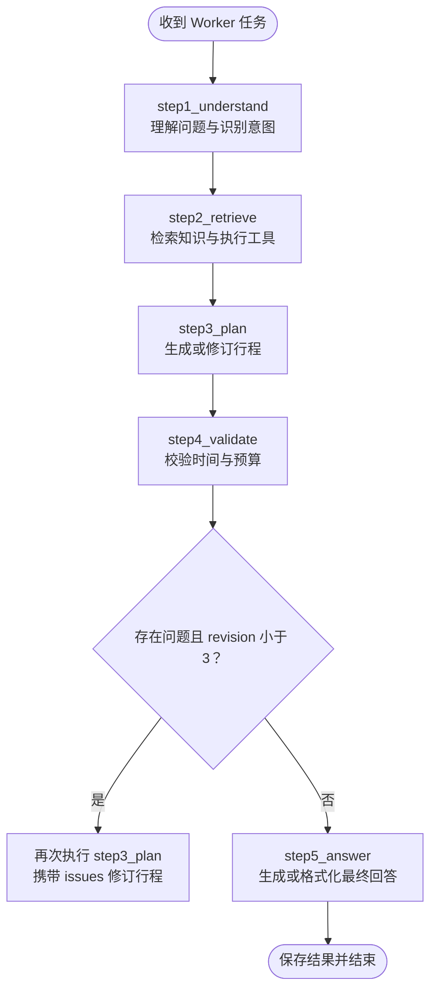

当校验结果为“是”时，LangGraph 实际执行 `step4_validate → step3_plan → step4_validate`。`revision` 每次执行规划节点后加 1；当前代码最多执行 3 次规划生成，达到上限后即使仍有问题也会进入最终回答，并把未解决问题展示给用户。

## 2.1 项目端到端业务流程表述

用户输入消息后，系统首先结合当前对话历史、已保存的旅游槽位和已有行程，分析用户意图，并提取本轮新增或修改的旅行需求。

如果当前任务缺少完成所必需的信息，系统会先追问用户；如果用户切换了旅行目的地，例如从广州改为西藏，系统会清理旧目的地相关的行程信息，并重新确认必要条件。

不需要追问时，系统根据问题性质收集信息：稳定的旅游资料优先通过 RAG 从知识库检索，天气、路线、地点等实时信息通过外部工具查询，两类信息可以同时使用；某些请求也可能无需检索或工具调用。

对于创建或修改行程的请求，系统会将用户需求、历史上下文、知识库证据和实时工具结果交给 LLM，生成结构化行程草案。

行程生成后，由确定性的 Python 校验逻辑检查时间冲突、预算、旅行天数和锁定活动等硬性条件。发现可自动处理的冲突时，系统会将问题和上一版行程交回 LLM 修订。当前最多执行三次行程生成，包括一次初次生成和最多两次自动修订。

最后，系统将普通旅游问答、追问、拒答或格式化后的行程结果通过流式方式展示到前端，并保存对话、引用证据、工具结果、行程版本和执行状态。

### 2.1.1 表述时需要说明的两个边界

- RAG 检索会先按用户权限、文档是否启用、是否为当前有效版本和资料是否过期进行过滤；回答前还会再次复核证据权限。
- 用户点击停止时，取消状态会传递到 API、Worker、LangGraph 节点和最终结果保存，避免已取消回答继续写入前端或数据库。

## 3. 图状态 AgentState

所有节点通过同一个 `AgentState` 读取上一步结果并写入下一步需要的数据。

| 字段 | 业务含义 | 主要写入节点 | 主要读取节点 |
|---|---|---|---|
| `run_id` | 本次对话任务 ID | Worker 初始化 | 全部节点，用于取消和状态检查 |
| `session_id` | 会话 ID | Worker 初始化 | 节点、检查点存储 |
| `context` | 当前问题及有效历史对话 | step1 | step3、step5 |
| `decision` | **路由结果**：路由模型输出的意图、领域、检索词、需求更新、追问和工具请求 | step1 | step2、step3、step5 |
| `requirements` | 目的地、天数、预算、人数等旅行约束 | step1 | step2、step3、step4、step5 |
| `evidence` | 知识库召回证据 | step2 | step3、step5 |
| `tool_results` | 天气等外部工具结果 | step2 | step3、step5 |
| `plan` | 结构化行程草案 | step3 | step4、step5 |
| `issues` | 时间冲突、超预算等校验问题 | step4 | step3、step5 |
| `revision` | 已执行的规划次数 | step3 | 条件路由 |
| `answer` | 最终回复文本 | step5 | Worker 持久化 |

### 3.1 旅游需求槽位：requirements

`AgentState["requirements"]` 是当前项目实际落地的旅游需求槽位容器。它把用户自然语言中分散出现的信息，沉淀成能够被后续检索、规划和校验直接使用的固定字段。

当前允许写入的槽位白名单位于 `step2_merge_explicit_requirements`：

| 槽位 | 含义 | 主要使用位置 |
|---|---|---|
| `destination` | 目的地 | 兜底检索、行程规划 |
| `departure` | 出发地 | 交通、线路规划 |
| `start_date` / `end_date` | 出行日期 | 天气、票务和行程规划 |
| `days` | 游玩天数 | 规划和 step4 天数校验 |
| `travelers` | 出行人数 | 费用和酒店安排 |
| `budget` / `budget_scope` | 预算及其范围 | step4 预算校验 |
| `pace` | 节奏，只有 `relaxed`（轻松）或 `compact`（紧凑） | 行程密度规划 |
| `interests` | 美食、亲子、自然、文化等兴趣 | 检索词和景点选择 |
| `diet` | 饮食偏好或限制 | 餐饮推荐 |
| `hotel_area` / `rooms` | 酒店区域和房间数 | 酒店查询和住宿安排 |
| `locked_activities` | 用户明确要求保留的活动 | step3 保留约束、step4 锁定活动校验 |

槽位在一轮对话中的流转如下：

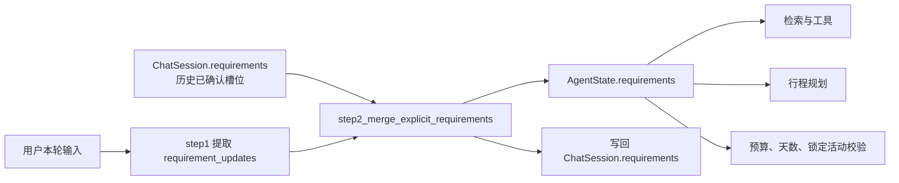

例如用户先说“去深圳玩三天”，再说“两个人，预算五千”，最后说“住宝安中心，世界之窗必须去”，系统会逐轮合并为：

```python
{
    "destination": "深圳",
    "days": 3,
    "travelers": 2,
    "budget": 5000,
    "hotel_area": "宝安中心",
    "locked_activities": ["世界之窗"]
}
```

合并策略不是让模型任意覆盖会话数据，而是只接受本轮 `requirement_updates` 中的白名单字段，并忽略值为 `None` 的字段。因此用户本轮只补充预算时，之前已确认的目的地、天数和偏好会继续保留。

### 3.2 槽位检查与追问的关系

step1 会根据当前意图、已有槽位和本轮输入判断是否存在完成当前任务所必需的缺口，并在 `decision.clarification` 中生成一个明确追问。存在追问时，step2 跳过检索与工具调用，step3 跳过计划生成，最终由 step5 先向用户提问，避免在关键条件未知时编造行程。

槽位检查并不要求所有字段都填写。不同任务需要的最小槽位不同：

| 用户任务 | 通常需要的关键槽位 | 可以暂缺的槽位 |
|---|---|---|
| “深圳有什么美食” | `destination` | 预算、人数、日期 |
| “明天深圳天气” | 城市和日期语义 | 预算、酒店、人数 |
| “安排三日游” | `destination`、`days`；若需要精确方案还应补充预算或偏好 | 房间数、饮食偏好 |
| “修改第二天行程” | 已有 `previous_plan` 或当前会话行程 | 出发地、房间数 |
| “住哪里方便” | `destination`，必要时补充 `hotel_area`、预算或人数 | 景点兴趣、出发地 |

当前槽位实现的边界是：`requirements` 仍然是 `dict`，还没有独立的 `TravelRequest` Pydantic 模型。因此字段白名单已经限制了可写字段，但预算、人数和日期的类型转换与跨字段规则仍主要依赖模型输出和后续业务逻辑。未来可以将这些槽位改为 `TravelRequest`，在写入会话前完成类型、范围和日期关系校验。

### 3.3 路由结果字段：decision

`AgentState["decision"]` 是整张图里唯一的**路由结果**字段。它回答的是“本轮要办什么事、需要哪些信息”，由 step1 的路由模型产出，之后每个节点都靠它决定自己要不要真正干活。4.3 里说的“下一步业务路由单”、检索模块文档里说的“路由结果”，指的都是这个字段。

#### 3.3.1 谁写、谁读、存到哪

| 角色 | 位置 | 说明 |
|---|---|---|
| 唯一写入者 | `step1_understand_request` | 模型返回的 JSON 通过校验后，用 `decision.model_dump()` 写入 |
| 读取者 | `step2_retrieve_evidence_and_tools` | 决定是否跳过检索、用什么检索词、要调用哪些工具 |
| 读取者 | `step3_build_or_revise_plan` | 只有 `plan` / `modify` 且没有追问时才生成行程 |
| 读取者 | `step5_answer_with_citations` | 决定固定拒答、固定寒暄、格式化行程还是流式回答 |
| 随状态保存 | 检查点 | 整个路由结果进入 LangGraph 检查点，支持断点恢复 |
| 落库 | `worker.process_chat` | 只取 `decision.intent` 写入 `ChatRun.result`，前端通过运行详情读到 |

注意最后两行的差别：检查点里保存的是完整的路由结果，而用户可见的运行结果里只有 `intent` 一个字段。

#### 3.3.2 路由结果的内部结构

路由结果是一个固定 6 个顶层字段的 JSON 对象（对应 `IntentDecision`，`extra="forbid"`，多一个字段都会被拒绝）：

| 子字段 | 类型 | 默认值 | 取值范围 | 业务含义 | 向下游提供什么 |
|---|---|---|---|---|---|
| `intent` | 枚举字符串 | `qa` | 9 个固定值，见 ① | 本轮要办的事 | 决定 step2 是否跳过、step3 是否规划、step5 用哪种输出形态 |
| `domains` | 字符串数组 | `[]` | 10 个约定值，见 ② | 本轮涉及的领域 | 只随路由结果保存，当前没有节点消费它 |
| `search_query` | 字符串 | `""` | 自由检索句，见 ③ | 包含城市或景点名的独立检索句 | 决定知识库召回哪批片段 |
| `requirement_updates` | 对象 | `{}` | 14 个槽位，见 ③ | 本轮明确新增或修改的旅行槽位 | 决定 `requirements` 的增量 |
| `clarification` | 字符串 / null | `null` | 一条中文追问，见 ③ | 需要追问时的问句 | 短路检索与规划，最终变成回答正文 |
| `tools` | 数组，最多 4 项 | `[]` | 8 个工具名，见 ④ | 实时工具请求 | 决定 `tool_results` |

把上表最后一列展开成流程视角，**这 6 个字段在后续节点里各自起什么作用**：

| 字段 | 谁读、读了做什么 | 判错了会怎样 |
|---|---|---|
| `intent` | step2 / step3 / step5。**总开关**：决定 step2 是否跳过检索、step3 是否生成行程、step5 用固定拒答 / 固定寒暄 / 格式化行程 / 流式回答中的哪一种 | 影响最大——整轮走错分支（如该规划却只做了问答） |
| `clarification` | step2 / step3 / step5。非空即“急停”：不检索、不调工具、不规划，直接把这句话当成回答交给用户 | 该问不问会编造条件；不该问却问会打断正常流程 |
| `search_query` | step2。交给 `search_knowledge` 召回知识库片段，产出 `evidence`；`evidence` 又被 step5 引用成 `[1]`、`[2]` | 检索跑偏 → 回答缺依据，或引用了不相关的资料 |
| `tools` | step2。最多 4 个线程并发执行，产出 `tool_results`（天气、房态房价、路线、城际交通） | 漏调会导致缺失实时数据；乱调只是白等一轮延迟 |
| `requirement_updates` | step1 自己**当场消费**：立刻合并进 `requirements` 并落库，成为之后每一轮的输入 | 影响最持久——多写一个字段，代价一直持续到这个会话结束 |
| `domains` | **没有任何节点读**。只作为标签随状态保存，并在「路由状态」面板里展示 | 无影响——唯一一个写错也不改变结果的字段 |

字段与状态字段的完整对应关系见 3.3.3，关系图见 3.3.4。

下面把每个字段的**全部可选取值**列全，方便写训练数据和做协议校验时逐条对照。

##### **① `intent`：9 个取值**

```text
out_of_scope   非旅游问题
social         问候、感谢、告别
qa             事实性问答，如交通、景点、美食、酒店、天气
explore        目的地或玩法探索
compare        多个酒店、景点、线路、交通方案对比
plan           创建新行程
modify         修改已有行程
format         只调整已有内容的表达或格式
booking        预订相关诉求
```

这 9 个值由 `Literal` 硬约束，写别的值会被 Pydantic 直接拒绝，没有第 10 个取值。每个取值的详细含义见 4.1。

##### **② `domains`：10 个取值**

```text
attraction       景点、玩乐场所
hotel            酒店、住宿
food             餐厅、美食
transportation   交通、路线
itinerary        行程安排、天数
weather          天气
budget           预算、花费
travelers        出行人数
dates            出行日期
general          目的地及通用旅游信息
```

这里要区分两个层面：

- **代码层面不限制取值**：`domains` 声明为 `list[str]`（`module5:28`），模型写集合外的字符串不会报错；
- **协议层面限制取值**：`router_return_fields_v1.md` 约定的训练协议和配套的协议校验脚本把上面 10 个值当作封闭集合，出现集合外的值或重复值都会校验失败。

`domains` 允许为空数组（`out_of_scope` 和 `social` 必须为空），也允许一项多于一个值，例如 `["hotel", "weather"]`；元素顺序不影响判定。

##### **③ 另外三个自由字段的取值约定**

| 字段 | 中文含义 | 取值约定 |
|---|---|---|
| `search_query` | 知识库检索句 | 不需要检索知识库时为空字符串；需要时是一句包含城市或景点名、可独立成问的检索句。训练协议进一步收紧：只在 `explore`、`plan`，或 `modify` 中用户明确要求查找、换酒店、找餐厅时才非空 |
| `requirement_updates` | 本轮需求更新 | 只能写下面 14 个槽位，其余字段一律非法 |
| `clarification` | 追问句 | 不需要追问时为 `null`；需要追问时只放一条最关键的追问句，不堆叠多个问题 |

`requirement_updates` 的 14 个槽位及其格式：

| 槽位 | 中文含义 | 类型 | 格式约束 |
|---|---|---|---|
| `destination` | 目的地（城市或地区） | 字符串 | — |
| `departure` | 出发地 | 字符串 | — |
| `start_date` | 出行开始日期 | 字符串 | `YYYY-MM-DD`，不能早于今天 |
| `end_date` | 出行结束日期 | 字符串 | `YYYY-MM-DD`，不能早于 `start_date` |
| `days` | 游玩天数 | 正整数 | ≥1；同时给出起止日期时会被后端按日期重算覆盖 |
| `travelers` | 出行人数 | 正整数 | ≥1 |
| `rooms` | 需要预订的房间数 | 正整数 | ≥1 |
| `budget` | 预算金额 | 非负数字 | — |
| `budget_scope` | 预算口径：这笔钱是“每人”还是“总共” | 字符串 | 预算口径说明，例如“每人预算”“一家三口总预算” |
| `pace` | 行程节奏 | 枚举字符串 | 只能是 `relaxed` 或 `compact`；“轻松、舒缓、慢一点、不赶”会归一到 `relaxed`，“紧凑、紧一点、密集”归一到 `compact` |
| `interests` | 兴趣偏好 | 字符串数组 | 非空；模型给单个字符串时会被包成数组 |
| `diet` | 饮食偏好或忌口 | 字符串 | 模型给数组时会用“、”连接成一个字符串 |
| `hotel_area` | 住宿区域 | 字符串 | — |
| `locked_activities` | 必须保留的活动 | 字符串数组 | 非空，用户明确要求保留的活动 |

其中 `days`、`travelers`、`rooms`、`budget`、`pace`、`interests`、`diet`、`locked_activities` 和 `start_date`/`end_date` 有显式类型校验；`destination`、`departure`、`hotel_area`、`budget_scope` 只校验“有没有值”，类型由训练协议约定为字符串。

还有两个细节：值为 `null` 的槽位会被丢弃；与已保存值完全相同的槽位也会被丢弃，所以 `requirement_updates` 里只会留下真正发生变化的条件。

##### **④ `tools`：8 个工具名，每项 6 个字段**

```text
weather_query        天气查询
poi_search           景点、场所检索
restaurant_search    餐厅检索
hotel_search         酒店检索
route_query          路线规划
ticket_search        票务查询
hotel_inventory      房态与房价查询
intercity_search     城际交通查询
```

每一项的结构固定如下（`ToolRequest`，同样 `extra="forbid"`）：

| 字段 | 类型 | 默认值 | 说明 |
|---|---|---|---|
| `name` | 枚举字符串 | 必填 | 只能是上面 8 个值之一 |
| `city` | 字符串 | `""` | 城市名，最长 100 |
| `query` | 字符串 | `""` | 查询关键词，最长 200 |
| `origin` | 字符串 | `""` | 路线起点，最长 100 |
| `destination` | 字符串 | `""` | 路线终点，最长 100 |
| `date` | 字符串 | `""` | 日期，最长 20 |

必填参数由 step1 的校验强制（`module5:113-119`），缺一个就把整份路由结果降级：

| 工具 | 中文含义 | 必填参数 |
|---|---|---|
| `poi_search` | 景点、场所检索 | `query` |
| `restaurant_search` | 餐厅检索 | `query` |
| `hotel_search` | 酒店检索 | `query` |
| `hotel_inventory` | 房态与房价查询 | `query` |
| `route_query` | 路线规划 | `origin` 和 `destination` |
| `weather_query` | 天气查询 | `city` |
| `ticket_search` | 票务查询 | 无强制必填 |
| `intercity_search` | 城际交通查询 | 无强制必填 |

##### **⑤ 两个完整示例**

需要检索和实时工具的请求：

```json
{
  "intent": "modify",
  "domains": ["hotel", "itinerary"],
  "search_query": "深圳 宝安中心 酒店 住宿 交通",
  "requirement_updates": {"hotel_area": "宝安中心", "pace": "relaxed"},
  "clarification": null,
  "tools": [
    {"name": "hotel_search", "city": "深圳", "query": "宝安中心酒店",
     "origin": "", "destination": "", "date": ""}
  ]
}
```

非旅游问题，除 `intent` 外全部空置：

```json
{
  "intent": "out_of_scope",
  "domains": [],
  "search_query": "",
  "requirement_updates": {},
  "clarification": null,
  "tools": []
}
```

字段取值由 step1 的白名单校验把关：超出协议的字段、类型错误或取值越界都会触发 `step0_safe_protocol_fallback`，把路由结果整体降级成“`intent=qa` + 一条追问”，而不是放行一份不可信的路由结果。因此下游节点可以认为手里的路由结果一定是协议内的合法结构。

#### 3.3.3 路由结果与其他状态字段的对应关系

正向看，一个子字段流向哪个状态字段：

| 路由结果子字段 | 处理方式 | 产生的状态字段 | 执行节点 |
|---|---|---|---|
| `intent` | 只做分支判断，不复制成新字段 | 间接决定 `plan`、`issues`、`answer` 是否存在 | step2、step3、step5 |
| `search_query` | 作为检索词传给 `search_knowledge` | `evidence` | step2 |
| `tools` | 最多 4 个线程并发执行 | `tool_results` | step2 |
| `requirement_updates` | 白名单校验后由 `step2_merge_explicit_requirements` 合并 | `requirements`，并写回 `ChatSession.requirements` | step1 |
| `clarification` | 非空即短路 | 抑制 `evidence`、`tool_results`、`plan`，内容最终写入 `answer` | step2、step3、step5 |
| `domains` | 原样保留 | 无 | 无 |

反向看，其他字段依赖路由结果的哪一部分：

| 状态字段 | 对路由结果的依赖 |
|---|---|
| `requirements` | 增量来自 `requirement_updates`，未提及的槽位继续沿用会话里已确认的值 |
| `evidence` / `tool_results` | 分别由 `search_query` 和 `tools` 触发；两个子字段为空，这两个字段就都为空 |
| `plan` | 只有 `intent` 是 `plan` 或 `modify`，且 `clarification` 为空时才会生成 |
| `issues` | 由 `plan` 和 `requirements` 推出，不直接读路由结果，但有没有计划取决于路由结果 |
| `answer` | 由 `intent`、`clarification`、`plan`、`evidence`、`tool_results` 共同决定输出形态 |
| `revision` | 与路由结果无关，只在 step3 执行成功后自增 |

一句话概括：**路由结果决定“做什么”，`requirements` 决定“条件是什么”，`evidence` 和 `tool_results` 决定“素材是什么”，`plan` / `issues` 决定“方案行不行”，`answer` 是最终结果。**

#### 3.3.4 字段关系图

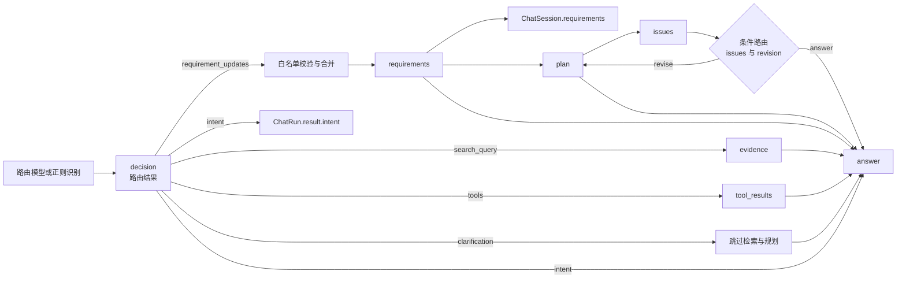

#### 3.3.5 容易混淆的一点：条件路由结果不是字段

项目里有两个“路由”，写文档和面试表述时要分开：

- **路由结果**（`decision`）：由路由模型产生、需要保存的业务决策，是 `AgentState` 的真实字段，见本节；
- **条件路由结果**（`revise` / `answer`）：step4 出口处的临时分支值，由 `issues` 和 `revision` 现场计算得出，不写入 `AgentState`、不落检查点、不落库，规则见 7.4。

### 3.4 模型输出之后：后端自动回填与加工机制

**先回答一个容易漏掉的问题：`requirement_updates` 最后确实会回填进 `requirements`，而且会落库、会被下一轮读回。** 模型写进 `requirement_updates` 的字段不是“用完就算”，而是真实改写了这个会话的旅行状态。

#### 3.4.1 回填链路：五步

```text
模型输出 decision.requirement_updates
  │
  ├─ ① 归一化 + 同值去重   module5:65-94    与已保存值完全相同的字段直接丢弃
  ├─ ② 日期重算            module5:97-106   同时给了 start_date/end_date → days 由日期差重算
  ├─ ③ 合并进需求          module5:232 → module3:85-110
  │                        {**previous, **updates}，只接受 14 个白名单字段，None 丢弃
  ├─ ④ 持久化              module5:240-241  chat.requirements = requirements; db.commit()
  └─ ⑤ 下一轮读回          module3:78       session.requirements → 下一轮 context["requirements"]
```

| 步骤 | 代码位置 | 做了什么 |
|---|---|---|
| ① 归一化 + 同值去重 | `module5:65-94` | 白名单与类型校验、字符串与数组互转；`if previous_requirements.get(key) == value: continue` |
| ② 日期重算 | `module5:97-106` | 日期合法则 `days = (end - start).days + 1`，覆盖模型给的 `days` |
| ③ 合并进需求 | `module5:232`、`module3:85-110` | `{**previous, **updates}`，仅白名单字段，`None` 丢弃 |
| ④ 持久化 | `module5:240-241` | 写入 `ChatSession.requirements` 并提交 |
| ⑤ 下一轮读回 | `module3:78` | 把 `session.requirements` 放回下一轮的 `context["requirements"]` |

三个直接后果：

1. 写进 `requirement_updates` 的条件**会持续影响之后每一轮**——检索、酒店推荐、预算估算、行程生成、step4 校验全都读 `requirements`；
2. 只写一次就长期生效，所以“多写一个字段”的代价是**持续的**，不是一次性的；
3. 这也是训练数据里 `context.requirements` 的**唯一来源**，所以训练输入必须与真实推理逐字对齐。

#### 3.4.2 同类的自动加工共 13 处

回填只是其中之一。按作用对象分四组，这里全部列出：

**A 类：对 `requirement_updates` 的加工**

| # | 机制 | 代码位置 | 行为 | 对标注的含义 |
|---|---|---|---|---|
| 1 | 同值去重丢弃 | `module5:93-94` | 与已保存值完全相同的更新直接丢弃 | “复述旧值”不会污染状态，但训练仍要求模型不写 |
| 2 | 类型归一化 | `module5:65-95` | `interests`/`locked_activities` 单字符串→数组，`diet` 数组→“、”拼接，`days`/`travelers`/`rooms` 必须正整数，`budget` 非负 | 类型错的更新进不了状态，且会触发整体降级 |
| 3 | `days` 自动重算 | `module5:105-106` | 由起止日期重算天数，覆盖模型值 | 验收完全不比对 `days` |
| 4 | 日期合法性校验 | `module5:97-104` | 必须 `YYYY-MM-DD`；开始不能早于今天；结束不能早于开始 | 非法日期导致整份路由结果降级 |
| 5 | 合并进需求 | `module5:232`、`module3:85-110` | 白名单合并，`None` 丢弃 | 白名单外的字段静默丢弃 |
| 6 | 持久化 | `module5:240-241` | 写入并提交 `ChatSession.requirements` | 写入即长期生效 |

**B 类：对 `requirements` 整体的重建**

| # | 机制 | 代码位置 | 行为 | 对标注的含义 |
|---|---|---|---|---|
| 7 | 目的地切换重建 | `module5:216-225`、`module3:124-138` | 目的地变了就清空 `start_date`/`end_date`/`days`/`hotel_area`/`locked_activities`，保留可复用字段；同时 `previous_plan = None` | 模型只写 `destination`，旧地点专属字段由后端清，不必写空值 |
| 8 | 切换后自动追问 | `module5:226-230` | 切换目的地且模型没给 `days` 时，后端自动补一条“请问计划游玩几天” | 后端兜底，但训练仍要求模型自己给 |
| 9 | `out_of_scope` 强制清空 | `module5:213-215` | 整体重置为 `IntentDecision(intent="out_of_scope")`，六个字段全空 | 越界问题多输出的内容会被整体丢弃 |

**C 类：对 `intent` 与 `tools` 的纠偏**

| # | 机制 | 代码位置 | 行为 | 对标注的含义 |
|---|---|---|---|---|
| 10 | `intent` 正则纠正 | `module5:205-212` | 命中“不要 / 暂不 / 先不 + 制定 / 生成 / 安排 / 规划 + 行程 / 方案”等表达，或“暂时 / 目前 / 先…不用 / 不要 + 路线 / 行程 / 规划” → 强制改为 `qa` | 数据集里“只记不做”类场景的代码依据 |
| 11 | 工具必填校验 | `module5:113-119` | 见 3.3.2 ④ 的必填参数表 | 缺参数 → 整份路由结果降级 |
| 12 | weather-only 跳过检索 | `module5:251-260` | 工具只有 `weather_query` 时不查知识库 | 天气场景的 `search_query` 实际不被消费 |

**D 类：上下文与输出侧**

| # | 机制 | 代码位置 | 行为 | 对标注的含义 |
|---|---|---|---|---|
| 13 | history 窗口 + summary 累积 | `module3:32-57` | 按字符预算从近到远选窗口，更早的消息摘录式追加进 `summary`（截断 12000 字符） | 长对话会出现“历史被压进 summary”的第四种上下文形态 |
| 13b | `out_of_scope` 排除出记忆 | `module3:27-31` | 拒答轮的问答不进窗口、不进摘要 | 无关问答不污染后续上下文 |
| 13c | `preferences` 独立持久化 | `module3:59-64` | 从 `Preference` 表按用户读取，与 `requirements` 分离且跨会话 | 需求绑会话，偏好绑用户 |
| 13d | `plan` 校验与修订 | `module5:290-315` | 校验时间重叠、超预算、锁定活动丢失、活动天数越界 | `locked_activities` 会被校验是否真的排进了行程 |
| 13e | `plan` 直接格式化 | `module5:318-341` | 已有计划时直接转 Markdown，不再调用模型 | 行程阶段不重复调用模型 |

#### 3.4.3 状态数据的四种归宿

| 数据 | 归宿 | 跨轮生效 | 跨会话 |
|---|---|---|---|
| `requirement_updates` | 合并进 `requirements` → `ChatSession.requirements` | 是 | 否，绑定会话 |
| `preferences` | `Preference` 表，与 `requirements` 分离 | 是 | 是，绑定用户 |
| `previous_plan` | `TripPlan.content` | 是 | 否，绑定会话；目的地切换时清空 |
| `summary` | `ChatSession.summary`，累加并截断 12000 字符 | 是 | 否，绑定会话 |

## 4. 节点一：step1_understand_request

### 4.1 业务职责

该节点相当于旅游助手的“接待与分诊”。它先判断用户现在想做什么，再抽取后续检索和规划所需的条件。

支持的意图包括：

- `out_of_scope`：非旅游问题。
- `social`：问候、感谢、告别等寒暄。
- `qa`：询问交通、景点、美食、酒店、天气等明确事实。
- `explore`：目的地或玩法探索。
- `compare`：多个酒店、景点、线路或交通方案对比。
- `plan`：创建新行程。
- `modify`：修改已有行程。
- `format`：调整已有内容的表达或格式。
- `booking`：预订相关诉求。

### 4.2 处理步骤

1. 调用 `require_running` 检查任务是否仍为运行状态，已取消的任务立即中断。
2. 调用 `step1_load_conversation_context` 读取当前问题和允许进入上下文的历史消息。
3. 对简单问候、感谢和告别进行正则识别，命中后直接得到 `social`，减少一次模型请求。
4. 其他请求调用 `ModelGateway.complete_json`，要求模型严格返回 `IntentDecision` 结构。
5. 对“不要规划、暂不生成行程”等明确表达进行代码级纠偏，避免模型误判为 `plan` 或 `modify`。
6. 若是 `out_of_scope`，清空上下文、检索词、工具和需求更新，保证无关问题不进入后续记忆与检索链路。
7. 合并本轮显式需求到会话需求中，并初始化后续节点需要的状态字段。

### 4.3 业务流程图：理解用户真正要办的事

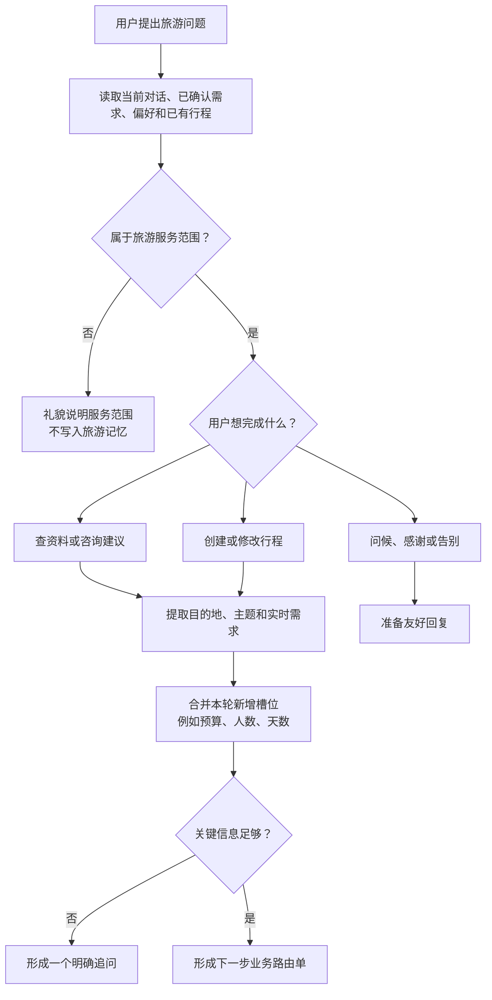

这一步的业务产物是“本轮要做什么、已有条件是什么、是否需要先追问”。它不会直接给用户安排景点或查询资料。

### 4.4 输入与输出

输入主要是 `run_id`、`session_id`。输出包括 `context`、`decision`、`requirements`，并将 `evidence`、`tool_results`、`issues` 初始化为空，将 `plan` 初始化为 `None`，将 `revision` 初始化为 0。

其中 `decision` 就是本节点产出的**路由结果**，其字段结构和它与下游字段的对应关系见 3.3。

### 4.5 追问触发

当模型判断缺少完成当前任务所必需的信息时，会在 `decision.clarification` 中写入一个明确问题。例如用户说“帮我安排一次旅行”，但没有提供任何目的地或偏好，此节点可以要求用户补充。存在追问时，后面的检索和规划节点会跳过实际处理，最终由 step5 输出追问。

## 5. 节点二：step2_retrieve_evidence_and_tools

### 5.1 业务职责

该节点把用户意图转换成可用于回答的真实信息来源，包括项目知识库资料和外部旅游工具结果。

### 5.2 处理步骤

1. 检查任务是否仍在运行。
2. 校验并读取 step1 生成的 `IntentDecision`。
3. 判断当前请求是否应跳过检索。
4. 对需要知识的请求调用 `search_knowledge`，查询词优先使用 `decision.search_query`，否则使用当前用户问题。
5. 首次无结果且已知目的地时，仅以目的地再执行一次兜底查询，避免无界循环。
6. 使用最多 4 个线程并行执行天气等工具请求。
7. 将结果写入 `evidence` 和 `tool_results`。

### 5.3 业务流程图：为回答收集可靠信息

**先澄清一个常见误读：知识库检索和工具调用不是二选一，而是两条互相独立的分支，可以同时发生。**
代码里唯一的真实例外只有一处——工具**全部**是 `weather_query` 时跳过知识库（`module5:265-267`），那是为了省掉一次没意义的检索，不是互斥设计。

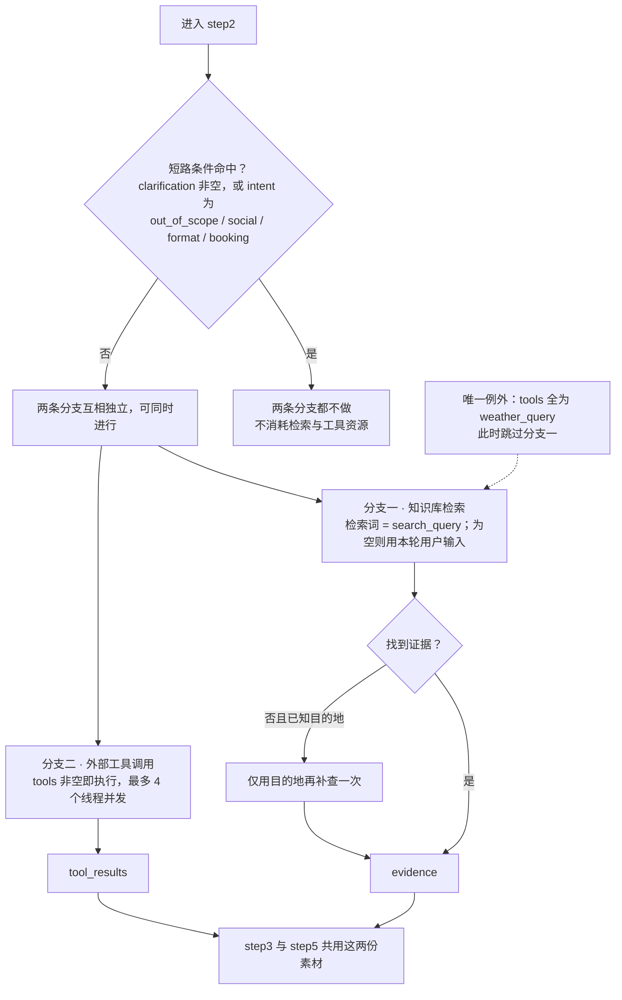

两条分支的触发条件互不依赖，对照如下：

| 情况 | 分支一：知识库检索 | 分支二：工具调用 |
|---|---|---|
| 短路（`clarification` 非空，或 `out_of_scope` / `social` / `format` / `booking`） | 不做 | 不做 |
| `tools` 全为 `weather_query` | **不做**（唯一的例外） | 做 |
| 其余情况 | 做（`search_query` 为空也会用本轮用户输入检索） | 做（`tools` 非空时） |

业务上，这个节点负责分清“管理员维护的稳定旅游资料”和“需要实时查询的外部信息”。两者**可以同时**提供给后续回答或行程规划：前者进 `evidence` 被引用成 `[n]`，后者进 `tool_results` 说明实时查询结果。

### 5.4 跳过规则

以下情况不会查询知识库或工具：

- step1 已经生成追问；
- `out_of_scope`（非旅游问题）；
- `social`（问候、感谢、告别等寒暄）；
- `format`（只调整已有内容的表达或格式）；
- `booking`（预订相关诉求）。

如果工具请求中只有天气查询，节点会跳过知识库检索，直接查询天气，以降低响应延迟。

### 5.5 业务例子

用户问“明天深圳天气怎么样”，step1 生成 `weather_query` 工具请求。step2 跳过知识库，直接调用天气接口，将预报写入 `tool_results`，供 step5 组织回答。

用户问“宝安中心附近有哪些酒店”，step2 使用问题或模型生成的检索词召回酒店资料；若还配置了相应实时工具，也可把工具结果一起交给回答节点。

## 6. 节点三：step3_build_or_revise_plan

### 6.1 业务职责

该节点负责把用户约束、检索证据、工具结果和已有行程转换成结构化 `DraftPlan`。它同时承担第一次规划和校验失败后的再次修订。

### 6.2 执行条件

只有 `plan` 或 `modify` 意图，并且不存在 `clarification` 时才调用模型。普通问答、寒暄、越界问题和等待补充信息的请求都会原样通过此节点。

### 6.3 业务流程图：把旅行条件变成可执行行程

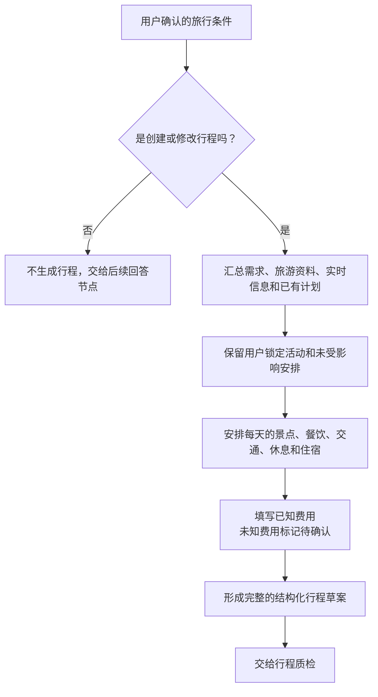

这个节点的重点不是写一段旅游文案，而是形成可被校验、保存和恢复的完整行程草案。

### 6.4 处理步骤

1. 检查任务运行状态。
2. 读取意图；不属于规划类请求时返回空变更。
3. 构造 `DraftPlan` JSON Schema。
4. 将旅行需求、对话上下文、知识证据、工具结果、已有计划和 step4 发现的问题一起交给模型。
5. 要求模型保留未要求修改的活动和被锁定的活动。
6. 对未知价格、交通时间等信息使用 `null` 或 `unknowns`，禁止用 0 或编造数字代替。
7. 校验模型返回值是否符合 `DraftPlan`，成功后将 `revision` 加 1。

### 6.5 DraftPlan 结构

计划由每天的 `activities` 组成。单个活动包含天数、开始时间、结束时间、名称、类型、地点、费用和备注；类型包括景点、用餐、交通、休息和酒店入住。计划还可记录尚未确认的信息 `unknowns`。

## 7. 节点四：step4_validate_time_and_budget

### 7.1 业务职责

该节点是确定性的“行程质检员”。它不调用模型，而是用代码检查计划是否在时间、预算和用户约束上可执行。

### 7.2 校验项目

- 活动结束时间必须晚于开始时间。
- 同一天的活动不能发生时间重叠。
- 已知费用总额不能超过用户预算。
- 用户锁定的活动不能在修改时丢失。
- 行程天数不能超过用户要求的天数。

### 7.3 业务流程图：行程上线前的质检

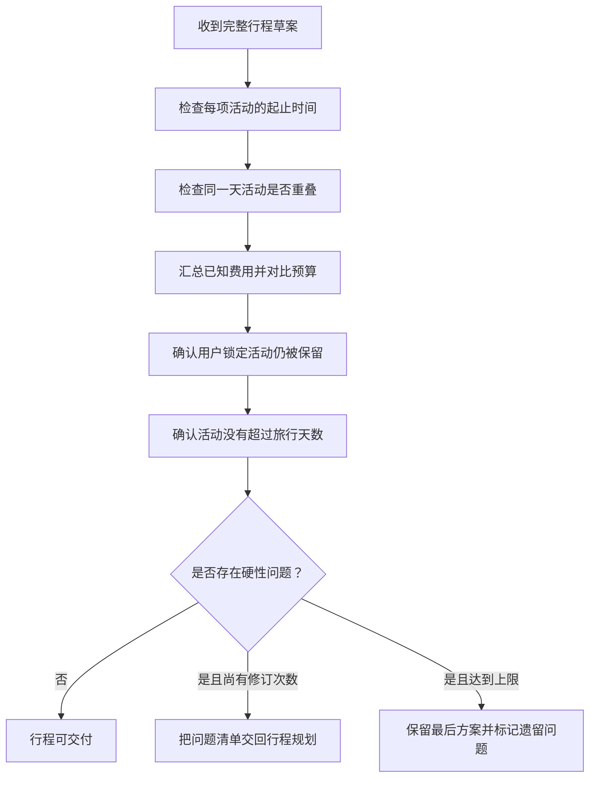

此处只处理可以明确判断的硬性条件。需要用户做偏好取舍的问题，例如两个必去景点只能二选一，应该在后续回答中向用户追问，而不是系统自行决定。

### 7.4 条件路由

```text
没有 issues                         -> step5_answer
存在 issues 且 revision < 3         -> step3_plan 修订
存在 issues 且 revision >= 3        -> step5_answer，并向用户说明遗留问题
```

这里的判断结果不是 `AgentState` 的新字段：它只在 step4 出口处由 `issues` 和 `revision` 现场算出（`lambda s: "revise" if s["issues"] and s["revision"] < 3 else "answer"`），不写入检查点，也不落库。真正作为字段保存的路由结果是 step1 写出的 `decision`，两者的区别见 3.3.5。

这种设计让模型负责提出方案，代码负责检查硬约束。即使模型连续无法修复问题，流程也会在限定次数后停止，避免无限循环。

## 8. 节点五：step5_answer_with_citations

### 8.1 业务职责

该节点统一生成用户最终看到的内容，并通过 `on_delta` 把文本增量推送或保存给前端。

### 8.2 四种输出方式

| 场景 | 输出方式 |
|---|---|
| 非旅游问题 | 返回固定拒答，并引导用户询问交通、景点、线路、美食、酒店或天气 |
| 寒暄 | 返回固定友好回复 |
| 已生成结构化行程 | 调用 `step5_format_plan_answer` 直接格式化 Markdown，不再调用模型 |
| 普通旅游问答/对比/探索/追问 | 调用 `ModelGateway.stream_answer` 流式生成答案 |

### 8.3 业务流程图：把内部结果交付给用户

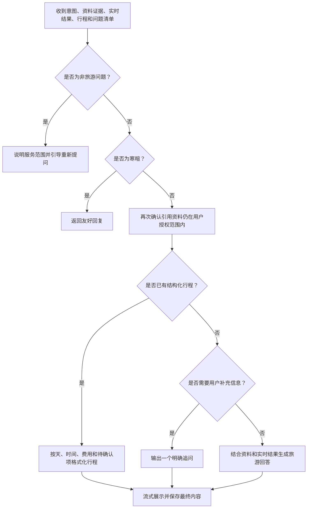

对用户而言，这一步完成的是“安全、可读、可追溯的交付”：有计划时展示计划，有缺口时追问，有资料时引用资料，有实时结果时说明查询结果。

### 8.4 最终权限复核

在普通问答生成前，节点会重新读取当前用户有权访问的知识块，只保留授权范围内的 `evidence`。这一步防止用户权限在检索后发生变化时，旧证据仍被输出。

### 8.5 回答约束

- 只回答旅游领域问题。
- 引用知识库证据时使用 `[n]` 标号。
- 不编造实时价格、房态、库存和开放状态。
- 工具不可用时明确说明，而不是伪造查询结果。
- 有追问时先提出追问。
- 有未解决的计划问题时向用户说明取舍。

## 9. 不同意图经过各节点时的行为

图的拓扑通常会依次经过五个节点，但节点内部可能直接返回，因此“经过节点”不等于“执行了检索或模型调用”。

| 意图/情况 | step1 | step2 | step3 | step4 | step5 |
|---|---|---|---|---|---|
| `out_of_scope` | 分类并清理上下文 | 跳过 | 跳过 | 无计划可校验 | 固定拒答 |
| `social` | 正则或模型分类 | 跳过 | 跳过 | 无计划可校验 | 固定寒暄回复 |
| `qa/explore/compare` | 提取检索词和工具 | 检索/工具 | 跳过 | 无计划可校验 | 流式模型回答 |
| `plan/modify` | 提取完整需求 | 检索/工具 | 生成或修订计划 | 硬规则校验 | 确定性格式化计划 |
| `format/booking` | 识别意图 | 当前实现跳过 | 跳过 | 无计划可校验 | 流式模型回答 |
| 存在 `clarification` | 生成一个追问 | 跳过 | 跳过 | 无计划可校验 | 输出追问 |

## 10. 所有路由情况的流程图

第 9 节用一张表概括了“不同情况经过各节点的行为”，本节把它逐条展开：**每一种路由情况单独一节，各自给出一张流程图**，并说明触发条件、节点走向和最终产物。

先明确一件事：影响流程走向的路由**有三层**，它们会叠加：

| 层级 | 由谁决定 | 作用 |
|---|---|---|
| **第一层：意图主路径** | `intent`（9 个取值） | 决定要不要检索、要不要规划、用哪种输出形态 |
| **第二层：横切分支** | `clarification` 是否为空、是否目的地切换、是否只有天气工具 | 可以在任意意图上“掐断”或改写主路径 |
| **第三层：条件边** | 步4 的 `issues` 与 `revision` | 决定规划是回炉重做还是直接交付 |

### 10.1 总览：三层路由决定流程走向

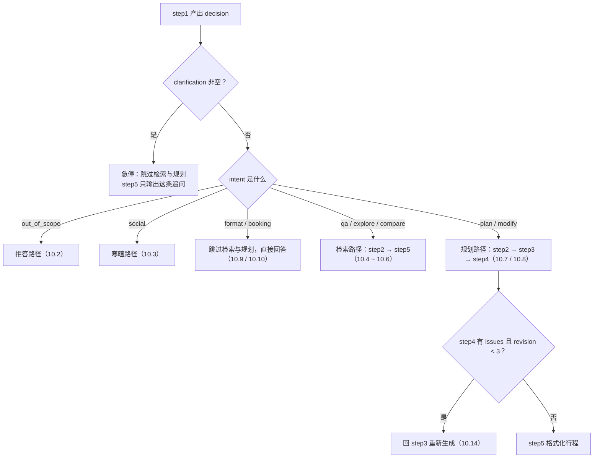

### 10.2 `out_of_scope`：非旅游问题

- **触发**：`step1` 判定问题与旅游无关（编程、作业、投资等）；即使历史里有行程，也不把当前问题当成旅游问题。
- **走向**：`step2`、`step3` 全部跳过（intent 在跳过集合里），`step4` 无计划可校验。
- **产物**：`step5` 返回固定拒答并引导用户改问旅游问题；该轮会被排除出后续对话记忆。

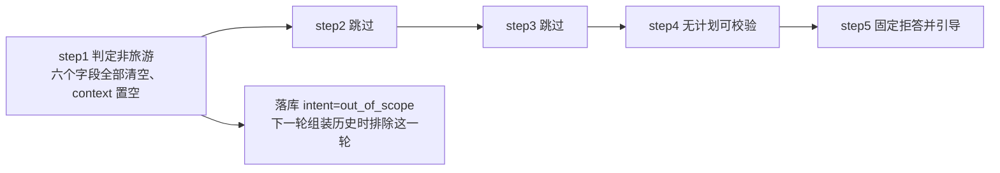

### 10.3 `social`：问候、感谢、告别

- **触发**：命中寒暄正则（你好 / 谢谢 / 再见等），或由模型分类为 `social`。
- **走向**：命中正则时 `step1` 直接判定，**连模型都不用调用**；`step2`、`step3` 跳过。
- **产物**：`step5` 返回固定友好回复，并顺势引导用户咨询旅游。

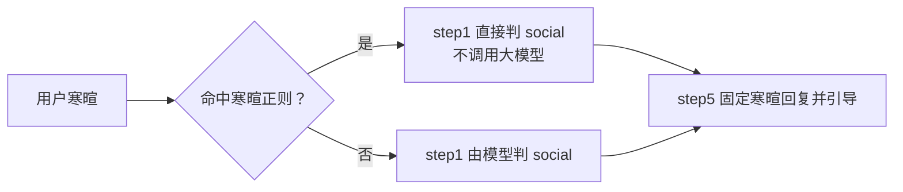

### 10.4 `qa`：事实性问答

- **触发**：问交通、景点、美食、酒店、天气等有明确答案的事。
- **走向**：`step2` 用 `search_query` 检索知识库，并按需并发执行 `tools`；`step3` 跳过（不是 `plan`/`modify`）。
- **产物**：`step5` 流式回答，把证据引用成 `[1]`、`[2]`。

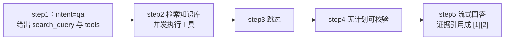

### 10.5 `explore`：目的地或玩法探索

- **触发**：用户还没定下来，想“看看有什么可选”。
- **走向**：与 `qa` 同形状，`step2` 检索目的地或玩法资料，工具按需。
- **产物**：`step5` 给方向与选项，**不直接锁死一份行程**（要落地方案应走 `plan`）。

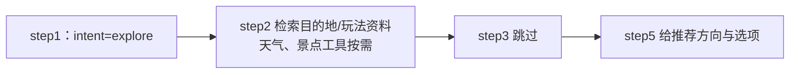

### 10.6 `compare`：多方案对比

- **触发**：明确要对比多个酒店、景点、线路或交通方案。
- **走向**：与 `qa` 同形状，`step2` 可能一次并发多个工具请求（最多 4 个）。
- **产物**：`step5` 逐项对比，各自带上自己的证据引用。

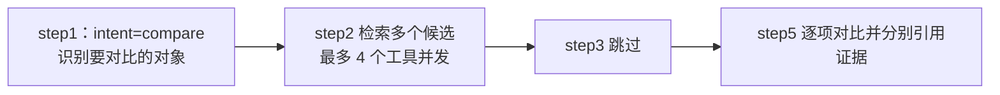

### 10.7 `plan`：创建新行程

- **触发**：用户要一份可执行的行程安排。
- **走向**：`step2` 检索与工具 → `step3` 生成 `DraftPlan` → `step4` 用硬规则校验 → 不合格则回 `step3` 修订（最多 3 轮）。
- **产物**：`step5` 把已校验的结构化行程**确定性格式化成 Markdown**，这一步不再调用模型。

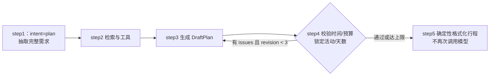

### 10.8 `modify`：修改已有行程

- **触发**：在已有行程上做调整（换酒店、改天数、调节奏等）。
- **走向**：与 `plan` 同形状，区别是 `step3` 会带着 `previous_plan` 做增量修改；**目的地被换掉时先清空地点专属槽位**（见 10.12）。
- **产物**：新版本的行程，写入 `TripPlan` 并保留历史版本。

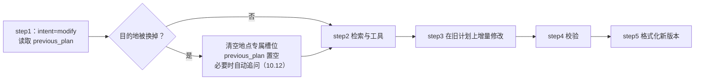

### 10.9 `format`：只调整表达或格式

- **触发**：内容不变，只想换个说法、换种排版。
- **走向**：`step2`、`step3` 都跳过（当前实现不检索、不重新规划）。
- **产物**：`step5` 流式改写已有内容。

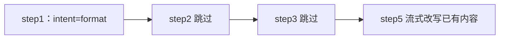

### 10.10 `booking`：预订相关诉求

- **触发**：用户表达想订票、订房、下单。
- **走向**：`step2`、`step3` 跳过——**当前实现不查实时库存，也不会自动下单**。
- **产物**：`step5` 只说明可行步骤，引导用户前往官方平台办理。

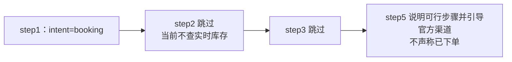

### 10.11 横切分支一：`clarification` 非空（追问短路）

这一条可以叠加在**任何意图**上，只要 `step1` 生成了追问，流程就会被“掐断”。

- **触发**：目标不唯一、或缺少完成当前任务必需的条件。
- **走向**：`step2` 不检索、不调工具；`step3` 不生成行程。
- **产物**：`step5` 先提出这条追问，并把它作为回答正文落库；下一轮历史里能看到这句话。

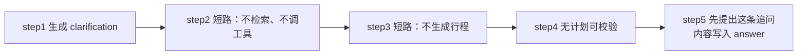

### 10.12 横切分支二：目的地切换

这一条只在 `plan` / `modify` 下触发，属于**后端自动加工**，模型不需要写空值。

- **触发**：本轮 `destination` 与会话里已保存的不同。
- **走向**：清空地点专属槽位（`start_date`、`end_date`、`days`、`hotel_area`、`locked_activities`），并把 `previous_plan` 置空；如果模型没给 `days`，后端再自动补一条追问。
- **产物**：新目的地的需求基线 + 一条“请问计划游玩几天”的追问。

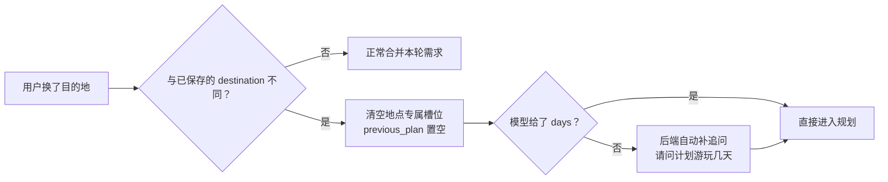

### 10.13 横切分支三：只请求天气（weather-only）

- **触发**：`tools` 非空且**全部**是 `weather_query`。
- **走向**：`step2` 跳过知识库检索，只调天气接口，用来降低响应延迟。
- **产物**：`tool_results` 里的天气预报；此时 `search_query` 实际不被消费。

```mermaid
flowchart LR
    S1["step1：tools 只有 weather_query"] --> Q{"工具全是天气？"}
    Q -- 是 --> W["step2 跳过知识库<br/>只调天气接口"]
    Q -- 否 --> KB["step2 检索知识库并执行全部工具"]
    W --> S5["step5 按预报回答"]
    KB --> S5
```

### 10.14 第三层：条件路由（revise 回炉）

这一条不是字段，而是步4 出口处**现场算出来**的分支值，规则见 7.4。

- **触发**：`step4` 校验出 `issues`（时间重叠、超预算、锁定活动丢失、天数越界）。
- **走向**：`issues` 非空**且** `revision < 3` → 回 `step3` 重新生成；否则直接进 `step5`。
- **产物**：要么是修订后的行程，要么是带着遗留问题说明的最终回答（避免无限循环）。

```mermaid
flowchart LR
    V["step4 输出 issues"] --> C{"issues 非空？"}
    C -- 否 --> A["answer：进 step5"]
    C -- 是 --> R{"revision &lt; 3？"}
    R -- 是 --> RE["revise：回 step3 修订"]
    RE --> V
    R -- 否 --> A2["answer：进 step5 并说明遗留问题"]
```

## 11. 业务案例

### 案例一：天气问答

用户输入：“明天深圳天气怎么样？”

```text
step1：识别 qa + weather_query
step2：调用天气工具，跳过知识库
step3：非规划请求，跳过
step4：没有计划，返回空 issues
step5：根据实时工具结果流式回答
```

### 案例二：三日行程规划与自动修订

用户输入：“一家三口去深圳玩 3 天，预算 5000 元，住宝安中心，安排景点和美食。”

```text
step1：识别 plan，提取人数、天数、预算、住宿区域和偏好
step2：检索景点、美食、交通、酒店资料，并调用所需工具
step3：生成结构化三日行程，revision = 1
step4：发现第二天两个活动时间重叠
step3：携带 overlap issue 修订，revision = 2
step4：校验通过
step5：将 DraftPlan 格式化为用户可读的每日行程
```

### 案例三：非旅游问题

用户输入：“什么是 LangChain？”

```text
step1：识别 out_of_scope，清理 context、检索词、工具和需求更新
step2：不检索、不调用工具
step3：不生成计划
step4：无计划可校验
step5：固定拒答并引导用户重新询问旅游问题
```

该请求不会作为有效旅游上下文参与之后的记忆检索。

### 案例四：信息不足而追问

用户输入：“给我安排一次旅行。”

```text
step1：发现缺少完成规划所需的关键信息，生成 clarification
step2：等待用户补充，不提前检索
step3：等待用户补充，不生成计划
step4：无计划可校验
step5：向用户提出一个明确问题
```

## 12. 检查点、恢复执行和 Worker

### 12.1 检查点存储

`checkpoint_store` 根据环境选择存储：

- 配置 PostgreSQL 时使用 `PostgresSaver`。
- 未配置 PostgreSQL 时使用本地 `data/checkpoints.sqlite` 中的 `SqliteSaver`。

`build_travel_graph` 在 `compile` 时注入 checkpointer。Worker 使用 `session_id` 作为 LangGraph 的 `thread_id`，因此每个会话拥有独立的图执行状态。

### 12.2 Worker 调用步骤

1. `process_chat` 创建一条 `generating` 状态的助手消息。
2. 打开 `checkpoint_store`。
3. 调用 `build_travel_graph(saver, persist_delta)` 构建图。
4. 通过 `graph.get_state(config)` 检查是否存在同一运行任务的未完成节点。
5. 未完成任务使用 `graph.invoke(None, config)` 从检查点恢复；新任务传入初始化状态重新执行。
6. `persist_delta` 定期保存流式文本、当前阶段和租约信息，同时检查用户是否点击停止。
7. 执行完成后保存最终回答、引用、行程版本、意图、需求、问题和工具结果。

## 13. 节点性能监控

五个节点都通过 `measure_agent_node` 包装。包装器会：

- 将当前节点映射为前端可见的执行阶段；
- 使用 `perf_counter` 统计节点耗时；
- 保存调用次数、累计耗时、最近一次耗时和完成/失败状态；
- 对规划与校验循环的多次调用进行累计。

因此可以区分总排队耗时、检索耗时、规划耗时、校验耗时和回答耗时，便于定位“回答突然变慢”发生在哪个节点。

## 14. 哪些函数不是 LangGraph 节点

以下函数参与工作流，但没有通过 `graph.add_node` 注册，所以不应被称为 LangGraph 节点：

| 函数/组件 | 作用 |
|---|---|
| `require_running` | 在节点开始时检查任务是否已取消 |
| `step1_load_conversation_context` | 为 step1 加载有效会话上下文 |
| `search_knowledge` | 被 step2 调用的知识库检索服务 |
| 旅游工具执行函数 | 被 step2 调用的天气等外部工具 |
| `step5_format_plan_answer` | 被 step5 调用的确定性行程格式化函数 |
| `checkpoint_store` | 提供 PostgreSQL/SQLite 检查点上下文 |
| `measure_agent_node` | 为正式节点添加阶段和性能统计 |
| `ModelGateway` | 封装结构化和流式大模型调用 |

## 15. 代码定位

| 内容 | 文件 |
|---|---|
| 状态模型、五个节点、条件路由、图构建 | `backend/trippilot/retrieval/module5_agent_workflow.py` |
| 节点阶段映射与耗时统计 | `backend/trippilot/retrieval/module7_performance_monitor.py` |
| 图调用、断点恢复、流式持久化、结果落库 | `backend/trippilot/worker.py` |
| 初始化数据库及检查点表 | `backend/trippilot/cli.py` |
| 对话图相关测试 | `tests/test_conversation.py`、`tests/test_travel_scope.py` |

## 16. 当前实现边界

- LangGraph 的动态分支只用于“校验失败后重新规划”；其他意图仍按固定拓扑经过节点，由节点内部决定是否跳过。
- `booking` 当前不会在 step2 查询实时库存，也不会自动下单；step5 只能说明可行步骤或引导前往官方平台。
- 行程答案由结构化计划确定性格式化，避免生成计划后再调用模型造成内容重复或改写失真。
- 天气、酒店价格、营业时间等实时性内容是否准确，取决于相应外部工具是否已配置以及接口返回结果。
