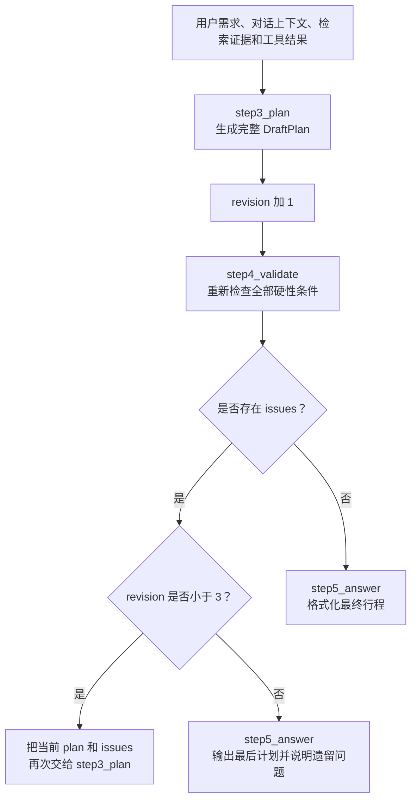

# TripPilot LangGraph 行程自动修订机制总结

## 1. 自动修订解决什么问题

大模型擅长组合景点、餐饮、酒店和交通方案，但第一次生成的行程不一定满足时间、预算和用户锁定要求。自动修订让系统在向用户展示行程前，先完成一次“模型生成、代码校验、模型修复”的闭环。

自动修订主要处理以下问题：

- 活动结束时间早于或等于开始时间；
- 同一天的两个活动发生时间重叠；
- 已知活动费用总额超过用户预算；
- 修改行程时遗漏用户锁定的活动；
- 活动被安排到用户要求的旅行天数之外。

该机制位于：

```text
backend/trippilot/retrieval/module5_agent_workflow.py
```

其中：

- `step3_build_or_revise_plan` 负责第一次生成和后续修订；
- `step4_validate_time_and_budget` 负责确定性校验；
- `build_travel_graph` 负责决定继续修订还是输出答案。

## 2. 自动修订流程图



图中的 `REVISE` 实际会重新进入 `step3_plan`，然后再次执行 `step4_validate`。为了避免部分 Markdown 查看器把回环线画乱，图中没有绘制跨节点返回线。

## 3. 为什么需要自动修订

### 3.1 模型生成具有不确定性

模型可以理解“轻松一点”“适合老人”“尽量省钱”等自然语言要求，但它并不是严格的日程计算器。第一次计划可能看起来合理，实际却存在活动重叠或费用超标。

### 3.2 硬性条件适合由代码检查

时间先后、预算加总、天数上限等规则可以用代码得到确定结果，不应依赖模型自行判断。因此项目把职责分开：

| 组件 | 职责 |
|---|---|
| 大模型 | 设计和调整旅游方案 |
| Python 校验代码 | 检查时间、预算、天数和锁定活动 |
| LangGraph | 根据校验结果决定修订或结束 |

### 3.3 减少用户手动纠错

系统能够自行修复的技术性问题，应在回答前处理。只有涉及用户取舍的问题，才需要向用户追问。

## 4. 修订次数的准确含义

当前代码中的 `revision` 统计的是 `step3_plan` 的执行次数，而不是纯粹的“重新修改次数”。

初始值为：

```python
revision = 0
```

每次成功生成完整计划后执行：

```python
revision = state["revision"] + 1
```

条件路由为：

```python
"revise" if state["issues"] and state["revision"] < 3 else "answer"
```

因此当前实际上是：

| step3 执行次数 | 业务含义 | 执行后的 revision | 校验失败后是否还能修订 |
|---|---|---:|---|
| 第 1 次 | 生成初始计划 | 1 | 可以 |
| 第 2 次 | 第一次自动修订 | 2 | 可以 |
| 第 3 次 | 第二次自动修订 | 3 | 不可以 |

即：

```text
初次生成 1 次 + 自动修订最多 2 次 = step3_plan 最多执行 3 次
```

如果业务要求“先生成一次，再额外修订三次”，应将上限调整为 4，或者把 `generation_count` 和 `revision_count` 分开记录。

## 5. 每一轮如何修订

第一次执行 `step3_plan` 时，模型主要收到：

```python
{
    "requirements": 用户当前旅行要求,
    "context": 有效对话上下文,
    "evidence": 知识库检索证据,
    "tool_results": 天气等工具结果,
    "plan": None,
    "issues": []
}
```

校验失败后，下一轮模型收到：

```python
{
    "requirements": 用户当前旅行要求,
    "context": 有效对话上下文,
    "evidence": 原有知识库证据,
    "tool_results": 原有工具结果,
    "plan": 上一轮完整计划,
    "issues": 上一轮校验发现的问题
}
```

模型根据 `issues` 修改上一版计划，并返回一份新的完整 `DraftPlan`。新计划会覆盖 `AgentState["plan"]`，随后校验节点从头检查全部规则。

模型不是只返回一个局部补丁。这样可以保证计划始终符合统一的 `DraftPlan` 数据结构，方便后续校验和展示。

## 6. 模型修订时遵守的规则

当前 `step3_build_or_revise_plan` 的提示词要求模型：

- 根据 `issues` 修复上一版计划；
- 保留未受影响的活动；
- 保留用户锁定的活动；
- 未知价格写为 `null`，不能使用 0 冒充免费；
- 未确认的信息放入 `unknowns`；
- 费用统一表示全体游客在该活动上的总费用估计；
- 每天安排约 3～5 个活动；
- 预留用餐、移动和休息时间；
- 没有工具证据的开放时间和交通可执行性标为待确认。

## 7. step4 如何校验计划

### 7.1 时间有效性

如果活动的结束时间不晚于开始时间，生成问题：

```text
第 N 天“活动名称”的结束时间不晚于开始时间
```

### 7.2 活动重叠

节点按“天数、开始时间”排序活动。如果当前活动的开始时间早于上一活动的结束时间，生成重叠问题。

### 7.3 预算上限

将所有非空的 `estimated_cost` 相加：

```python
known_cost = sum(activity["estimated_cost"] or 0 for activity in activities)
```

如果用户预算是有效数字且 `known_cost > budget`，生成超预算问题。未知费用不会计入已知总额，因此最终仍需要提示用户核实。

### 7.4 锁定活动

如果 `requirements["locked_activities"]` 中的活动没有出现在新计划名称集合中，生成“未保留锁定活动”问题。

### 7.5 行程天数

如果任何活动的 `day` 超过用户要求的 `days`，生成活动超出旅行天数的问题。

## 8. 完整业务案例

用户要求：

> 一家三口深圳三日游，预算 3000 元，世界之窗必须保留，行程轻松一些。

### 8.1 第一次生成

```text
第 1 天
09:00—12:00 世界之窗，费用 700 元
11:30—13:00 午餐，费用 300 元

三天已知总费用：3600 元
revision = 1
```

第一次校验得到：

```python
issues = [
    "第1天午餐与前一活动时间重叠",
    "所有活动已知总额3600超过预算3000"
]
```

### 8.2 第一次修订

模型收到初始计划和两个问题后，将午餐调整到 12:30，并替换部分收费活动：

```text
第 1 天
09:00—12:00 世界之窗，费用 700 元
12:30—13:30 午餐，费用 240 元

三天已知总费用：2900 元
revision = 2
```

第二次校验发现时间和预算已经通过，但模型误删了用户锁定的“世界之窗”之外的另一个锁定活动，产生新的 `issues`。

### 8.3 第二次修订

模型再次收到当前计划和最新问题，恢复缺失的锁定活动并调整其他安排：

```text
revision = 3
```

第三次校验通过时，进入 `step5_answer` 输出行程；仍未通过时也会结束循环，同时在最终回答中列出遗留问题。

## 9. 哪些问题适合自动修订

| 问题 | 是否适合自动修订 | 原因 |
|---|---|---|
| 普通活动时间重叠 | 适合 | 可以移动非锁定活动时间 |
| 总费用略微超预算 | 适合尝试 | 可以替换非锁定收费项目 |
| 活动超过旅行天数 | 适合 | 可以压缩或移动活动 |
| 非锁定活动安排过密 | 适合 | 可以减少活动并增加休息 |
| 修改时误删锁定活动 | 适合 | 可以恢复锁定活动 |

## 10. 哪些问题应追问用户

以下问题涉及偏好或高影响取舍，不应由模型擅自决定：

- 两个用户锁定的活动本身时间冲突；
- 必须提高预算才能保留所有核心项目；
- 必须在舒适度和景点数量之间选择；
- 更换酒店、交通方式会明显改变价格或体验；
- 实时票务、房态或营业状态无法确认；
- 多种调整方案都可行，但没有足够偏好判断用户更喜欢哪一种。

合理回答示例：

```text
您锁定的世界之窗和博物馆在当前日期存在时间冲突。
您希望优先保留哪一个？
```

## 11. 当前实现的边界

当前代码会对所有 `issues` 统一尝试自动修订，没有进一步区分“可以自动解决的问题”和“必须由用户决策的问题”。因此可能出现模型连续改写两次，最后仍然无法解决锁定活动冲突的情况。

更完整的企业实现可以为校验问题增加结构化类型：

```python
class ValidationIssue(BaseModel):
    code: str
    message: str
    severity: Literal["warning", "error"]
    resolution: Literal["auto_revise", "ask_user"]
    related_activities: list[str]
```

条件路由即可变成：

```text
没有问题                         → 输出答案
只有 auto_revise 问题且未到上限   → 自动修订
存在 ask_user 问题               → 直接追问用户
达到自动修订上限                 → 输出遗留问题并让用户选择
```

这种设计可以减少无意义的模型重试，并避免系统擅自替用户做重要取舍。

## 12. 自动修订的核心结论

自动修订的目标是先修复能够明确判断的技术性错误，而不是无限次让模型重写行程。当前实现由模型生成方案、Python 校验硬约束、LangGraph 控制循环，最多执行三次规划，其中包括一次初始生成和两次自动修订。仍无法解决的问题会随最终行程展示给用户。
