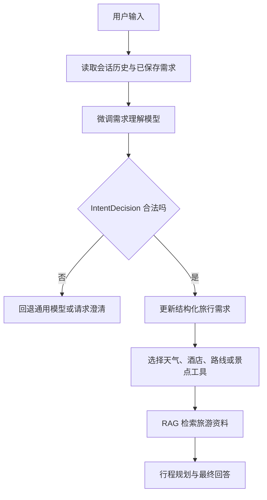
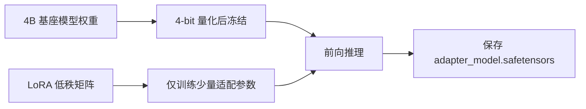
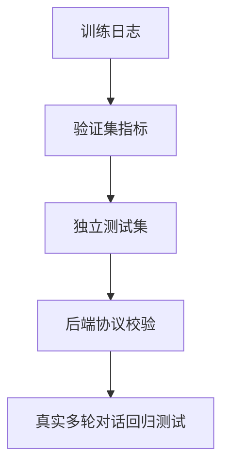
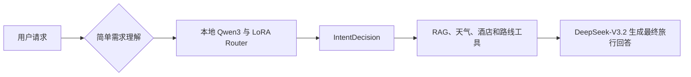
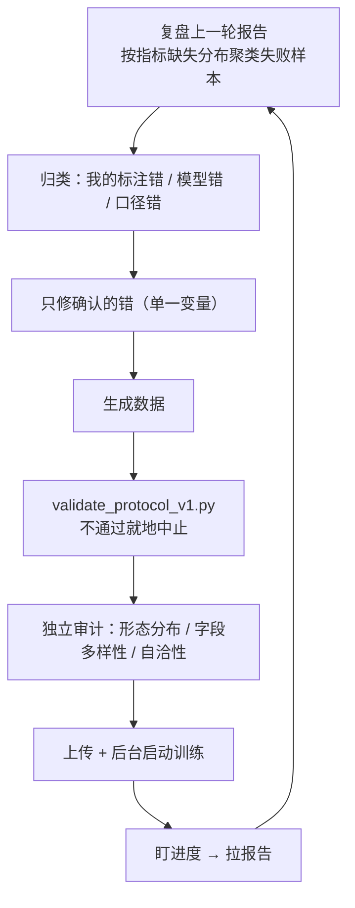

# TripPilot 多轮偏好理解微调：全流程学习与面试指南

> 目标：让旅行对话助手稳定理解用户在多轮交流中提出的偏好与变更，并输出可被后端直接消费的 `IntentDecision JSON`。本次实践采用 **Qwen3-4B-Instruct-2507 + QLoRA + LlamaFactory**。

## 1. 先说明：本次微调解决什么问题

TripPilot 的旅行助手要处理的不只是“用户问了什么”，还要判断用户是否正在修改已保存的旅行需求。

例如已有需求：`深圳、3 天、2 人、预算 3000、住福田中心区`。

用户继续说：

```text
酒店换到宝安中心附近，预算别变，第二天轻松一点。
```

模型不能只回答酒店建议，而要识别：

```json
{
  "intent": "modify",
  "domains": ["hotel", "itinerary"],
  "search_query": "",
  "requirement_updates": {
    "hotel_area": "宝安中心",
    "pace": "relaxed"
  },
  "clarification": "",
  "tools": [
    {
      "name": "hotel_search",
      "city": "深圳",
      "query": "宝安中心",
      "origin": "",
      "destination": "",
      "date": ""
    }
  ]
}
```

这类能力称为**结构化需求理解**。它把自然语言变成稳定的数据结构，后端才能更新记忆、查询酒店或重新生成行程。

## 2. 为什么选择这个微调方向

本项目不优先微调旅游知识、天气、酒店库存或路线事实，原因如下：

- 天气、酒店价格、库存、营业时间持续变化，应通过高德、酒店平台、知识库和工具查询获取。
- RAG 的职责是检索已有旅游资料并给出来源上下文。
- 大模型微调更适合学习稳定行为：意图识别、字段抽取、多轮需求覆盖规则、JSON 输出纪律、无关问题拒答。

本次目标是让模型学习“**用户表达方式 → 标准后端协议**”，而不是把旅游事实背进参数中。

## 3. 在项目链路中的位置



模型所在的核心代码链路是：

```text
backend/trippilot/retrieval/module5_agent_workflow.py
  └─ IntentDecision：定义模型必须输出的协议
```

## 4. 需要先掌握的核心概念

| 概念 | 简单解释 | 在本项目中的作用 |
|---|---|---|
| 基座模型 | 已具备通用语言能力的原始模型 | Qwen3-4B-Instruct-2507 |
| SFT | 用“输入—正确输出”监督模型学习任务 | 学习需求理解与 JSON 输出 |
| LoRA | 只训练少量低秩适配参数 | 节省显存、训练快 |
| QLoRA | 基座模型 4-bit 量化后再 LoRA 训练 | 32GB 显存可训练 4B 模型 |
| Adapter | LoRA 训练产物 | 训练后加载到 Qwen 基座模型上 |
| Chat Template | 把 system/user/assistant 消息转成模型 token 的规则 | 使用 `qwen3_nothink` |
| 数据契约 | 输出字段、类型和可选值的严格约定 | 防止模型输出后端不存在的字段 |
| 冒烟训练 | 用少量数据快速验证全链路 | 先用 8 条样本排除环境/配置问题 |
| 训练集/验证集/测试集 | 训练、调参、最终验收的不同数据 | 不能拿训练数据证明模型可上线 |

## 5. 模型与训练方案选择

### 5.1 为什么选 Qwen3-4B-Instruct-2507

- 中文指令理解和 JSON 输出能力较好。
- 4B 参数规模适合单张 32GB 显存卡进行 QLoRA 学习。
- 非思考版本更适合作为低延迟的路由/字段抽取模型。
- 训练完成后可以作为 TripPilot 的一个专用小模型；复杂行程生成仍可保留 DeepSeek-V3.2。

面试表达：

> 我没有用微调模型替换整套旅行问答模型，而是将其定位为结构化需求路由器。它先提取意图和字段，再由 RAG、实时工具与通用大模型完成事实查询和最终规划，这样既控制延迟和成本，也避免将动态信息固化到模型参数里。

### 5.2 为什么不是全参数微调

全参数微调要更新数十亿个参数，显存、时间和成本都更高。当前任务是学习输出格式和偏好理解，不需要大幅改变通用语言能力，因此采用 QLoRA 更合理。



## 6. 本次实操的完整流程

### 阶段 1：核验云端算力环境

本次云端环境：RTX 5090 32GB、Python 3.12、PyTorch CUDA 可用。

关键命令：

```bash
nvidia-smi
python - <<'PY'
import torch
print(torch.__version__)
print(torch.cuda.is_available())
print(torch.cuda.get_device_name(0))
PY
```

应确认：GPU 被识别、`torch.cuda.is_available()` 为 `True`、显存足够。

### 阶段 2：创建隔离训练环境

```bash
python3 -m venv --system-site-packages .venv
source .venv/bin/activate
```

隔离环境避免训练包与系统预装包混在一起。每次安装或升级依赖后，都应执行：

```bash
pip check
```

如果输出 `No broken requirements found.`，说明声明的依赖关系没有冲突。

### 阶段 3：安装并校验 LlamaFactory

LlamaFactory 是对 Hugging Face 训练流程的封装，统一处理模型加载、数据集、模板、LoRA/QLoRA、训练器和导出。

关键验证：

```bash
llamafactory-cli version
pip check
```

本次遇到过 `datasets`、`pandas` 与 Gradio 的版本冲突。处理原则是：**先看目标包要求的版本范围，显式安装兼容版本，然后用 `pip check` 验证**，不要盲目全局升级。

### 阶段 4：下载基座模型

由于训练服务器无法访问 Hugging Face，本次使用 ModelScope 下载：

```bash
modelscope download \
  --model Qwen/Qwen3-4B-Instruct-2507 \
  --local_dir /root/autodl-tmp/trippilot-finetune/models/Qwen3-4B-Instruct-2507
```

下载后至少检查：

```bash
du -sh /root/autodl-tmp/trippilot-finetune/models/Qwen3-4B-Instruct-2507
ls -lh /root/autodl-tmp/trippilot-finetune/models/Qwen3-4B-Instruct-2507
```

模型文件中应有 `config.json`、tokenizer 文件和多个 `.safetensors` 权重分片。

### 阶段 5：基线推理

在训练前，先让未微调模型完成一次旅行回答，确认模型文件、CUDA、tokenizer 和模板都可用。

基线的意义：训练后若输出异常，可以区分是“训练造成的问题”，还是“原始模型/环境本来就不能运行”。

### 阶段 6：定义数据契约

数据契约文件定义了模型输出允许的：

- `intent`：如 `plan`、`modify`、`qa`、`out_of_scope`。
- `requirement_updates`：如 `destination`、`days`、`travelers`、`budget`、`pace`、`hotel_area`。
- `tools`：如 `weather_query`、`hotel_search`、`route_query`。

为什么必须先定契约？

因为没有契约时，模型可能输出 `update_hotel_location` 或 `new_hotel_area`，但后端只认识 `modify` 与 `hotel_area`，造成模型看起来“回答对了”，系统却无法执行。

### 阶段 7：构造 ShareGPT 格式训练数据

每个样本包含三段消息：

```json
{
  "messages": [
    {"role": "system", "content": "只输出合法 IntentDecision JSON"},
    {"role": "user", "content": "当前已保存需求...本轮用户..."},
    {"role": "assistant", "content": "{合法 JSON 标签}"}
  ]
}
```

重点：用户输入必须携带“当前已保存需求”，否则模型无法理解“预算别变”“第二天轻松一点”这类省略表达。

### 阶段 8：先做 8 条冒烟训练

冒烟训练不是为了取得效果，而是快速验证：

- 模型能加载；
- 4-bit BitsAndBytes 量化可用；
- 数据格式能被读取；
- 模板匹配；
- CUDA 与 bf16 可训练；
- Adapter 能写入磁盘并可再次加载推理。

本次结果：8 条数据、1 个 epoch、训练成功，并生成约 64MB 的 `adapter_model.safetensors`。

### 阶段 9：从 192 条扩展到 1,500 条 V2 数据

192 条样本只够验证数据流，不够支撑稳定的领域行为。V2 扩展了以下覆盖面：

- 酒店区域修改；
- 预算、人数、天数的显式修改；
- “轻松一点”“少走一点路”等节奏偏好；
- 老人、亲子、兴趣、饮食限制；
- 景点、酒店、美食、天气、交通工具选择；
- 比较、重新规划、格式化和预订意图；
- 闲聊与非旅游问题的拒答分类。

当前 V2 文件：

```text
/root/autodl-tmp/trippilot-finetune/data/formal/train/trippilot_preference_bootstrap_v2.json
```

注意：V2 是脚本模板扩增的 bootstrap 数据。它用于学习训练流程和初步能力验证，不能替代真人对话标注数据。

### 阶段 10：注册数据集

LlamaFactory 不会自动知道 JSON 在哪里。需要在 `dataset_info.json` 注册：

```json
{
  "trippilot_preference_bootstrap_v2": {
    "file_name": "formal/train/trippilot_preference_bootstrap_v2.json",
    "formatting": "sharegpt",
    "columns": {"messages": "messages"}
  }
}
```

这里的 `dataset` 名称与训练 YAML 中的 `dataset:` 必须完全一致。

### 阶段 11：正式 QLoRA 训练配置

核心配置：

```yaml
model_name_or_path: /root/autodl-tmp/trippilot-finetune/models/Qwen3-4B-Instruct-2507
quantization_bit: 4
quantization_method: bnb
stage: sft
finetuning_type: lora
lora_rank: 16
lora_alpha: 32
lora_target: all
dataset: trippilot_preference_bootstrap_v2
template: qwen3_nothink
cutoff_len: 1024
per_device_train_batch_size: 2
gradient_accumulation_steps: 8
learning_rate: 1.0e-4
num_train_epochs: 3.0
bf16: true
```

参数理解：

| 参数 | 含义 | 本次选择理由 |
|---|---|---|
| `quantization_bit: 4` | 基座权重使用 4-bit | 降低显存占用 |
| `lora_rank: 16` | LoRA 可训练容量 | 比冒烟训练的 rank 8 有更多表达能力 |
| `lora_alpha: 32` | LoRA 缩放强度 | 常见配套设置，约为 rank 的两倍 |
| `cutoff_len: 1024` | 单条最大 token 长度 | 需求理解任务较短，避免无谓显存占用 |
| `batch_size: 2` | 一次送入 GPU 的样本数 | 32GB 显存上的保守稳定值 |
| `gradient_accumulation: 8` | 累积 8 次再更新 | 有效批大小为 `2 × 8 = 16` |
| `bf16: true` | 使用 Brain Floating Point 16 | 新 GPU 通常更快且数值稳定 |
| `val_size: 0.1` | 划出 10% 验证数据 | 监控训练过程，不作为最终效果证明 |

### 阶段 12：启动、监控、保存

```bash
CUDA_VISIBLE_DEVICES=0 llamafactory-cli train \
  /root/autodl-tmp/trippilot-finetune/configs/train_qwen3_4b_qlora_v2.yaml \
  2>&1 | tee /root/autodl-tmp/trippilot-finetune/logs/train_qwen3_4b_qlora_v2.log
```

监控显存：

```bash
watch -n 2 nvidia-smi
```

需要重点看：

- 是否出现 CUDA out of memory；
- `loss` 是否能正常打印；
- loss 是否整体下降；
- `eval_loss` 是否极端恶化；
- 是否按 `save_steps` 生成 checkpoint。

输出目录中最关键的产物：

```text
adapter_model.safetensors   # LoRA 适配器权重
adapter_config.json         # Adapter 配置
tokenizer.json              # tokenizer 文件
training_loss.png           # 训练损失曲线
trainer_log.jsonl           # 训练日志
```

## 7. 如何判断训练有没有效果

不能只看 loss。至少要验证以下四层：



### 7.1 训练日志

loss 下降说明模型正在拟合训练数据，但不能证明业务正确。

### 7.2 独立测试集

测试集必须与训练集不重复，尤其应包含训练中未出现的表达方式，例如：

```text
原计划不动，把住的地方往机场方向挪一挪。
```

预期：只更新 `hotel_area`，不要误改预算、天数或目的地。

### 7.3 协议校验

程序应检查：

- 输出可被 JSON 解析；
- `intent` 属于枚举值；
- 更新字段均为后端允许字段；
- `tools.name` 是白名单工具；
- 不包含 `new_hotel_area` 这种后端未知字段。

### 7.4 业务回归测试指标

建议建立表格并统计：

| 指标 | 定义 |
|---|---|
| JSON 合法率 | 可成功 `json.loads` 的比例 |
| Schema 合法率 | 通过 Pydantic/JSON Schema 的比例 |
| 意图准确率 | `intent` 与人工标签一致的比例 |
| 字段抽取 F1 | 每个需求字段是否正确抽取 |
| 误更新率 | 用户未要求变更但模型改写字段的比例 |
| 无关问题拦截率 | 非旅游问题被正确标为 `out_of_scope` 的比例 |
| 工具选择准确率 | 是否选择正确工具和参数 |

## 8. 训练结束后如何接入项目

训练结果不是一个独立完整模型，而是 LoRA Adapter。因此部署需要同时保留：

```text
Qwen3-4B-Instruct-2507 基座模型
        +
adapter_model.safetensors
        =
TripPilot 偏好理解模型
```

推荐接入方式：



这样可让本地小模型专门处理结构化、低延迟任务；DeepSeek-V3.2 负责复杂推理和自然语言表达。

接入前必须完成独立测试集和后端协议校验。若不通过，保持当前 DeepSeek 路由作为回退方案。

## 9. 常见问题与排查

| 现象 | 可能原因 | 处理方式 |
|---|---|---|
| `Network is unreachable` | 云端无法访问 Hugging Face | 改用 ModelScope 或配置镜像 |
| `git lfs is not a git command` | 未安装 Git LFS | 模型下载优先用 ModelScope CLI |
| `pip check` 报冲突 | 不兼容的 `datasets`/`pandas` 等 | 查看 LlamaFactory 版本约束，显式回退/固定版本 |
| CUDA OOM | batch、上下文或 LoRA 参数过大 | 降低 batch/cutoff_len/rank，提高梯度累积 |
| 输出含未知字段 | 训练标签未严格遵守契约 | 修正数据并加入 Schema 验证 |
| 输出夹杂解释文字 | system 指令不足或模板不匹配 | 明确“只输出 JSON”，使用 `qwen3_nothink` |
| loss 下降但业务错误 | 训练集模板化/泄漏/覆盖不足 | 使用独立真人测试集，补充困难样本 |
| 模型遗忘通用能力 | 训练轮数过多或数据过窄 | 降低 epoch、学习率，增加多样数据 |

## 10. 面试高频问题与回答框架

### 问：为什么 RAG 项目还要微调？

> RAG 解决“回答依据什么知识”，微调解决“模型如何稳定执行一个固定业务动作”。本项目用 RAG 提供景点、酒店和路线资料，用微调模型把多轮自然语言转成后端可执行的需求更新 JSON。两者解决的问题不同。

### 问：为什么不把酒店和天气资料直接微调进模型？

> 酒店价格、库存、天气和交通都具有时效性。微调后知识会过期且无法溯源，因此实时信息走外部工具，稳定的语言理解和字段抽取才走微调。

### 问：QLoRA 是什么，为什么适合这次任务？

> QLoRA 将冻结的基座模型以 4-bit 量化加载，只训练 LoRA 低秩矩阵。它显著降低显存占用，同时能让模型适配特定输出协议。对 4B 模型和 32GB 单卡而言，适合低成本快速迭代。

### 问：为什么先做冒烟训练？

> 真实训练成本高。冒烟训练用极小数据验证模型、量化、数据集、模板、GPU、保存和加载是否全部打通。这样能在几分钟内发现配置错误，避免在大训练开始后才失败。

### 问：你如何避免模型错误更新用户偏好？

> 第一层用严格的数据契约约束标签；第二层在推理后用 Pydantic 或 JSON Schema 校验；第三层仅允许白名单字段进入记忆更新；第四层对目的地、日期、预算等高影响字段做冲突检测或澄清；第五层保留通用模型回退。

### 问：训练 loss 降低是否代表可上线？

> 不代表。loss 只说明模型拟合了训练数据。上线前还要验证独立测试集上的意图准确率、字段抽取 F1、JSON/Schema 合法率、误更新率，以及真实多轮会话回归结果。

## 11. 下一阶段数据迭代计划

当前 1,500 条 V2 数据用于跑通正式训练。若要将模型真正接入项目，应按以下优先级扩展：

1. 收集并脱敏真实旅行对话，人工标注正确 `IntentDecision`。
2. 建立不少于 300 条独立测试集，禁止与训练模板重复。
3. 补充困难样本：否定、纠正、省略、矛盾、多项同时修改、地点切换、非旅游话题夹杂旅游需求。
4. 增加低频但高风险字段：日期范围、房间数、儿童/老人、饮食禁忌、锁定景点。
5. 每轮训练后自动跑 Schema 校验和回归测试，只在业务指标提升时替换 Adapter。

---

复习重点：**数据契约先于训练；动态事实交给 RAG 与工具；冒烟训练先于正式训练；loss 不等于业务效果；Adapter 不是完整模型；上线必须做协议校验与独立回归测试。**

---

# 附录：protocol_v1 六轮迭代实战复盘（2026-09-16 ~ 09-18）

> 本附录承接正文第 11 节，记录为「正式接入」而做的 protocol_v1 专项微调全过程：六轮训练、每一处改动的动因、踩过的坑、可复用的方法论，以及从后端代码里反推出的标注依据。
> 所有数字均来自**独立测试集**，不是训练集或验证集。

## 附录 A：起点与终点

| | 起点（semantic_router_v1） | 终点（protocol_v1 第六轮） |
|---|---:|---:|
| 协议合法率 | — | **100%** |
| 主意图准确率 | 76.16% | **95.33%** |
| 字段抽取 | 62.25%（entities） | **94.89%**（requirement_updates） |
| 严格整条通过率 | 49.01% | **83.78%** |
| 接入判定 | 不接入生产 | 7 项里 5 项达标，剩余 2 项分别差 4 条与 6 条 |

**严格通过率提升 34.77 个百分点**；主意图从「经常判错」变成「基本稳定」。

## 附录 B：六轮指标全表

数据规模随轮次增长，第一到四轮的测试集不同源，横向比较只能看方向；第五、六轮是**同一批 450 条**，可直接对比。

| 轮次 | test 规模 | protocol | intent | domains | search_query | req_updates | clarification | tools | **strict** |
|---|---:|---:|---:|---:|---:|---:|---:|---:|---:|
| 一 | 198 | 100% | 100% | 96.97% | 88.38% | 85.35% | 93.94% | 79.29% | **57.58%** |
| 二 | 216 | 100% | 98.15% | 92.13% | 93.98% | 89.35% | 94.44% | 94.44% | **73.61%** |
| 三 | 264 | 100% | 95.83% | 95.83% | 95.08% | 91.29% | 95.45% | 93.18% | **79.17%** |
| 四 | 276 | 100% | 100% | 97.83% | 95.65% | 89.13% | 94.20% | 94.57% | **80.80%** |
| 五 | 450 | 100% | 96.44% | 95.33% | 89.78% | 94.89% | 92.67% | 86.00% | **73.11%** |
| 六 | 450 | 100% | 95.33% | 94.22% | **97.56%** | 94.89% | 94.67% | **95.78%** | **83.78%** |

数据集与改动对照：

| 轮次 | 数据量 | 场景数 | 本轮主要改动 | 数据翻倍或重构的原因 |
|---|---:|---:|---|---|
| 一 | 1,386 | 31 | 建库：真实 `context` 输入 + 固定协议 | — |
| 二 | 1,512 | 31 | 补「保持不变」样本；提示词补「今天是 2026-09-17」 | 首轮暴露日期被改写、不变仍写更新 |
| 三 | 1,848 | 40 | 独立校验器；补齐 7 项门槛；补 booking 场景 | 需要「不合格就地中止」，不浪费 GPU |
| 四 | 1,932 | 46 | 修 QA-03/04 共用期望；修 MOD-09 语义不符 | 三轮暴露「8 条措辞共用一个答案」 |
| 五 | 3,150 | 75 | **字段取值多样化** + 上下文三形态 | 四轮暴露 8 个字段恒为一个值 |
| 六 | 3,150 | 75 | **检索边界统一** + cold 形态收紧 | 五轮暴露标注自相矛盾与期望不可知 |

## 附录 C：六个必须先定死的前提

这六条是本项目真正的「地基」。任何一条没定死，后面的数据和指标都会跟着错。

### C1. 协议只能有一套，且必须以后端代码为准

项目里曾**同时存在两套协议**：

| 来源 | 协议 | 命运 |
|---|---|---|
| `module5_agent_workflow.py:24-32` | `IntentDecision`（intent/domains/search_query/requirement_updates/clarification/tools） | ✅ 唯一准绳 |
| 某版设计文档 | `operation` / `entities` / `state_changes` | ❌ 已废弃，不得再引入 |

`IntentDecision` 带 `extra="forbid"` 且有字段白名单校验——**模型输出 `operation` 会被直接判为非法并触发 fallback**。用废弃协议训出来的模型，必须先写适配层才能进链路，等于白训。

> **做法**：动手前先读后端 Pydantic 模型定义，把 6 个顶层字段、9 个 intent、14 个需求字段、8 个工具名逐条抄下来当契约。

### C2. 训练输入必须逐字对齐真实推理

真实推理喂给模型的是 `json.dumps(context)`，而 `context` 由 `module3_context_memory.py` 构造：

```json
{
  "history": [{"role": "user", "content": "..."}, {"role": "assistant", "content": "..."}],
  "summary": "",
  "requirements": {},
  "preferences": {},
  "previous_plan": null,
  "current_message_id": "m-..."
}
```

**本轮用户说的话就在 `history` 最后一条**，没有额外包一层。

曾出现过把输入写成「当前已保存需求：{…}。本轮用户：xxx」的版本——那和线上实际喂给模型的不是一回事。**训练看 A、上线看 B，模型会「格式对但字段乱填」**，这是最隐蔽的一类失真。

### C3. 验收口径必须按字段性质分档

**枚举类严格比对，自然语言类只校验「有没有」。**

| 字段 | 性质 | 口径 |
|---|---|---|
| `intent` / `domains` / `tools.name` | 枚举 | 严格，一字不差 |
| `tools.query` | 自由检索词 | 只校验「是否需要关键词」 |
| `search_query` | 自由检索句 | 只校验「是否需要检索」 |
| `clarification` | 自由问句 | 只校验「要不要追问」 |
| `budget_scope` / `diet` | 自然语言描述 | 只校验「是否被更新」 |
| `days` | 后端会重算 | 完全不比对 |
| 其余 `requirement_updates` | 结构化值 | 严格 |

判定原则：**指标必须衡量「对系统的真实影响」，而不是「字面像不像」。**

### C4. 每条样本的期望值必须由该条句子唯一确定

禁止「同一场景 N 条措辞共用同一个期望值」。那会让模型把该字段当**常量背下来**（看到房型就填 `rooms: 2`），而不是学会从用户话里**提取值**。

最隐蔽的坑：**train/test 同源生成时，测试集里该字段的期望值恰好也是那个常量，这类缺陷在验收中完全测不出来**——四轮训练都没发现，直到人工审计字段分布才暴露。

### C5. 每个字段都必须有多个取值

实测暴露的「常量记忆」字段（修复前，训练集内取值数）：

| 字段 | 取值数 | 实际值 |
|---|---:|---|
| `rooms` | 1 | 恒为 2 |
| `pace` | 1 | 恒为 `relaxed`（**一条 `compact` 都没有**） |
| `travelers` | 1 | 恒为 4 |
| `budget` | 1 | 恒为 5000 |
| `start_date` / `end_date` | 1 | 恒为一组日期 |
| `days` | 1 | 恒为 4 |
| `budget_scope` | 1 | 恒定一句 |

修复后：`pace` 2 种（枚举全覆盖）、`rooms` 3 种、`travelers` 5 种、`budget` 5 种、日期 5 组。

> **强制校验**：`validate_protocol_v1.py` 内建检查——某字段出现 ≥5 次且只有 1 种取值 → 校验失败、中止训练。

### C6. 「要不要检索/带工具」的判定边界必须唯一

同一语义必须只有一种标注。实测的矛盾：

| 场景 | 用户说 | 原标注 | 问题 |
|---|---|---|---|
| QA-03 记兴趣 | 先记住我喜欢海边和夜景 | 无检索 ✅ | 语义相同 |
| MOD-18 追加兴趣 | 偏好里再加上“喜欢爬山” | **有检索** ❌ | 标注相反，模型无法区分 |

**判定规则（本轮确立）**：

```text
search_query 非空 ⟺ intent ∈ {explore, plan}，或 modify 中用户明确要求
                  查找 / 换酒店 / 找餐厅
qa / booking / 纯记录偏好 / 纯修改已保存字段 → 一律为空字符串
字段值不变只约束 requirement_updates，不影响 tools 与 search_query
```

其中「qa 与 booking 一律为空」有**代码依据**：`qa` 场景的检索会走 `search_query or 用户原话` 的兜底（用户问句本身就是最好的检索词）；`booking` 在 step2 直接跳过知识检索，`search_query` **根本不被消费**。

## 附录 D：踩过的 17 个坑

### D 组 1：协议与设计类

**坑 1｜两套协议并存**
现象：文档里的 `operation/entities/state_changes` 与后端 `IntentDecision` 打架。
根因：设计文档迭代后未同步废弃标记，且未核对后端代码。
修法：以后端 Pydantic 模型为唯一准绳；废弃协议列入项目记忆的黑名单。

**坑 2｜训练输入格式与真实推理不一致**
现象：模型「格式对但字段乱填」。
根因：数据脚本自造了一种输入包装（「当前已保存需求：…本轮用户：…」），与线上 `json.dumps(context)` 不同源。
修法：训练输入逐字用 `json.dumps(context)`，本轮用户消息置于 `history` 最后一条。

**坑 3｜期望值比后端多要求了字段（`days`）**
现象：模型不给 `days` 被判错。
根因：`days` 由后端按 `start_date`/`end_date` 确定性重算（`module5:105-106`），模型给不给都不影响链路。
修法：`days` 加入验收忽略集，完全不比对。

**坑 4｜对「不被消费的字段」提了过严要求**
现象：`booking` 场景的 `search_query` 被严格比对，模型总挂。
根因：step2 对 `booking` 直接跳过知识检索——该字段写了也不会被用。
修法：`qa`/`booking` 的 `search_query` 统一置空；顺带发现 `domains` 全后端零消费点。

### D 组 2：数据质量类

**坑 5｜字段取值单一（最严重，8 个字段同时中招）**
现象：模型「看到房型就填 `rooms: 2`」，与上下文人数无关（3 人、4 人都填 2）。
根因：造数据时 8 条措辞共用一组值，字段被训成常量。
修法：每条措辞带自己的期望值（`(文本, payload)` 元组）；校验器强制检查取值多样性。

**坑 6｜同场景多条措辞共用期望值**
现象：QA-03 八条措辞语义各不相同（海边/夜景/自然风景/亲子乐园…），期望值却都是 `{"interests": ["海边","夜景"]}`。
根因：为省事给场景配了一个统一答案。
修法：逐条配 `_payload`；同类问题在 `CLR-03` 的 `domains` 上再次出现（8 条措辞维度不同，期望却都是 `["budget"]`）。

**坑 7｜期望值在输入中不可知**
现象：cold（全新会话）形态下要求 `search_query = "成都 行程框架 概览"`，而输入里没有任何城市信息。
根因：城市来自生成器的轮换参数，模型看不到。
修法：场景级收紧（依赖城市的场景禁用 cold）+ 生成时断言（cold 下期望依赖城市则报错）。
**这类错题模型不可能答对，必须靠断言拦住，不能靠人工发现。**

**坑 8｜标注与语义矛盾**
现象：「偏好{景点}和博物馆，帮我安排」标注成「只记偏好」；「同行不能吃辣，找餐厅时注意一下」却要求带 `restaurant_search`。
根因：写措辞时只想着覆盖面，没逐条核对语义与期望是否一致。
修法：改措辞或改期望，二者必须自洽。

**坑 9｜测试措辞新颖但训练没覆盖**
现象：`{景点}不想去了，取消掉。`「先给个每日安排的主线。」等测试句失败。
根因：训练 5 条措辞与测试句用词风格差距大（训练用「撤掉/删掉/框架/概要」，测试用「不想去了/主线」）。
修法：把测试句式挪进训练集（保留细微差异，如加「先」字），保持「句式覆盖、措辞不重复」。

### D 组 3：评估口径类

**坑 10｜把自由文本当枚举逐字比对**
现象：`tools.query` 期望「特色美食」实际「特色小吃」被判错。
代价：一轮里 41 条误判，`tools` 指标被压低到 79.29%。
验证：拿**同一批数据**只换判分规则重算 → 157/198 变 189/198，**模型一字未改，分数涨 16 个百分点**。
修法：`query` 只校验「该有时是否为空」，工具名/城市/起终点仍严格。

**坑 11｜同类问题散落在多个字段**
`clarification`（问句措辞）、`diet`（「不辣」vs「不吃辣」）、`budget_scope`（「不含往返大交通」vs「不含机票」）都是同一性质。
修法：抽象出「宽松比对字段集」，一处配置、全局生效。

**坑 12｜指标口径与指标定义脱节**
现象：改 `query` 的判法，涨的是 `tools` 的分数——因为 `tools` 的定义是「5 个子字段全一致」，`query` 是其中一格。
教训：**正确率不是模型的客观属性，是判卷脚本数出来的数**；换尺子读数就变，必须能解释清楚分子分母。

**坑 13｜汇总时遗漏无门槛指标**
现象：总结表里只有 5~6 项，漏掉 `clarification`、`search_query`。
后果：这两个指标「有观测、无门槛」，改坏了不会报警——而它们实际各导致 12~13 条失败。
修法：8 项指标全列；给这两项补上门槛（92% / 90%）。

### D 组 4：工程与运维类

**坑 14｜`dataloader_num_workers` 与机器核数不匹配**
现象：训练 10 s/it，比预期慢 2.4 倍。
根因：208 核机器配了 2 个 worker，数据加载成为瓶颈。
修法：配 8 → 4.2 s/it。**该参数必须按机器核数设置**。

**坑 15｜`pkill -f` 误杀自己的 SSH 会话**
现象：远程执行「停止训练」后连接立刻断开，像是服务器挂了。
根因：`pkill -f 'llamafactory-cli train'` 的**模式串出现在自己这条 SSH 命令行里**，把自身进程一起匹配杀掉。
修法：把模式拆成变量拼接（`PAT='llamafactory'; pkill -f "${PAT}-cli train"`），或把脚本用 stdin 传过去执行。

**坑 16｜批量正则改写把文件改坏**
现象：想批量清空 8 处 `search_query`，正则越界，**75 处全被清空**（EXP/CMP/PLN 的检索句一起没了）。
根因：跨块匹配的边界写错；本机无 git 历史，无法回滚。
修法：
1. 改生成器**逐条 Edit**，不用批量正则；
2. 改动前先把当前版本复制一份（或确认服务器上有备份）；
3. 本次靠服务器上留存的上传版本恢复——**远程副本意外成了备份**。

**坑 17｜训练会被网络/实例中断，必须设计成可续跑**
现象：训练中途服务器关机（SSH `Connection refused`），第五轮直接没跑成；另一轮 SSH 被网络重置。
根因：算力实例可能被关机、SSH 长连接会被重置、沙箱环境还会拦截外部网络（表现为连到 `198.18.0.243` 这种代理地址）。
修法：
1. 训练用 `setsid nohup ... < /dev/null &` 后台跑，**SSH 断开不影响训练**；
2. 每轮产物先归档（`outputs/xxx-runN`）再开新轮，保留对比与回滚能力；
3. 关键脚本与数据同时留在本地和服务器，互为备份。

## 附录 E：一轮迭代的标准动作（SOP）



对应命令：

```bash
# 1. 生成
python generate_protocol_v1_dataset.py --data-dir ./data

# 2. 规则校验（不通过直接中止，不浪费 GPU）
python validate_protocol_v1.py --data-dir ./data

# 3. 一键：自检 → 生成 → 校验 → 训练 → 验收
bash train_protocol_v1_one_click.sh

# 4. 独立验收（8 项指标 + 7 个门槛）
python run_protocol_v1_acceptance.py --model <base> --adapter <output> --dataset <test> --report <json>
```

失败分析必须做成**分类统计**，不能只看总数：

```text
先算「失败样本的指标缺失分布」——谁导致 strict 挂掉
再算「失败原因组合 TOP-N」——找共现模式
最后按用户话语聚类——找「按句式塌方」的集中区
```

经验：**失败往往按句式塌方，而不是均匀分布。** 46 条 `search_query` 失败里，6 条来自同一句「先给个每日安排的主线」——定位到句式，根因就浮现了。

## 附录 F：后端自动加工机制（对标注有直接影响）

**`requirement_updates` 会被回填进 `requirements` 并持久化，成为后续所有轮次的输入。**

```text
模型输出 {"requirement_updates": {"travelers": 3, "budget": 8000}}
  ↓ ① module5:93-94    与已保存值相同的字段 → continue 丢弃
  ↓ ② module5:105-106  有起止日期 → days 重算（覆盖模型值）
  ↓ ③ module5:232      合并 {**previous, **updates}（仅 14 个白名单字段）
  ↓ ④ module5:237      chat.requirements = requirements + db.commit()
  ↓ ⑤ module3:77       下一轮读回 → 就是训练数据里的 context.requirements
```

**这意味着模型多写一个字段的代价是持续的**——它会一直留在会话状态里，影响后续所有轮的酒店推荐、预算估算与行程生成。这就是「凭空生成 `rooms: 2`」被定为最高危错误的原因。

共 13 处自动加工，对标注影响最大的几条：

| 机制 | 位置 | 对标注的含义 |
|---|---|---|
| 同值更新被丢弃 | `module5:93-94` | 「复述旧值」不污染状态，但训练仍要求模型不写（不依赖后端兜底） |
| `days` 由起止日期重算 | `module5:105-106` | 验收完全不比对 `days` |
| 目的地切换清空地点专属字段 | `module5:218-225` + `module3:113-138` | 模型只写 `destination`，不必写空值清旧字段 |
| 切换后自动追问 | `module5:226-230` | 模型漏给 `days` 时后端兜底补一句追问 |
| out_of_scope 强制清空 | `module5:215-217` | 模型多输出的内容被整体丢弃，但训练仍要求全空 |
| intent 正则纠正 | `module5:205-214` | 命中「不要/暂不 + 安排/规划 + 行程」→ 强制 `qa` |
| 工具必填校验 | `module5:113-119` | 缺必填参数会导致整个决策 fallback |
| weather-only 跳过检索 | `module5:254-256` | 天气场景的 `search_query` 不被消费 |
| `domains` 无消费点 | 全后端 + 前端 | 纯标签，标注优先保证「可判定」而非语义完美 |

**状态字段的四种归宿**：

| 字段 | 归宿 | 跨轮生效 | 跨会话 |
|---|---|---|---|
| `requirement_updates` | → 合并进 `ChatSession.requirements` | ✅ | ❌ 绑会话 |
| `preferences` | `Preference` 表（与服务需求分离） | ✅ | ✅ 绑用户 |
| `previous_plan` | `TripPlan.content`（JSON） | ✅ | ❌ 绑会话；目的地切换时清空 |
| `summary` | `ChatSession.summary`（累加、截断 12,000 字符） | ✅ | ❌ 绑会话 |

一个副产品发现：真实长对话里历史会被压缩进 `summary`、更早的无关问答还会被排除出记忆——这说明**上下文形态不止「有空有满」两种**，做数据时要按真实轮次分布覆盖。

## 附录 G：上下文形态必须覆盖（第五轮的关键发现）

前四轮所有样本共用一种上下文形态：**1 轮历史 + `requirements` 恒 5 字段齐全 + `summary` 空 + `previous_plan` 为 null**。

但真实链路里这些都随轮次变化。第五轮引入三种形态：

| 形态 | history | requirements | preferences / summary / previous_plan |
|---|---|---|---|
| **cold**（全新会话） | 仅本轮 1 条 | 空 `{}` | 全空 |
| **full**（1 轮） | 3 条 | 5 个基础字段 | 空 / 空 / null |
| **rich**（2 轮） | 5 条 | 8 个字段（含出发地、起止日期） | 非空 / 非空 / DraftPlan 字典 |

`previous_plan` 的形态必须对齐后端真实结构（`DraftPlan`：`title` / `activities` / `unknowns`），不能自己编。

**效果**：最终轮按形态拆 strict——cold **97.22%**、full 82.13%、rich 83.09%。新会话形态反而最好，说明这一盲区补得值。

配套还做了一条**自洽性约束**：依赖历史值的措辞（含「不变/继续/保留/照旧/维持/还是/保持/上次/刚才/之前」等标记，或期望 `clarification` 非空）**自动排除 cold 形态**——不允许出现「全新会话里说‘继续’」这种自相矛盾的样本。

## 附录 H：面试可用的深度表达

### 问：数据量够大就够了吗？

> 不够。我们到过 3,150 条、75 个场景，但真正的瓶颈是**标注的自洽性**：8 个字段在训练集里只有一个取值、同一场景 8 条措辞共用一个答案、同一语义在两组场景里标注相反。这些问题在指标上表现为「某个字段就是学不会」，在 loss 上完全看不出来。我的结论是：**数据质量的下限由「每条样本的期望值能否由该条句子唯一确定」决定，而不是由条数决定。**

### 问：为什么同一批数据只换判分规则，指标会变？

> 因为「准确率」不是模型的客观属性，而是判分脚本数出来的数。我们的 `tools` 指标定义是「5 个子字段全一致」，其中 `query` 是自由生成的检索词——原本逐字比对，把「特色美食」和「特色小吃」判成错。改成只校验「该有时是否为空」后，**同一批 198 条数据从 79.29% 变成 95.45%，模型一个字节都没改**。所以我坚持：枚举字段严格比对，自然语言字段只校验「有没有」，指标要衡量对系统的真实影响。

### 问：怎么发现「模型在背答案」这种问题？

> 靠审计字段取值分布，而不是看 loss。我把每个需求字段在训练集里的取值数和分布打出来，一眼看到 `rooms` 出现 42 次只有 `2` 这一个值、`pace` 只有 `relaxed`。反证也很硬：上下文是 3 人、4 人时模型照样输出 `rooms: 2`——它不是在推算，是在填唯一见过的常量。
> 更关键的是，**这类缺陷在同源生成的测试集上测不出来**，因为测试集的期望值恰好也是那个常量。所以我把这条做进了校验器：某字段出现 ≥5 次且只有 1 种取值 → 直接报错、中止训练。

### 问：多轮对话项目里，为什么要把上下文形态做成数据的一部分？

> 因为路由模型每轮都要读全部上下文（历史、已有需求、已有行程）才能判断「继续」「还是」这类省略表达。如果训练时只喂一种形态（比如永远 1 轮历史 + 需求齐全），上线遇到「全新会话」或「多轮长对话」就会失真。我后来引入了 cold / full / rich 三种形态，并加了断言：期望值依赖城市时该场景不允许用 cold 形态，否则就会造出「输入里没有任何城市信息、却要求输出带城市名的检索句」这种模型不可能答对的错题。

### 问：你怎么定位一个指标为什么不达标？

> 三步：先算失败样本的指标缺失分布（谁导致整条失败），再算失败原因组合找共现模式，最后按用户话语聚类。**失败往往按句式塌方而不是均匀分布**——我们 46 条检索失败里有 6 条来自同一句测试措辞，定位到句式后根因就清楚了：一类是模型该检索没检索，一类是我把知识问答也标成了需要检索。
> 分类完还要把失败的锅分开：**哪些是我的标注错、哪些是模型错、哪些是口径错**。我们最后一轮 26 条 `domains` 失败里，6 条是我的标注错（修完指标直接从 94.22% 变 95.56% 过线）。

### 问：训练一轮的成本大概多少，怎么控制？

> Qwen3-4B + 4bit QLoRA + 3 epoch + 2,250 条数据，在 RTX 5090 上约 45 分钟训练 + 10 分钟验收一轮。控制成本的关键是**每轮只改一类问题**，并且**校验不通过就地中止、不浪费 GPU**；同时训练用后台方式跑，被网络中断也不影响。

## 附录 I：如果继续下一轮，优先级

按投入产出排序：

1. **修 `CLR-03` 的 `domains` 标注**（8 条措辞各配自己的维度）——单点修复即可让 `domains` 从 94.22% → 95.56% 达标。
2. **SYSTEM 补 `domains` 逐值判定表**——目前提示词只给了白名单、一个字的语义定义都没有，这是「漏标 `dates` / 多标 `travelers`」的根因。
3. **补「话里提到就标、不凭历史补列」两条铁律**——直接针对「从 `requirements` 补列维度」的行为。
4. **`compare ↔ qa` 意图边界**（6+6 条混淆）——需要补「对比着介绍一下」这类句式的困难样本。
5. 让模型学会「删除/取消行程项必须追问换成什么」（31 条该追问没追问）。

同时保留一条原则：**门槛线本身也要复核。** `strict ≥ 85%` 是沿用上一版诊断文档的建议值，不是业务硬要求。当 7 项指标里 5 项已稳定达标、剩余 2 项只差几条时，更值得回头确认的是这条线该不该定在这里，而不是继续磨数据。

---

**本附录复习重点：**

1. **协议先于数据，数据先于训练**——协议以后端代码为准，训练输入逐字对齐真实推理。
2. **期望值必须由该条句子唯一确定**，字段取值必须多样；这两条要用校验器卡死，不能靠人工自觉。
3. **枚举严格、自由文本宽松**；指标要衡量对系统的真实影响，且必须能解释清楚分子分母。
4. **失败按句式塌方**——先聚类、再分类（我的错/模型的错/口径的错），每轮只改一类问题。
5. **同源 train/test 会掩盖常量记忆**——必须靠字段取值分布审计，不能只看 loss 和验收分。
6. **改动前先备份、逐条改**——批量正则一次的破坏力，可能胜过十轮训练。
7. **训练要能被打断**——后台跑、产物归档、脚本双份；算力实例随时可能消失。
