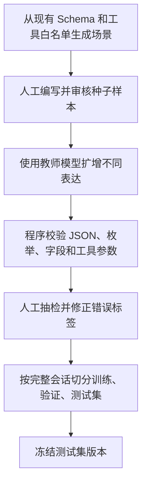
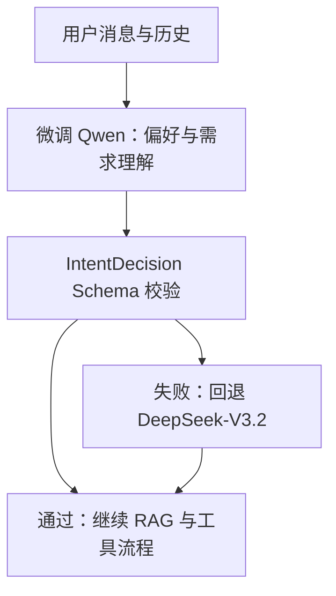

# TripPilot 多轮偏好理解微调计划

> 编写日期：2026-09-16  
> 训练目标：微调“多轮旅游对话中的用户偏好与需求理解”，不是训练旅游知识问答模型。  
> 训练环境：阿里云云显卡。  
> 推荐方案：Qwen3-4B-Instruct-2507 + 4-bit QLoRA + LlamaFactory + SFT。

## 1. 这次具体训练什么

训练模型理解用户在多轮对话中新增、修改、否定和保留的旅游需求，并稳定输出当前项目已经定义好的 `IntentDecision` JSON。

例如：

| 用户表达 | 模型应该理解的结果 |
|---|---|
| “第二天别太赶” | 更新 `pace=relaxed`，意图通常为 `modify` |
| “酒店换到宝安中心附近，预算别变” | 更新 `hotel_area=宝安中心`，保留既有 budget |
| “带老人，少走路” | 更新 `travelers` 相关描述和 `pace=relaxed`，偏好无障碍、少步行 |
| “不想去人太多的地方” | 更新偏好，后续行程规避热门拥挤景点 |
| “先别做行程，我只是看看酒店” | `intent=qa` 或 `explore`，不能误进入 `plan` |
| “还是三个人，预算改成四千” | 只更新 `travelers=3` 与 `budget=4000` |
| “什么是 LangChain” | `intent=out_of_scope`，不能污染旅游记忆 |

模型不负责以下内容：

- 天气、酒店房态、门票价格、路线耗时等实时事实。
- 景点、美食、交通知识的检索。
- 预算超标、活动时间重叠、天数超过限制等硬校验。
- 外部工具实际执行与权限判断。

这些能力继续由高德接口、RAG、后端验证器和工具白名单负责。

## 2. 为什么选择这个方向

当前项目的 `step1_understand_request` 已经要求模型输出固定的 `IntentDecision`：

```text
intent
domains
search_query
requirement_updates
clarification
tools
```

其中真正适合微调的部分是：

1. 根据历史理解“那个”“第二天”“还是”“换一家”等指代。
2. 区分新增、修改、否定和继承的需求。
3. 只写入本轮明确改变的 `requirement_updates`，不覆盖用户已确认的其他条件。
4. 正确识别“询问信息”与“要求生成/修改行程”。
5. 在领域外问题时拒答，并阻止该问题进入会话记忆。

这是一个结构化、可自动评测的任务。相比直接微调整份行程生成，它更适合第一轮云端训练。

## 3. 模型与云显卡选择

### 3.1 基座模型

选择 `Qwen/Qwen3-4B-Instruct-2507`。

理由：

- 4B 规模足够处理中文多轮对话和结构化 JSON，又比 8B 更适合首次云端练习。
- 该版本是非思考模型，不产生 `<think>` 内容，更适合直接输出业务 JSON。
- Qwen3 系列已被 LlamaFactory 支持，训练与后续 OpenAI 兼容服务较成熟。

参考资料：[Qwen3-4B-Instruct-2507 模型卡](https://huggingface.co/Qwen/Qwen3-4B-Instruct-2507)、[LlamaFactory Qwen3 支持说明](https://github.com/hiyouga/LlamaFactory)

### 3.2 阿里云显卡建议

优先选择带 **24 GB 显存** 的单卡实例，以便稳定进行 4-bit QLoRA，并保留 4,096 token 的训练长度。

| 训练阶段 | 推荐显存 | 说明 |
|---|---:|---|
| 环境、数据、100 条冒烟训练 | 16 GB | 可以验证依赖、数据格式和脚本 |
| 正式训练 Qwen3-4B QLoRA | 24 GB | 建议选择，余量更稳定 |
| 后续 8B 或更长上下文实验 | 40 GB 及以上 | 非本阶段必需 |

建议优先使用阿里云 PAI 的训练任务或 GPU ECS 的 Ubuntu CUDA 镜像。第一次训练建议开按量付费实例，先完成 100 条数据、几十个 step 的冒烟训练，再启动完整任务。训练结束立即保存模型产物到 OSS，并停止实例。

### 3.3 不使用全参数微调

第一阶段采用 QLoRA，而不是全参数微调：

- 基座模型权重按 4-bit 加载，显著减少显存占用。
- 只训练 LoRA Adapter，训练完成后产物更小、便于保存、回滚和对比。
- 你可以保留同一个 Qwen 基座，切换不同版本 Adapter 做 A/B 对比。

LlamaFactory 提供 Qwen3 的 QLoRA 示例，并支持 Adapter 合并和 OpenAI 风格 API 服务。[QLoRA 示例说明](https://github.com/hiyouga/LlamaFactory/blob/main/examples/README.md)

## 4. 数据设计

### 4.1 数据量目标

| 数据集 | 数量 | 是否人工审核 | 用途 |
|---|---:|---|---|
| 种子样本 | 400–600 | 全部审核 | 定义标签与输出标准 |
| 扩增训练样本 | 2,000–3,000 | 抽检至少 30% | 增加表达多样性 |
| 验证集 | 300 | 全部审核 | 选择最佳 checkpoint |
| 固定测试集 | 400 | 全部审核 | 只用于最终比较，训练不可见 |

第一轮的有效训练数据目标为 **2,400–3,600 条**。数据不宜全部由模型自动生成；至少要人工审核种子样本和所有验证、测试样本。

### 4.2 数据覆盖矩阵

训练集必须覆盖以下场景，每类至少 80–150 条：

| 类别 | 示例 |
|---|---|
| 新建需求 | “国庆去杭州玩三天，两个人，预算五千” |
| 只改一个字段 | “酒店改到西湖附近” |
| 同时改多个字段 | “还是三个人，预算改四千，节奏轻松点” |
| 否定与撤销 | “别安排爬山”“不住景区旁边了” |
| 历史指代 | “第二天呢”“那个博物馆保留” |
| 偏好表达 | “带老人少走路”“想多吃本地小吃” |
| 询问与规划区分 | “深圳住哪里方便” 与 “给我排深圳三天行程” |
| 多工具意图 | “查深圳明天天气，再推荐附近酒店” |
| 信息不足 | “周末去玩两天” |
| 无关与混合问题 | “什么是 Python”“先规划北京行程，再教我 Python” |
| 抵抗错误继承 | 新话题出现时不能带入上一趟旅行的预算或城市 |
| 真实措辞噪声 | 错别字、口语、省略主语、连续修改 |

### 4.3 训练样本格式

训练接口保持与当前项目一致：输入使用最近对话、已存储的 requirements 和本轮消息；输出使用完整 `IntentDecision` JSON。

```json
{
  "messages": [
    {
      "role": "system",
      "content": "你是 TripPilot 旅游需求理解器。只输出符合 IntentDecision Schema 的 JSON。只把本轮明确变化写入 requirement_updates；旅游无关问题必须为 out_of_scope。"
    },
    {
      "role": "user",
      "content": "当前已保存需求：{\"destination\":\"深圳\",\"days\":3,\"travelers\":2,\"budget\":3000,\"hotel_area\":\"福田\"}\n历史对话：用户：帮我规划深圳三日游。助手：好的。\n本轮用户：酒店换到宝安中心附近，预算别变，第二天轻松一点。"
    },
    {
      "role": "assistant",
      "content": "{\"intent\":\"modify\",\"domains\":[\"hotel\",\"plan\"],\"search_query\":\"深圳 宝安中心 酒店 轻松行程\",\"requirement_updates\":{\"hotel_area\":\"宝安中心\",\"pace\":\"relaxed\"},\"clarification\":null,\"tools\":[{\"name\":\"hotel_search\",\"city\":\"深圳\",\"query\":\"宝安中心附近酒店\",\"origin\":\"\",\"destination\":\"\",\"date\":\"\"}]}"
    }
  ]
}
```

关键标注规则：

1. 输出必须是可解析 JSON，不能混入解释文字。
2. `requirement_updates` 只记录本轮新增或修改，不重复保存已有字段。
3. 用户没有明说的预算、日期、人数、偏好不能猜测。
4. `out_of_scope` 时 `tools=[]`、`domains=[]`、`search_query=""`、`requirement_updates={}`。
5. 工具只允许当前后端支持的工具名称和字段。
6. 相对日期必须基于输入中的明确基准日期处理；不要把“明天”永远标成某个固定日期。

## 5. 数据生产流程



建议先写 500 条种子样本。扩增时，每个种子只产生 3–5 个语义等价改写，防止训练集被同一种模板淹没。

严禁将真实用户手机号、账号、订单号、精确住址和可识别个人身份的信息直接上传到云端训练环境。真实对话需要先脱敏，再进入样本库。

## 6. 训练配置

### 6.1 推荐 YAML 起点

下面是第一轮正式训练的建议参数；真正开跑前应以 LlamaFactory 当前版本提供的 Qwen3 QLoRA 示例为基础调整模板字段。

```yaml
### model
model_name_or_path: Qwen/Qwen3-4B-Instruct-2507
template: qwen3_nothink

### method
stage: sft
do_train: true
finetuning_type: lora
quantization_bit: 4
quantization_method: bitsandbytes
lora_target: all
lora_rank: 16
lora_alpha: 32
lora_dropout: 0.05

### dataset
dataset: trippilot_preference_train
dataset_dir: data
cutoff_len: 4096
val_size: 0.1
preprocessing_num_workers: 8

### output
output_dir: saves/trippilot-qwen3-4b-preference-qlora-v1
logging_steps: 10
save_steps: 100
eval_strategy: steps
eval_steps: 100
save_total_limit: 3
plot_loss: true

### train
per_device_train_batch_size: 1
gradient_accumulation_steps: 16
learning_rate: 1.0e-4
num_train_epochs: 3
lr_scheduler_type: cosine
warmup_ratio: 0.05
fp16: true
```

参数解释：

| 参数 | 初始值 | 调整依据 |
|---|---:|---|
| `cutoff_len` | 4,096 | 多轮历史太长才提高；不要为了极少数样本盲目扩大 |
| `lora_rank` | 16 | 先够用；明显欠拟合再尝试 32 |
| `learning_rate` | `1e-4` | 验证集波动大或 JSON 质量下降时降到 `5e-5` |
| `epoch` | 3 | 以验证集为准，出现过拟合就提前停止 |
| 有效 batch | 16 | `1 × 16`，适合单卡显存约束 |
| `save_steps` | 100 | 便于从验证集挑选最佳 checkpoint |

不要直接照抄旧版本 YAML。训练前先执行 `llamafactory-cli --help` 并确认当前版本是否使用 `eval_strategy`、`evaluation_strategy` 等字段；不同版本的字段名可能不同。

### 6.2 云端训练顺序

1. 创建 Ubuntu + CUDA GPU 环境，并挂载足够的数据盘。
2. 从 ModelScope 或 Hugging Face 下载基座模型到数据盘，不放系统盘。
3. 创建独立 Python 环境，安装当前版本的 LlamaFactory、PyTorch CUDA、bitsandbytes、datasets、TensorBoard。
4. 上传脱敏后的数据集、数据注册文件和 YAML 配置到 OSS 或训练磁盘。
5. 先执行 100 条样本、50–100 step 的冒烟训练，确认显存、数据格式、loss、checkpoint 保存均正常。
6. 运行完整训练，并实时查看日志、显存占用、训练 loss 与验证指标。
7. 保存最优 Adapter、训练 YAML、训练日志、数据版本号和评测报告到 OSS。
8. 停止按量付费实例，避免闲置计费。

## 7. 评测计划

### 7.1 自动评测

固定测试集必须完全不参加训练与验证。每条输出依次检查：

```text
模型原始输出
    ↓
JSON 能否解析
    ↓
IntentDecision Pydantic Schema 是否通过
    ↓
intent 是否正确
    ↓
requirement_updates 字段和值是否正确
    ↓
tools 名称与必填参数是否正确
    ↓
是否错误改写了未更新的历史需求
```

第一版建议通过线：

| 指标 | 通过线 |
|---|---:|
| JSON 可解析率 | ≥ 99.5% |
| Pydantic Schema 通过率 | ≥ 99% |
| intent Macro-F1 | ≥ 0.92 |
| `out_of_scope` 召回率 | ≥ 0.97 |
| `requirement_updates` 字段 F1 | ≥ 0.92 |
| 工具名称准确率 | ≥ 0.95 |
| 工具必填参数完整率 | ≥ 0.95 |
| 未更新字段被错误覆盖率 | ≤ 2% |

### 7.2 人工评测

从固定测试集中随机抽取 50 条复杂多轮案例，由你按以下标准打分：

- 是否理解了“还是”“不要”“那个”“第二天”等指代和否定。
- 是否只更新本轮明确变化的偏好。
- 是否把无关问题拦在旅游记忆之外。
- 是否把“看酒店/问路线”误判成完整行程规划。
- 是否在信息不足时合理追问，而非编造。

### 7.3 必须对比三组结果

| 对比组 | 目的 |
|---|---|
| 当前 DeepSeek-V3.2 | 项目当前线上基线 |
| 未微调 Qwen3-4B | 分辨基座能力 |
| QLoRA 后的 Qwen3-4B | 证明微调实际提升 |

若微调模型没有稳定超过“未微调 Qwen3-4B”，说明数据或训练策略有问题，不应立即接入生产。

## 8. 接回 TripPilot 的方式

第一阶段不替换线上模型。先让微调模型与 DeepSeek-V3.2 对同一批测试或影子请求同时输出，记录对比结果。

达到指标后，再把它只接入 `step1_understand_request`：



建议后端增加三个清晰方法：

```python
complete_preference_understanding_json(...)
validate_preference_understanding_result(...)
fallback_to_remote_router_when_invalid(...)
```

每次调用记录：模型名、Adapter 版本、耗时、JSON 是否可解析、Schema 是否通过、是否回退。这些指标应写入现有 `ChatRun.result.performance`，这样可以直接比较微调前后时延与成功率。

## 9. 计划排期

| 阶段 | 预计投入 | 交付物 |
|---|---:|---|
| 第 1 天：标注规范与测试集 | 1 天 | 字段规则、400 条固定测试集 |
| 第 2–4 天：训练数据 | 2–3 天 | 2,400–3,600 条脱敏 JSONL 数据 |
| 第 5 天：云端环境与冒烟训练 | 半天 | 可重复执行的环境与小样本训练记录 |
| 第 6 天：正式 QLoRA | 半天到 1 天 | Adapter、训练日志、最优 checkpoint |
| 第 7 天：评测与误差分析 | 1 天 | 三组对比结果、失败案例分类 |
| 第 8 天：影子接入 | 1 天 | 与现有 DeepSeek 的在线对比数据 |

## 10. 这轮训练的完成标准

满足以下条件才算完成，而不是“loss 下降了”：

1. Adapter 可以独立加载并输出完整 JSON。
2. 固定测试集达到第 7 节的自动评测门槛。
3. 在复杂多轮测试中不污染历史需求，也不把无关问题写入记忆。
4. 微调 Qwen3-4B 的结果稳定优于未微调 Qwen3-4B。
5. 对于 Schema 失败、超时或网络失败，TripPilot 能自动回退现有 DeepSeek-V3.2。
6. 训练配置、数据版本、Adapter、评测结果全部保存，可复现实验。

## 11. 最终建议

这一轮只训练“偏好与需求理解”，不要把行程生成、普通问答、工具调用、天气和酒店事实都混进同一个数据集。训练边界越单一，结果越容易评测，也越容易看出这次微调到底提升了什么。

完成这一轮后，再根据失败样本决定是否进入“行程局部修改”微调，而不是提前把两个问题混在一起训练。
