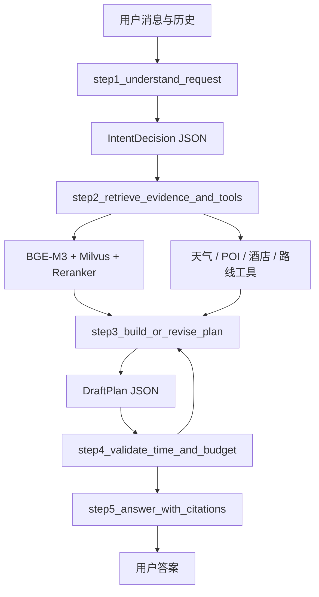
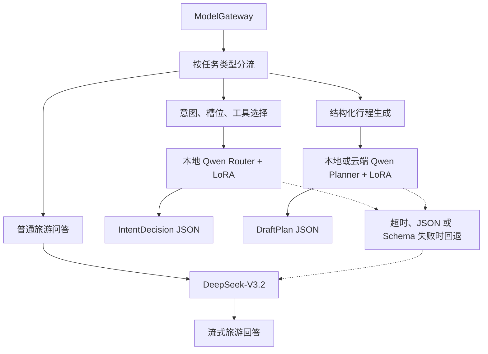

# TripPilot 大模型微调练习建议

> 编写日期：2026-09-16  
> 适用项目：`D:\codex_pro\RAG`  
> 目标：围绕现有 Agentic RAG 做一次可训练、可评测、可接回项目的微调练习，而不是重新训练整套系统。

## 1. 先给出建议结论

这个项目最值得练习的不是“把旅游知识训练进模型”，而是训练模型稳定完成两个结构化任务：

1. **对话路由**：把用户消息稳定转换成 `IntentDecision`，识别意图、旅游领域、上下文需求变化和待调用工具。
2. **行程规划**：把用户要求、检索证据和工具结果稳定转换成满足 `DraftPlan` Schema 的行程 JSON。

旅游知识、景点开放时间、酒店房态、票价和天气会持续变化，应继续通过知识库、酒店接口、高德接口取得。模型微调负责“怎么判断、怎么调用、怎么组织”，RAG 和工具负责“当前事实是什么”。

建议采用以下练习路线：

| 项目 | 首选方案 |
|---|---|
| 基座模型 | `Qwen/Qwen3-1.7B`，先验证完整训练链路 |
| 第二阶段模型 | `Qwen/Qwen3-4B-Instruct-2507`，有更大显存或云 GPU 时使用 |
| 微调方法 | 4-bit QLoRA + SFT |
| 训练框架 | LlamaFactory；想深入代码时再使用 Transformers + PEFT + TRL |
| 第一批训练任务 | `IntentDecision` 路由与工具选择 |
| 第二批训练任务 | `DraftPlan` 结构化行程生成 |
| 不建议作为第一练习 | 全参数微调、强化学习、微调 BGE-M3、把实时旅游资料训练进模型 |
| 现有 DeepSeek-V3.2 | 保留为基线、教师模型和失败回退，不必立即替换 |

## 2. 当前项目中模型实际负责什么

现有流程位于 `backend/trippilot/retrieval/module5_agent_workflow.py`：



当前 DeepSeek-V3.2 主要参与：

- `step1_understand_request`：意图识别、需求槽位更新、搜索词和工具参数生成。
- `step3_build_or_revise_plan`：生成符合 Pydantic Schema 的结构化行程。
- `step5_answer_with_citations`：普通旅游问答、工具结果解释与带引用回答。

当前 BGE-M3 是 Embedding 模型，不负责回答。硅基流动的 BGE Reranker 负责候选片段精排。第一次练习只微调 LLM，能把变量控制得最清楚。

## 3. 模型更换建议

### 3.1 本机练习首选：Qwen3-1.7B

适合先训练路由模型。模型小，容易在有限显存上跑通数据预处理、QLoRA、保存 Adapter、离线评测和部署全过程。它的定位是“小而稳定的业务模型”，不用承担所有开放问答。

建议用途：

- 旅游范围内/范围外分类。
- `plan`、`modify`、`qa`、`booking`、`compare` 等意图分类。
- 从多轮历史抽取 destination、days、budget、hotel_area 等字段。
- 输出 `weather_query`、`hotel_search`、`route_query` 等工具参数。

风险：1.7B 对复杂的多日行程、约束冲突和长上下文理解能力有限，所以第一阶段不替代所有 DeepSeek 调用。

### 3.2 效果优先：Qwen3-4B-Instruct-2507

这是更适合最终接入本项目的候选模型。官方模型卡说明它是 4B 非思考模型，强化了指令遵循和工具使用，并且不会输出 `<think>` 标签；这对要求严格 JSON、避免前端出现思考标记很有帮助。[Qwen3-4B-Instruct-2507 模型卡](https://huggingface.co/Qwen/Qwen3-4B-Instruct-2507)

建议用途：

- 同时训练路由与行程 JSON。
- 在本地承担 `step1_understand`。
- 训练效果达标后，再尝试承担 `step3_plan`。

本机显卡约 6 GB，而且运行中的 BGE-M3 已占用约 2.8 GB。训练前需要停止 TripPilot Worker 或把 Embedding 暂时切到 CPU；即使如此，4B QLoRA 仍可能受上下文长度和 Windows CUDA 环境影响。更稳妥的 4B 训练环境是 12–16 GB 显存，8B 建议使用更大的云 GPU。这里的显存数字应在正式训练前用 100 条样本做一次小规模试跑验证。

### 3.3 Qwen3-8B：作为云 GPU 进阶实验

Qwen3-8B 有 8.2B 参数，原生上下文 32,768，工具调用能力更强。[Qwen3-8B 模型卡](https://huggingface.co/Qwen/Qwen3-8B)

它更适合比较“模型容量是否显著改善复杂行程”，不适合在当前 6 GB 显卡上作为第一选择。训练成本明显增加，而结构化路由任务未必需要 8B。

### 3.4 为什么暂时不选 DeepSeek-R1 蒸馏模型

本项目更需要短延迟、稳定 JSON 和工具调用，而不是长推理文本。推理型模型容易生成额外思考内容，延长当前已经较慢的行程生成。可以把它作为生成高质量行程草案或训练数据的教师模型，不建议作为本机第一版在线路由模型。

## 4. 微调方向及优先级

### 4.1 P0：意图、需求槽位和工具路由

输入：系统规则、最近几轮消息、当前 requirements。  
输出：严格的 `IntentDecision` JSON。

训练必须覆盖：

- 纯旅游请求：交通、景点、路线、美食、酒店、天气、门票、预算。
- 无关请求：编程、股票、数学题、通用百科，并输出 `out_of_scope`。
- 混合请求：“先规划北京行程，再给我写 Python”，只处理旅游部分。
- 上下文指代：“第二天改轻松点”“酒店换到宝安中心”“还是三个人”。
- 否定和撤销：“不要规划行程了”“不住景区附近”。
- 信息不足：目的地不清楚时生成 clarification，而不是编造。
- 多工具：查天气后规划、搜索酒店并估算到景点路线。
- 工具参数缺失：不能虚构 city、date、origin、destination。

这是首选方向，因为输出可以用 Schema 和字段准确率自动评分，训练成效最容易证明。

### 4.2 P1：结构化行程生成

输入：requirements、授权 evidence、tool_results、已有 plan、issues。  
输出：严格的 `DraftPlan` JSON。

训练重点：

- 天数、人数、预算、节奏、兴趣和锁定活动必须满足。
- 活动时间不重叠，跨区域移动留出合理时间。
- 费用未知时输出 `null`，不能把未知价格写成 0。
- 实时事实只使用 evidence/tool_results；资料不足时写入 unknowns。
- 修改行程时只改变受影响部分。
- 酒店、餐厅、景点和交通安排保持空间上的连续性。
- 生成失败样本：预算冲突、闭馆、恶劣天气、酒店区域改变后应如何修订。

### 4.3 P2：有依据的旅游问答

训练模型只根据证据回答，并使用 `[1]`、`[2]` 引用。重点不是背知识，而是：

- 证据充分时回答并引用。
- 证据冲突时说明冲突和来源。
- 证据不足时明确说明，不编造票价、营业时间和库存。
- 工具返回 unavailable 时提示用户如何继续查询。

这一方向的评测比 JSON 任务复杂，建议在 P0、P1 稳定后再做。

### 4.4 P3：偏好对齐

积累足够真实反馈后，可构造“好回答/差回答”对，使用 DPO 或 ORPO 训练：

- 偏好简洁但信息完整的回答。
- 拒绝无关问题时礼貌引导回旅游话题。
- 不重复用户已经确认的信息。
- 不用过多符号、标题或机械模板。

第一轮不需要强化学习。SFT 数据质量不稳定时，DPO 只会放大问题。

## 5. 数据集怎么做

### 5.1 建议数据量

| 阶段 | 训练集 | 验证集 | 测试集 | 目的 |
|---|---:|---:|---:|---|
| 路由最小实验 | 800–1,500 | 150 | 200 | 跑通全流程并验证提升 |
| 路由可用版本 | 3,000–6,000 | 400 | 600 | 覆盖多轮和边界场景 |
| 行程生成实验 | 1,500–3,000 | 200 | 300 | 学习 Schema 与约束 |
| 偏好对齐 | 500–1,500 对 | 100 对 | 200 对 | 改善表达与拒答 |

不要盲目追求十万条合成数据。先保证每个标签、工具、否定表达和多轮修改都有覆盖。

### 5.2 单条路由训练样例

```json
{
  "messages": [
    {"role": "system", "content": "你是 TripPilot 旅游路由器，只输出 IntentDecision JSON。"},
    {"role": "user", "content": "我后天去深圳，先查天气，再安排两天轻松一点的行程。"},
    {"role": "assistant", "content": "{\"intent\":\"plan\",\"domains\":[\"weather\",\"attraction\",\"route\"],\"search_query\":\"深圳 两日游 轻松 景点 交通\",\"requirement_updates\":{\"destination\":\"深圳\",\"days\":2,\"pace\":\"relaxed\"},\"clarification\":null,\"tools\":[{\"name\":\"weather_query\",\"city\":\"深圳\",\"date\":\"解析后的实际日期\"}]}"}
  ]
}
```

日期样本不能长期保存固定的“后天”答案。制作数据时应把基准日期放进 system 内容，输出依据该日期计算出的结果，或者把相对日期保留给确定性代码解析。

### 5.3 数据来源

1. 从项目的意图枚举、工具 Schema、Pydantic Schema 自动生成场景矩阵。
2. 用当前 DeepSeek-V3.2 批量生成候选样本，作为教师数据。
3. 通过程序校验 JSON、字段枚举、日期、工具参数和活动时间。
4. 人工审核边界样本，尤其是无关问题、多轮修改、否定和预算冲突。
5. 从真实对话中只提取已脱敏、获得使用许可的样本；删除用户名、电话、订单号、精确住址等信息。

训练集、验证集、测试集应按“完整会话”划分，不能把同一会话的不同轮次分到不同集合中。目的地模板也要去重，否则测试分数会虚高。

## 6. 推荐训练技术栈

LlamaFactory 已支持 Qwen3、SFT、LoRA、4/8-bit QLoRA、DPO/ORPO 等训练方式，并提供 OpenAI 风格 API。[LlamaFactory 官方仓库](https://github.com/hiyouga/LlamaFactory)

建议独立建立训练目录，避免把训练依赖塞进生产后端：

```text
finetuning/
├─ README.md
├─ requirements-train.txt
├─ configs/
│  ├─ step1_qwen3_1_7b_router_qlora.yaml
│  └─ step2_qwen3_4b_plan_qlora.yaml
├─ datasets/
│  ├─ raw/
│  ├─ processed/
│  └─ splits/
├─ scripts/
│  ├─ step1_export_anonymized_samples.py
│  ├─ step2_generate_synthetic_cases.py
│  ├─ step3_validate_training_json.py
│  ├─ step4_split_by_conversation.py
│  ├─ step5_train_adapter.py
│  └─ step6_evaluate_adapter.py
├─ evaluation/
│  ├─ router_cases.jsonl
│  └─ plan_cases.jsonl
└─ outputs/                 # 加入 .gitignore
```

第一轮建议参数起点：

| 参数 | 起点 | 说明 |
|---|---:|---|
| quantization | 4 bit | 降低显存占用 |
| LoRA rank | 16 | 路由任务通常足够 |
| LoRA alpha | 32 | 作为初始值，结合验证集调整 |
| dropout | 0.05 | 小数据集降低过拟合 |
| learning rate | `1e-4` | QLoRA 常见起点，若验证波动则降至 `5e-5` |
| epoch | 2–3 | 以验证集提前停止为准 |
| max sequence length | 2,048 | 路由任务；多轮行程可逐步提高到 4,096 |
| effective batch size | 16–32 | 通过 gradient accumulation 实现 |
| target modules | 所有主要 linear 层 | 先按 LlamaFactory 的 Qwen3 模板配置 |

训练和推理必须使用相同 chat template。LlamaFactory 官方说明对有思考/非思考模板的模型要区分模板，并提供 QLoRA 与合并 Adapter 示例。[LlamaFactory examples](https://github.com/hiyouga/LlamaFactory/blob/main/examples/README.md)

## 7. 评测指标

### 7.1 路由模型

| 指标 | 建议通过线 |
|---|---:|
| JSON 可解析率 | ≥ 99.5% |
| Pydantic Schema 通过率 | ≥ 99% |
| intent Macro-F1 | ≥ 0.92 |
| out_of_scope 召回率 | ≥ 0.97 |
| requirement 字段 F1 | ≥ 0.92 |
| 工具名称准确率 | ≥ 0.95 |
| 必填工具参数完整率 | ≥ 0.95 |
| P95 响应时间 | 明显低于当前远程路由调用 |

### 7.2 行程模型

- `DraftPlan` Schema 通过率。
- 天数、预算、人数、锁定活动满足率。
- 时间重叠率与非法时间率。
- 证据支持率：具体事实是否来自 evidence 或 tool_results。
- 修改保持率：未要求修改的活动是否被错误改动。
- 人工评分：可执行性、路线合理性、信息完整性、表达质量。

必须同时对比：

1. 当前 DeepSeek-V3.2 基线。
2. 未微调的同一 Qwen 基座。
3. 微调后的 Qwen + LoRA。

只有第 3 项稳定优于第 2 项，并达到业务阈值，才能证明微调有效；仅看训练 loss 下降不能说明可用。

## 8. 如何接回当前项目

训练服务对外提供 OpenAI 兼容的 `/v1/chat/completions` 后，现有 `ModelGateway` 已具备相近协议，但建议升级为按任务路由的配置，而不是全项目只用一个模型：



实线表示正常处理路径；虚线表示本地微调模型无法正常输出时才会进入 DeepSeek-V3.2 回退，不是每次请求都会调用 DeepSeek。

推荐增加的配置：

```dotenv
TRIP_ROUTER_BASE_URL=http://127.0.0.1:8010/v1
TRIP_ROUTER_MODEL=trippilot-router-qwen3-1.7b
TRIP_PLANNER_BASE_URL=http://127.0.0.1:8011/v1
TRIP_PLANNER_MODEL=trippilot-planner-qwen3-4b
TRIP_LLM_BASE_URL=<现有通用回答服务>
TRIP_LLM_MODEL=deepseek-ai/DeepSeek-V3.2
```

建议实现三个清晰方法：

- `complete_intent_json(...)`
- `complete_plan_json(...)`
- `stream_travel_answer(...)`

每个方法分别记录模型名、耗时、Schema 是否通过、是否回退。灰度阶段让本地模型和 DeepSeek 同时离线执行，但只把现有模型答案返回给用户；积累比较数据后再切换线上流量。

## 9. 四个练习里程碑

### 里程碑 1：建立不可污染的测试集

- 手写 200 条路由案例，覆盖所有 intent、工具和边界情况。
- 编写 JSON、Schema、字段准确率评测脚本。
- 测出 DeepSeek-V3.2 与未微调 Qwen 的基线。

### 里程碑 2：完成 1.7B 路由 QLoRA

- 构造 1,000–1,500 条训练样本。
- 用 4-bit QLoRA 训练 2–3 epoch。
- 输出 Adapter、训练曲线、错误样本表和对比报告。
- 暂不接生产，只离线评测。

### 里程碑 3：接入双模型路由

- 本地 Qwen 只处理 `step1_understand_request`。
- Schema 失败、超时或低置信场景回退 DeepSeek。
- 使用现有 `ChatRun.result.performance` 比较耗时和成功率。

### 里程碑 4：训练 4B 行程模型

- 构建包含证据、工具结果和冲突修订的行程数据。
- 在更大显存环境训练 Qwen3-4B。
- 用确定性校验器评价预算、时间、天数和锁定活动。
- 达标后替换 `step3_build_or_revise_plan`，普通问答仍保留 DeepSeek。

## 10. 容易踩的坑

1. **把 RAG 文档直接当 SFT 数据**：这会让模型背诵内容，不能保证事实最新，也没有教会它如何使用证据。
2. **用模型自己的答案训练，再用同一模型打分**：结果会偏向教师模型风格，必须有规则评测和人工抽查。
3. **随机按单条切分数据**：同一模板或会话泄漏到测试集，会得到虚高分数。
4. **只测试正常问题**：生产故障通常来自否定、改口、无关问题、缺参数和工具失败。
5. **训练时使用一种模板，部署时换模板**：会直接破坏格式遵循和效果。
6. **一次替换所有模型调用**：出现回归时无法知道是路由、规划还是回答出了问题。
7. **本机同时运行 BGE 与训练模型**：6 GB 显存很容易 OOM；训练期间应停 Worker，并以独立环境运行。
8. **没有保留训练版本信息**：至少记录基座模型 commit、数据集版本、配置、随机种子、Adapter 路径和评测结果。

## 11. 最适合你现在开始的实验

先做“**Qwen3-1.7B 旅游路由器 QLoRA**”。它与项目现有 `IntentDecision` 完全对应，数据容易构造，结果能自动验证，训练资源也最可控。完成后，你会完整练习：数据设计、合成数据审核、SFT/QLoRA、Schema 评测、OpenAI 兼容服务、模型路由、失败回退和线上性能比较。

如果这个实验的 JSON 通过率、意图 Macro-F1、工具参数完整率和延迟达到上述目标，再进入 4B 行程规划微调。这个顺序能把训练收益和 RAG、工具、提示词的收益区分开，也最符合当前 TripPilot 的工程结构。
