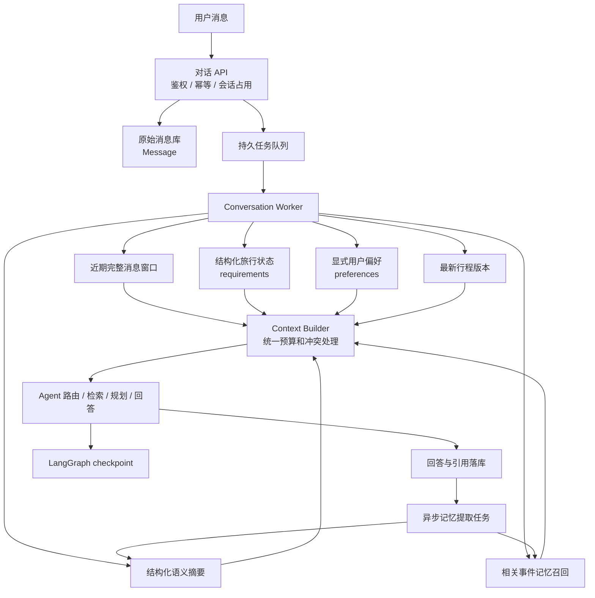

# TripPilot 企业级对话记忆管理设计

## 1. 结论

企业项目不应该只选择“保存全部聊天”或者“让大模型生成一段摘要”中的一种。更可靠的方案是分层管理：

```text
原始消息层        保证可追溯
近期上下文层      保证当前对话连贯
结构化业务状态层  保证预算、人数、日期等关键条件准确
语义摘要层        压缩较早对话的含义
用户偏好层        保存经过授权的跨会话偏好
事件记忆层        按需召回过去的重要事件
业务产物层        保存行程、订单草稿等版本化结果
执行状态层        保存 Agent 工作流进度
```

大模型适合压缩早期对话的语义，但不能成为预算、日期、订单状态等关键数据的唯一存储。关键业务字段必须由结构化数据库、校验规则和版本记录管理。

## 2. 推荐总体架构



## 3. 企业级记忆分层

### 3.1 原始消息层

原始消息是审计和重新计算的最终依据，建议保持不可变或只允许合规脱敏，不应该被摘要覆盖。

建议保存：

```text
tenant_id
user_id
session_id
message_id
sequence
role
content
status
created_at
model_id
citations
trace_id
```

企业要求：

- 使用客户端消息 ID 保证重复提交幂等；
- 用户消息、助手消息和工具结果需要明确区分；
- 失败、取消、审核拒绝等状态不能伪装成正常回答；
- 保存租户字段，所有查询必须带租户过滤；
- 敏感字段按企业要求加密或脱敏；
- 原始消息设置保留期限和删除流程。

当前 TripPilot 的 `Message` 已经覆盖会话、顺序、角色、内容、引用和状态，可以继续增加 `tenant_id`、`trace_id`、模型版本和安全标签。

### 3.2 近期上下文层

近期上下文不需要独立永久存储，它是从原始消息中动态生成的模型输入。

选择策略不应只按“最近 N 条”，建议按 token 预算：

```text
系统指令预算
+ 当前用户问题
+ 最近完整问答
+ 结构化业务状态
+ 摘要与召回记忆
+ 检索证据
<= 模型上下文预算
```

优先保留：

1. 当前用户问题；
2. 最近未完成任务相关的问答；
3. 用户明确更正的信息；
4. 最近工具结果和确认结果；
5. 普通历史消息。

当前 TripPilot 使用 18000 字符预算。企业版本更适合使用目标模型 tokenizer 计算 token，而不是字符数量，因为中英文、JSON 和代码的字符/token 比例不同。

### 3.3 结构化业务状态层

这是企业系统最重要的一层。对于旅游助手，以下信息不能只存在于自由文本摘要：

```json
{
  "destination": "北京",
  "departure": "深圳",
  "start_date": "2026-10-01",
  "end_date": "2026-10-03",
  "travelers": 2,
  "budget": 5000,
  "pace": "relaxed",
  "hotel_area": "东城区",
  "locked_activities": ["故宫"]
}
```

推荐规则：

- 模型只提出 `updates`，服务端决定是否写入；
- 使用 Pydantic/JSON Schema 做类型、范围和跨字段校验；
- 保存字段来源消息 ID；
- 保存更新时间和版本号；
- 用户本轮明确值覆盖历史推断值；
- 删除和清空必须是显式操作，不能用 `null` 含糊表达；
- 目的地变化时清理地点绑定字段；
- 金额、人数、日期和订单状态使用确定性代码校验。

建议把目前的 JSON `requirements` 逐步升级成带元数据的结构：

```json
{
  "budget": {
    "value": 5000,
    "source_message_id": "msg_123",
    "updated_at": "2026-09-23T10:30:00+08:00",
    "confidence": "explicit",
    "version": 3
  }
}
```

### 3.4 结构化语义摘要层

企业项目可以调用大模型生成摘要，但建议输出结构化 JSON，而不是一整段无法校验的散文。

推荐 Schema：

```json
{
  "stable_facts": [
    {
      "fact": "本次从深圳出发",
      "source_message_ids": ["msg_12"],
      "confidence": "explicit"
    }
  ],
  "decisions": [
    {
      "decision": "故宫必须保留",
      "source_message_ids": ["msg_18"]
    }
  ],
  "open_questions": [
    "尚未确认酒店星级"
  ],
  "rejected_options": [
    {
      "item": "环球影城",
      "reason": "用户认为节奏太紧"
    }
  ],
  "conversation_summary": "用户计划两人从深圳前往北京进行三日历史文化游……"
}
```

每项摘要事实都应该携带来源消息 ID。没有来源的内容不能升级为关键业务事实。

#### 摘要触发条件

不要每轮同步调用摘要模型。推荐满足任一条件后异步执行：

- 未摘要消息超过指定 token 数；
- 完成一个业务阶段，例如目的地选择完成；
- 会话暂时空闲；
- 即将超过上下文窗口；
- 会话结束前生成最终摘要。

#### 摘要更新方式

```text
旧结构化摘要
+ 从 summary_through 之后到新边界的有效消息
+ 当前结构化 requirements
        ↓
摘要模型输出新 JSON
        ↓
Schema 校验
        ↓
来源消息 ID 校验
        ↓
冲突检测
        ↓
版本化写入
```

摘要应作为辅助上下文，不能直接覆盖结构化 `requirements`。

### 3.5 用户长期偏好层

长期偏好必须区分“用户明确设置”和“模型推测”。

建议状态：

| 类型 | 是否跨会话 | 写入方式 |
|---|---:|---|
| 明确偏好 | 是 | 用户主动设置或确认 |
| 本次旅行要求 | 否 | 写入当前 `requirements` |
| 模型推测偏好 | 默认否 | 只能作为候选，确认后再保存 |
| 敏感信息 | 严格限制 | 按隐私和合规规则处理 |

建议提供“查看我的记忆、修改、删除、关闭跨会话记忆”能力，不能让用户无法知道系统长期保存了什么。

### 3.6 事件记忆层

当用户有大量历史会话时，不应把所有旧摘要都发送给模型。可以将重要事件写入向量库或支持向量检索的数据库：

```json
{
  "event": "用户上次北京行程选择住在东城区，并认为早晨九点出发较合适",
  "user_id": "user_1",
  "session_id": "session_8",
  "source_message_ids": ["msg_81", "msg_86"],
  "event_type": "travel_feedback",
  "created_at": "...",
  "valid_until": "..."
}
```

只在当前问题确实需要时进行 Top-K 召回，并执行：

- 用户和租户权限过滤；
- 时间衰减；
- 事件类型过滤；
- 相似度阈值；
- 重排；
- 来源复核。

“用户去年去过北京”不能自动推导成“用户永远喜欢北京”。事实和偏好必须分开。

### 3.7 业务产物层

行程、报价、预订草稿不应该塞进摘要，而要作为版本化业务对象保存。

建议保存：

```text
plan_id
session_id
version
base_version
content
validation_issues
status
created_by
created_at
```

用户说“恢复上一版”时直接读取版本，不依赖大模型从聊天摘要中还原。

### 3.8 执行状态层

LangGraph checkpoint 只记录 Agent 执行状态：

- 当前执行到哪个节点；
- 节点输入输出；
- 是否等待重试或人工确认；
- Worker 中断后从哪里恢复。

它不应该作为用户记忆查询接口，也不应该代替消息表、需求表和行程表。

## 4. 企业级写入流程

```text
1. 用户消息事务落库
2. 创建幂等运行记录和持久工作项
3. 读取近期消息、摘要、结构化状态、偏好和相关事件
4. 模型提出意图与状态增量
5. 服务端执行 Schema、权限和业务规则校验
6. 使用版本号或行锁更新结构化状态
7. 执行检索、工具和 Agent 工作流
8. 流式回答持续落库
9. 成功后保存业务产物和运行结果
10. 异步提取摘要及重要事件
11. 写入摘要版本、来源范围和模型版本
```

第 10 步应放入独立后台任务，避免摘要模型延长用户等待时间。

## 5. 企业级读取流程

Context Builder 应统一控制上下文，而不是由各节点随意拼接。

推荐优先级：

```text
当前用户明确表达
  > 已确认结构化 requirements
  > 用户显式 Preference
  > 最近完整消息
  > 有来源的结构化摘要
  > 检索到的历史事件
  > 模型推断
```

如果发生冲突：

```text
历史摘要：预算5000元
当前用户：预算改成3000元
```

必须以当前用户明确表达为准，同时把旧摘要事实标记为失效或在下一版摘要中移除。

## 6. 推荐数据表

在当前表结构基础上，可以新增：

### 6.1 `conversation_memory_snapshots`

| 字段 | 用途 |
|---|---|
| `id` | 摘要版本 ID |
| `tenant_id`、`user_id`、`session_id` | 权限隔离 |
| `version` | 摘要版本 |
| `from_seq`、`through_seq` | 摘要覆盖的消息范围 |
| `summary_json` | 结构化摘要 |
| `model_name` | 使用的摘要模型 |
| `prompt_version` | 摘要提示词版本 |
| `source_hash` | 输入消息完整性校验 |
| `status` | pending / ready / failed |
| `created_at` | 创建时间 |

### 6.2 `conversation_memory_events`

| 字段 | 用途 |
|---|---|
| `id` | 事件 ID |
| `tenant_id`、`user_id`、`session_id` | 权限隔离 |
| `event_type` | 决策、反馈、偏好候选等 |
| `content` | 可读事件内容 |
| `embedding` 或 `vector_id` | 语义召回 |
| `source_message_ids` | 来源消息 |
| `importance` | 重要程度 |
| `valid_until` | 过期时间 |
| `superseded_by` | 被哪个新事件替代 |

## 7. 摘要模型提示词边界

摘要模型需要明确：

```text
只总结输入消息明确表达的内容
不得把建议写成用户决定
不得把工具候选写成已预订结果
保留未解决问题
保留被否决方案及原因
事实必须附来源消息ID
新明确信息可以使旧事实失效
不得输出Schema以外字段
```

输出后仍需服务端校验，不能因为模型返回 JSON 就默认可信。

## 8. 安全、隐私与生命周期

企业实现至少要覆盖：

- 租户隔离和用户所有权检查；
- 传输与存储加密；
- 日志禁止输出完整聊天和密钥；
- 用户查看、修改、导出和删除记忆；
- 会话记忆与跨会话记忆分开授权；
- 敏感信息检测和脱敏；
- 消息、摘要、向量和备份的统一删除；
- TTL 与数据保留策略；
- 管理员访问审计；
- 摘要提示词注入防护。

删除不能只删 PostgreSQL 行，还要同步清理向量库、对象存储、checkpoint、缓存和备份生命周期标记。

## 9. 监控与验收指标

| 指标 | 含义 |
|---|---|
| 记忆事实准确率 | 摘要事实是否能被来源消息支持 |
| 关键条件召回率 | 预算、人数、日期等是否在需要时进入上下文 |
| 冲突率 | 回答是否使用了已被用户修改的旧信息 |
| 过期记忆率 | 已失效信息仍被召回的比例 |
| 无关记忆污染率 | 非业务问题进入记忆的比例 |
| 来源可追溯率 | 摘要和事件能否定位到原消息 |
| 摘要任务延迟 | 后台摘要从触发到可用的时间 |
| 上下文 token 成本 | 每轮记忆占用的 token 数 |
| 删除完整率 | 用户删除后各存储是否全部清理 |

测试集必须覆盖：

- 用户修改预算和日期；
- 切换目的地；
- 否定之前的偏好；
- 指代“第二个”“上一版”；
- 长对话窗口溢出；
- 无关问题插入；
- 模型失败和用户取消；
- 跨会话偏好读取；
- 用户删除记忆；
- 两个租户存在相似数据时的权限隔离。

## 10. TripPilot 推荐升级顺序

### 第一阶段：强化当前确定性记忆

1. 保留原始消息、`requirements`、`Preference`、`TripPlan` 和 checkpoint 分层；
2. 将字符预算改为模型 token 预算；
3. 为 `requirements` 增加来源消息、更新时间和版本；
4. 把当前 `summary` 在界面和代码注释中明确称为“历史摘录”；
5. 增加记忆查看和删除页面。

### 第二阶段：异步结构化摘要

1. 新增 `conversation_memory_snapshots`；
2. 长对话达到阈值后投递摘要任务；
3. 使用低成本模型输出固定 JSON Schema；
4. 校验来源消息 ID；
5. 摘要失败时继续使用当前确定性摘录，不影响正常聊天；
6. 对比新旧摘要后再切换活动版本。

### 第三阶段：事件记忆检索

1. 只提取有业务价值的决策、反馈和偏好候选；
2. 存入带权限、有效期和来源的事件表；
3. 按当前问题选择性召回；
4. 用户确认后才能把候选偏好升级为长期偏好；
5. 建立离线评估集，验证召回和冲突率。

## 11. 最适合当前项目的目标形态

```text
近期消息：完整原文，按token预算选择
早期历史：LLM异步生成结构化摘要，保留来源
核心条件：requirements确定性保存
长期偏好：用户确认后保存
过去事件：按需向量召回，不全量注入
行程方案：独立版本化保存
执行恢复：LangGraph checkpoint
兜底机制：摘要模型失败时继续使用规则摘录
```

这套方案兼顾回答质量、响应时间、成本、审计、隐私和故障恢复，适合从当前 TripPilot 逐步升级，而不需要一次性重写现有记忆模块。
