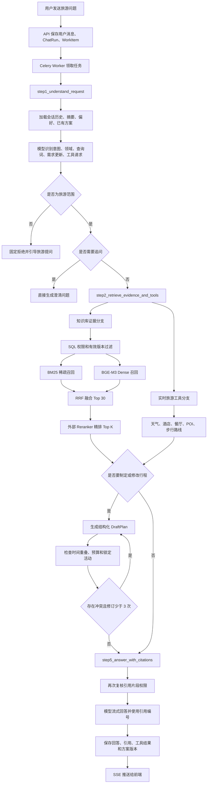

# TripPilot 检索模块业务流程与代码详解

## 1. 文档目标

本文按照当前项目的真实代码说明检索部分如何工作，重点回答四个问题：

1. 用户的一句话如何变成可执行的检索任务。
2. 知识库、会话记忆和实时旅游工具分别提供什么数据。
3. BM25、BGE-M3、RRF 和 Reranker 在代码中如何衔接。
4. 检索证据怎样经过权限复核后进入最终回答和引用。

项目代码根目录为 `D:\codex_pro\RAG`，检索主包为 `backend/trippilot/retrieval`。

## 2. 当前技术配置

| 能力 | 当前实现 | 当前状态 |
|---|---|---|
| 向量数据库 | Milvus 3 | 已启用 |
| 稀疏召回 | Milvus 内置 BM25，中文 Jieba Analyzer | 已启用 |
| Dense Embedding | 本地 `BAAI/bge-m3` | 已启用 |
| 向量维度 | 1024 | 已验证 |
| 向量相似度 | COSINE | 已启用 |
| 多路融合 | Milvus RRF，`k=60` | 已启用 |
| 精排 | 硅基流动 `BAAI/bge-reranker-v2-m3` | 已启用 |
| 实时旅游数据 | 高德 Web 服务 | 天气、POI、餐厅、酒店基础资料、步行路线可用 |
| 对话模型 | 硅基流动 `deepseek-ai/DeepSeek-V3.2` | 用于意图、查询改写、行程草案和回答 |
| 上下文窗口 | 最近完成消息，字符预算 18000 | 已启用 |
| 持久记忆 | PostgreSQL 会话要求、偏好、摘要、方案版本 | 已启用 |

## 3. 总流程图



## 4. 三类信息来源的业务边界

### 4.1 知识库检索

知识库用于管理员上传并审核过的旅游资料，例如景区说明、酒店介绍、城市攻略和内部路线手册。它适合回答相对稳定、需要来源引用的问题。

示例：管理员上传《深圳景区开放与预约指南》，用户询问“世界之窗是否需要预约”。系统从文档片段召回证据，并在回答中显示 `[1]`。

知识库不能天然代表实时价格、库存和天气。文档即使写着某个价格，也必须结合文档有效期和来源日期理解。

### 4.2 会话上下文与持久记忆

会话记忆用于理解省略和指代，不属于向量知识库。例如用户先说“预算 3000 元”，再说“换成轻松一点”，第二句话要结合已保存预算和上一版行程。

系统保存：

- 已完成的对话消息。
- 会话摘要和结构化旅行条件。
- 用户主动保存的长期偏好。
- 最近一个行程版本。

与旅游无关的问答可以显示在聊天记录里，但会根据 `ChatRun.result.intent == out_of_scope` 从后续上下文和摘要中排除。

### 4.3 实时旅游工具

实时工具当前通过高德 Web 服务查询：

- `weather_query`：城市实况或近期天气预报。
- `poi_search`：景点、地点等 POI。
- `restaurant_search`：餐厅基础资料。
- `hotel_search`：酒店名称、地址、电话、位置等基础资料。
- `route_query`：当前实现为地点解析加步行路线。

`ticket_search`、`hotel_inventory` 和 `intercity_search` 尚未接入供应商，会返回结构化 `unavailable`，回答层必须说明未核验，不能虚构班次、实时房价、空房或下单成功。

## 5. 代码模块职责

| 模块 | 主要职责 | 关键入口 |
|---|---|---|
| `module1_local_embedding.py` | 加载本地 BGE-M3，在 GPU 上生成归一化 Dense 向量 | `create_local_embeddings` |
| `module1_model_gateway.py` | 调用兼容 OpenAI 协议的模型服务，处理 JSON 和流式输出 | `complete_json`、`stream_answer` |
| `module2_knowledge_search.py` | 权限过滤、BM25/Dense 召回、RRF、候选还原和重排 | `search_knowledge` |
| `module3_context_memory.py` | 加载会话窗口、摘要、偏好、方案和结构化条件 | `step1_load_conversation_context` |
| `module4_travel_tools.py` | 执行天气、酒店、餐厅、POI 和路线查询 | `execute_travel_tool` |
| `module5_agent_workflow.py` | LangGraph 总编排，连接理解、检索、计划、校验和回答 | `build_travel_graph` |
| `module6_conversation_api.py` | 保存消息、创建任务、SSE 推送、停止生成和直接检索 API | `send_message`、`stream_run`、`search` |

## 6. 知识库检索代码步骤

### Step 1：加载当前用户允许访问的片段

入口：`step1_load_authorized_chunks(db, user, kb_id)`。

SQL 查询连接 `Chunk → DocumentVersion → Document → KnowledgeBase`，并在召回前执行以下过滤：

1. 文档必须启用：`Document.enabled is True`。
2. 文档不能被软删除。
3. 版本必须是文档的 `active_version_id`，旧版本不会参与召回。
4. 版本状态必须为 `READY`。
5. 知识库必须公开，或者当前用户是知识库所有者。
6. `valid_until` 存在时不能早于今天。

业务意义：权限控制发生在向量召回之前，私有文档不会仅依赖模型“自觉不引用”。

### Step 2：生成查询 Dense 向量

入口：`create_embeddings([query])`，当前转入 `create_local_embeddings`。

本地 BGE-M3 的处理步骤：

1. `step1_load_local_embedding_model` 首次调用时从本地目录加载模型。
2. 检查 CUDA 设备是否真实可用。
3. 按配置启用 FP16。
4. 设置最大文本长度。
5. `model.encode` 分批编码并归一化向量。
6. 强制检查输出形状为 `(文本数量, 1024)`。
7. 转成 `float32` 后返回 Milvus。

模型通过 `lru_cache` 在同一 Worker 中复用，并用 `RLock` 避免多个请求同时争用 GPU。

### Step 3：执行 BM25 与 Dense 双路召回

入口：`step2_search_milvus_hybrid(rows, query)`。

Milvus 同时接收两个 `AnnSearchRequest`：

```text
稀疏请求：query 文本 → sparse_vector → BM25 → limit 30
稠密请求：BGE-M3 查询向量 → dense_vector → COSINE → limit 30
```

两路请求都带 `kb_id in [...]` 权限过滤条件。

- BM25 擅长精确词匹配，例如酒店名、景点名、地铁站和专有名词。
- Dense 向量擅长语义匹配，例如“适合带老人慢慢逛”与“低强度、无障碍友好”的表达差异。

### Step 4：RRF 融合

Milvus 使用 RRF Ranker 合并两路排序，当前 `k=60`，返回前 30 个候选。

RRF 关注候选在各召回通道中的名次，不要求 BM25 分数和余弦相似度处于同一量纲。概念公式为：

```text
RRF(document) = Σ 1 / (k + rank_i(document))
```

同一个片段如果在关键词召回和语义召回中都排名靠前，会获得更高融合分数。

代码还用 `allowed_chunk_ids` 再检查一次 Milvus 返回的 `chunk_id`，防止不在本次授权 SQL 结果中的候选进入精排。

### Step 5：还原业务字段

入口：`step2_format_candidates(rows, fused_scores)`。

Milvus 返回的是索引命中，回答层还需要数据库中的业务信息。该函数把命中还原为：

```json
{
  "chunk_id": "片段ID",
  "document_id": "文档ID",
  "version_id": "版本ID",
  "knowledge_base_id": "知识库ID",
  "filename": "原文件名",
  "page": 3,
  "heading": "交通方式",
  "content": "证据正文",
  "score": 0.03,
  "score_source": "rrf",
  "source_url": "可选来源地址"
}
```

这些字段最终用于管理员检索测试和用户端“查看资料来源”。

### Step 6：外部 Reranker 精排

入口：`rerank_candidates(query, candidates, top_k)`。

系统把查询和最多 30 个候选正文发给 `BAAI/bge-reranker-v2-m3`，按 `relevance_score` 重新排序，最后返回默认 Top 8。

如果没有配置 Reranker，代码按 RRF 顺序降级，并把 `score_source` 标成 `rrf`。当前生产配置已启用 Reranker，成功结果标记为 `reranker`。

### Step 7：回答前再次进行权限复核

入口：`step5_answer_with_citations`。

回答节点重新执行 `step1_load_authorized_chunks`，形成当前允许的 `chunk_id` 集合，只把仍有权限的证据传给模型。这样即使检索后文档被停用或权限变化，回答阶段也不会继续引用该片段。

模型只能使用证据列表对应的 `[1]`、`[2]` 编号；没有证据时可以给一般建议，但不能虚构具体开放时间、价格或库存。

## 7. Agent 检索编排步骤

### Model 1：理解问题与查询改写

`step1_understand_request` 把会话上下文交给 `ModelGateway.complete_json`，输出 `IntentDecision`：

```json
{
  "intent": "qa | explore | compare | plan | modify | ...",
  "domains": ["hotel", "weather"],
  "search_query": "深圳宝安中心附近酒店 交通便利",
  "requirement_updates": {"destination": "深圳", "hotel_area": "宝安中心"},
  "clarification": null,
  "tools": [
    {"name": "hotel_search", "city": "深圳", "query": "宝安中心酒店"}
  ]
}
```

模型负责提出决策，服务端负责校验结构、执行权限和工具。工具最多四个，字段由 Pydantic 校验。

### Step 2：并行获取知识证据和实时数据

`step2_retrieve_evidence_and_tools` 执行：

1. 调用 `search_knowledge` 获取知识库证据。
2. 若修改行程时查询词没有命中，并且记忆中已有目的地，则用目的地做一次补充检索。
3. 使用最多四线程并行执行旅游工具。

澄清问题、社交对话、格式转换、预订引导和无关问题不会进入常规检索。

### Model 2：生成或修改结构化行程

当意图为 `plan` 或 `modify` 时，`step3_build_or_revise_plan` 根据需求、上下文、证据和工具结果生成 `DraftPlan`。

每项活动必须包含天数、开始/结束时间、类型、费用口径和备注。未知费用使用 `null`，不能用 0 冒充免费。

### Step 4：确定性规则校验

`step4_validate_time_and_budget` 不依赖模型，检查：

- 结束时间是否晚于开始时间。
- 同一天活动是否重叠。
- 已知活动总费用是否超预算。
- 用户锁定的活动是否被保留。
- 活动天数是否超过用户要求。

存在冲突时最多回到 Model 2 修订三轮，防止无限循环。

### Model 3：流式回答与引用

最后一个模型调用同时接收结构化需求、证据、实时工具结果、方案和校验问题。`stream_answer` 把供应商返回的增量交给 Worker，Worker定期保存部分文本，前端通过 SSE 获取最新快照。

流式输出开始后不自动重试，避免超时重试造成回答内容重复。结构化模型请求尚未产生可见文本，首次超时时会安全重试一次。

## 8. 业务案例一：查询宝安中心酒店

用户：`我想住在宝安中心附近，有什么酒店推荐？`

### 8.1 路由结果

```text
intent = explore 或 qa
search_query = 深圳 宝安中心 酒店 住宿 交通
requirement_updates = {destination: 深圳, hotel_area: 宝安中心}
tools = [{name: hotel_search, city: 深圳, query: 宝安中心酒店}]
```

### 8.2 知识库分支

知识库可能召回管理员上传的《深圳住宿区域指南》，提供宝安中心交通、商圈和适合人群等稳定信息。

### 8.3 实时工具分支

`hotel_search` 调用高德 POI 关键字搜索：

```text
city = 深圳
keywords = 宝安中心酒店
types = 100000
citylimit = true
offset = 5
```

`citylimit=true` 防止同名关键词匹配到其他城市。返回的 POI 可以包含名称、地址、电话和坐标。

### 8.4 最终回答边界

回答可以列出酒店基础资料，并结合知识库解释交通便利性。不能声称某日有房、价格为多少或已经预订，因为 `hotel_inventory` 尚未接入。

## 9. 业务案例二：根据天气调整行程

用户：`明天深圳天气怎么样？适合去深圳湾公园吗？`

### 9.1 查询准备

路由模型选择 `weather_query`，城市为深圳，日期为明天。工具先调用行政区查询把“深圳”转换为六位 adcode，再调用天气接口。

### 9.2 证据组合

- 高德天气结果负责回答明天的天气情况。
- 知识库中的深圳湾公园资料负责解释景点类型、主要活动和注意事项。
- 上一轮行程记忆负责确认深圳湾公园安排在哪一天。

### 9.3 回答方式

如果天气显示雷阵雨，回答可以建议携带雨具或把完全户外活动换到其他时段。天气工具结果不是 RAG 文档引用；回答需要说明实时来源和查询时间，不能把未来预报说成确定事实。

## 10. 业务案例三：语义召回解决措辞不同

管理员文档片段：`该景区坡度较小，设有无障碍通道，适合低强度游览。`

用户：`带行动不便的老人去哪里比较轻松？`

- BM25 可能只能命中“老人”等少量重合词，甚至没有明显命中。
- BGE-M3 能识别“行动不便、轻松”和“无障碍、低强度”之间的语义关联。
- 若某片段同时包含老人服务设施，BM25 和 Dense 都命中，RRF 会提高其排名。
- Reranker 阅读完整问题和片段后，把真正回答无障碍需求的片段排到前面。

最终回答必须说明证据来自哪个文件和片段，不能仅因语义相似就扩写文档没有提到的医疗保障能力。

## 11. 业务案例四：无关问题不进入检索

用户：`什么是 LangChain？`

路由模型应输出：

```json
{
  "intent": "out_of_scope",
  "domains": [],
  "search_query": "",
  "requirement_updates": {},
  "clarification": null,
  "tools": []
}
```

系统不查知识库、不调用高德、不生成行程，直接提示只处理交通、景点、线路、美食、酒店和天气等旅游问题。这组消息保留在页面中，但不进入下一轮记忆上下文。

## 12. API 调用关系

### 12.1 用户聊天

```text
POST /api/v1/chat
  → 保存 Message、ChatRun、WorkItem
  → Celery Worker 执行 LangGraph
GET /api/v1/chat/runs/{run_id}/events
  → SSE 返回运行阶段、部分回答和最终状态
POST /api/v1/chat/runs/{run_id}/cancel
  → 标记任务取消，后续长步骤和流式回调停止
```

客户端的 `client_message_id` 在同一会话内唯一。重复提交相同 ID 会返回原来的 Run，避免网络重试生成两份相同消息。

### 12.2 直接知识检索

```text
POST /api/v1/knowledge/search
Body: {"query": "深圳亲子景点", "top_k": 8}
```

该接口仍执行用户权限过滤，适合调试前台可见知识检索结果。

管理端还提供指定知识库的检索测试接口，调用前要求管理员身份和该知识库访问权限。

## 13. 失败与降级路径

| 故障 | 当前行为 |
|---|---|
| 查询为空 | 直接返回空证据，不无意义调用向量库 |
| 没有授权片段 | 返回空证据 |
| 未配置 Reranker | 保留 RRF 排序并标记 `score_source=rrf` |
| 高德未配置或超时 | 返回 `unavailable` 和具体原因 |
| 城市名称不明确 | 要求补充省份或区县 |
| 天气日期超出近期范围 | 明确说明超出工具范围 |
| 酒店库存或票务未接入 | 不虚构实时价格、库存或班次 |
| 模型首次结构化请求超时 | 自动重试一次 |
| 流式回答中断 | 不自动重试，避免重复文本 |
| 用户点击停止 | 数据库标记取消，节点和增量保存重新检查状态 |

## 14. 已有测试覆盖

| 测试文件 | 检查内容 |
|---|---|
| `test_milvus_result_mapping.py` | Milvus 3 自定义主键映射、融合分数和越权候选过滤 |
| `test_conversation.py` | 会话隔离、幂等提交、并发限制、取消、记忆和方案校验 |
| `test_travel_tools.py` | 天气城市编码转换、酒店类别和城市限制、库存边界 |
| `test_travel_scope.py` | 无关问题跳过检索并返回固定引导 |
| `test_model_gateway_timeout.py` | 结构化请求超时重试和明确错误提示 |

当前项目完整离线测试最近一次结果为 15 项通过。此前的真实部署验收还验证过文档入库、Milvus 双路检索、外部重排以及最终两条引用返回。

## 15. 阅读和手写代码顺序

如果用于复习或面试，建议按下面顺序阅读和手写：

1. 先写 `IntentDecision` 和 `AgentState`，明确流程中传递什么业务数据。
2. 写 `step1_build_authorized_chunk_query`，先保证权限和版本边界。
3. 写本地 BGE-M3 的加载、编码和维度验证。
4. 写 Milvus 两个 `AnnSearchRequest` 和 RRF 融合。
5. 写 `step2_format_candidates`，把索引命中还原成可引用证据。
6. 写 `rerank_candidates`，理解召回和精排的职责区别。
7. 用 `search_knowledge` 串起权限、召回、还原和精排。
8. 写会话上下文加载，处理历史、摘要、偏好、方案和无关消息隔离。
9. 写高德工具白名单和 `unavailable` 结果。
10. 用 LangGraph 串起理解、检索、计划、规则校验和回答。
11. 最后写 API、持久任务、SSE 和取消机制。

这个顺序先建立安全、可验证的证据管道，再加入模型决策，便于逐层测试和定位问题。
