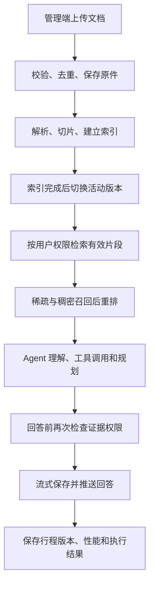

# TripPilot 项目中的巧妙设计总结

## 1. 文档范围

本文只总结当前代码已经实现的设计，不把需求文档中的未来规划当成已完成功能。

除了“生成行程 → 代码校验 → 自动修订”之外，项目还在知识库发布、混合检索、权限控制、上下文记忆、异步任务、停止生成、断点恢复、流式输出、版本恢复和模型调用等位置形成了多个闭环。



## 2. 设计一：文档先建索引，成功后再切换活动版本

### 解决的问题

管理员上传同一份文档的新版本时，新版本可能在解析、切片或向量化阶段失败。如果上传后立即替换旧版本，用户会在处理中途查不到资料。

### 实现方式

`process_document_job` 按以下状态推进：

```text
STORED → PARSING → CHUNKING → INDEXING → READY
```

只有新版本完成解析、切片和索引后，代码才设置：

```python
document.active_version_id = latest_ready
```

检索查询又明确要求：

```python
Document.active_version_id == DocumentVersion.id
DocumentVersion.status == "READY"
```

### 巧妙之处

旧版本在新版本处理期间继续服务。新版本失败时，只把新版本标为 `FAILED`，不会让已经可用的知识突然下线。这是一种小型的蓝绿发布思路。

### 业务案例

管理员更新“深圳景点营业时间.pdf”。新文件向量化失败时，用户仍然能查到旧版资料；修复并重试成功后，活动版本一次性切换到新版。

### 代码位置

- `backend/trippilot/ingestion/module3_index_and_publish.py`
- `backend/trippilot/retrieval/module2_knowledge_search.py`

## 3. 设计二：原文件、业务记录和处理任务分阶段提交并补偿

### 解决的问题

上传文件同时涉及对象存储和数据库。任何一边失败，都可能出现数据库有记录但文件不存在，或者文件存在但数据库没有记录的“半成功”状态。

### 实现方式

上传接口先完成文件安全校验，再保存原件，然后在同一个数据库事务中创建：

- `Document`；
- `DocumentVersion`；
- `WorkItem`。

数据库写入失败时执行：

```python
db.rollback()
storage.delete_original(key)
```

### 巧妙之处

对象存储无法参加数据库事务，因此代码用显式补偿删除解决跨存储一致性问题。同时，只有任务记录提交成功后，后台 Worker 才可能处理该文件。

### 代码位置

- `backend/trippilot/ingestion/module4_admin_api.py`
- `backend/trippilot/ingestion/module1_document_storage.py`

## 4. 设计三：文件名校验之外，还检查真实文件结构

### 解决的问题

仅检查扩展名无法判断上传内容是否真实。例如把可执行文件改名为 `.pdf`，或者上传解压后极大的恶意 DOCX。

### 实现方式

`DocumentStorage.step1_validate_file` 组合检查：

- 后缀是否属于 PDF、DOCX、MD、TXT；
- 文件是否为空以及是否超过大小限制；
- PDF 是否以 `%PDF-` 开头；
- DOCX 是否是有效 ZIP 且包含 `word/document.xml`；
- DOCX 解压后总大小是否超过 100 MB；
- MD/TXT 是否可以按 UTF-8 解码；
- 使用 SHA-256 计算内容指纹。

### 巧妙之处

它同时处理格式伪装、压缩炸弹、乱码文本和重复文件，不依赖用户提交的文件名判断真实性。

## 5. 设计四：SHA-256 内容去重，不靠文件名去重

### 解决的问题

同一个文件可能使用不同文件名重复上传；不同文件也可能恰好同名。

### 实现方式

系统对文件字节计算 SHA-256，并在同一个知识库中查询未删除文档的相同哈希。如果命中，直接返回已有 `document_id` 和 `version_id`：

```json
{
  "duplicate": true
}
```

### 巧妙之处

去重依据是内容本身，避免重复解析、重复生成向量和重复占用存储空间。

## 6. 设计五：向量集合名称绑定嵌入模型和维度

### 解决的问题

切换嵌入模型或向量维度后，如果继续使用旧 Milvus 集合，会发生维度不匹配，或者把不同语义空间中的向量混在一起。

### 实现方式

`collection_name` 使用以下内容生成 12 位指纹：

```text
embedding_model + embedding_dimension
```

最终集合名称类似：

```text
travel_hybrid_a1b2c3d4e5f6
```

### 巧妙之处

模型配置变化会自然得到新的集合名称，不需要人工记住清空旧索引，减少错误复用向量集合的风险。

### 代码位置

`backend/trippilot/retrieval/module2_knowledge_search.py`

## 7. 设计六：先确定用户有权访问什么，再进行召回

### 解决的问题

如果先从整个向量库召回，再在结果中删除无权访问的数据，可能浪费召回名额，也容易因遗漏过滤导致私有知识泄露。

### 实现方式

`step1_build_authorized_chunk_query` 先通过 SQL 得到当前用户可访问的片段，要求：

- 文档已启用；
- 文档未软删除；
- 版本是当前活动版本；
- 版本状态为 `READY`；
- 知识库公开，或者知识库属于当前用户；
- `valid_until` 没有过期。

Milvus 搜索时再将知识库 ID 放入过滤表达式，同时只接受位于 `allowed_chunk_ids` 集合内的命中。

### 巧妙之处

权限不是回答生成后的装饰，而是检索候选集合的一部分。即使向量库中还保留旧版本或其他用户的向量，它们也不能进入最终候选。

## 8. 设计七：回答前再次复核证据权限

### 解决的问题

检索和生成回答之间存在时间差。管理员可能在这个间隔内停用或删除文档，用户权限也可能变化。

### 实现方式

`step5_answer_with_citations` 在生成普通问答前重新加载授权片段：

```python
allowed = {row[0].id for row in step1_load_authorized_chunks(db, user)}
evidence = [item for item in evidence if item["chunk_id"] in allowed]
```

### 巧妙之处

项目形成“双重权限门”：

```text
检索前权限过滤 → 回答前权限复核
```

第一次保证召回范围正确，第二次处理执行期间的权限变化。

### 代码位置

`backend/trippilot/retrieval/module5_agent_workflow.py`

## 9. 设计八：稀疏检索、稠密检索、RRF 和可选重排分层组合

### 解决的问题

纯关键词检索不擅长处理同义表达，纯向量检索可能漏掉酒店名、线路号和景点专名等精确词。

### 实现方式

Milvus 模式同时执行：

- 稀疏 BM25 召回；
- 稠密向量 COSINE 召回。

两路结果用 RRF 融合，再把最多 30 个候选交给外部 Reranker，最终返回 `top_k`。

未配置 Reranker 时，不让整个检索失败，而是保留 RRF 顺序并标记：

```python
score_source = "rrf"
```

本地模式则对已授权数据库片段运行 BM25，便于在没有 Milvus 时继续开发和测试。

### 巧妙之处

这是分层降级结构：

```text
Milvus 混合召回 + Reranker
             ↓ 未配置重排
Milvus 混合召回 + RRF
             ↓ 使用本地检索模式
授权片段本地 BM25
```

核心问答不会因为可选重排服务未配置而完全不可用。

## 10. 设计九：天气专用请求跳过知识库检索

### 解决的问题

“明天深圳天气怎么样”主要依赖实时天气接口。再查询静态知识库既增加延迟，也可能混入过时天气描述。

### 实现方式

step2 检查模型生成的工具请求。如果请求只有 `weather_query`，直接跳过 `search_knowledge`，并执行天气工具。

此外，普通知识检索第一次没有证据且已知目的地时，只使用目的地再查询一次，不进行无限检索循环。

### 巧妙之处

系统按信息性质选择来源：实时数据交给工具，稳定资料交给 RAG。一次有限兜底兼顾召回率和可控耗时。

## 11. 设计十：无关问题可见，但不污染旅游记忆

### 解决的问题

用户可能在旅游会话中询问编程、投资等无关问题。直接删除消息会破坏聊天记录；保存进上下文又会影响后续旅游意图识别。

### 实现方式

step1 将问题标记为 `out_of_scope`，清空本轮图状态中的上下文和需求更新，并把意图保存到 `ChatRun.result`。

之后 `step1_load_conversation_context` 构造历史窗口时，会找到所有 `out_of_scope` 运行记录，排除对应的用户消息和助手拒答消息。

### 巧妙之处

项目将“用户在界面上能看到的聊天记录”和“模型下一轮使用的有效记忆”分开：

```text
界面历史：保留无关问题和拒答
模型记忆：过滤无关问题和拒答
```

既满足审计和用户体验，又避免上下文污染。

### 代码位置

- `backend/trippilot/retrieval/module5_agent_workflow.py`
- `backend/trippilot/retrieval/module3_context_memory.py`

## 12. 设计十一：原始历史、压缩摘要、结构化需求和偏好分层记忆

### 解决的问题

把全部历史消息每次都发送给模型，会不断增加 Token、延迟和费用。只保留最近消息又可能忘记较早的重要条件。

### 实现方式

上下文由四类信息组成：

| 记忆层 | 保存内容 | 用途 |
|---|---|---|
| `history` | 字符预算内的最近完整消息 | 理解当前指代和连续对话 |
| `summary` | 更早消息的带序号摘录 | 保留远期事实线索 |
| `requirements` | 目的地、人数、预算、天数等 | 作为当前旅行硬约束 |
| `preferences` | 用户长期保存的独立偏好 | 跨会话复用 |

最新行程版本又通过 `previous_plan` 单独提供，不必从自然语言历史中重新猜测。

需求合并只允许预定义字段，而且只接受本轮明确给出的非空值，降低模型写入任意业务字段或覆盖旧值的风险。

### 巧妙之处

不同生命周期的数据使用不同存储形态，不让一段不可控的自由文本承担全部记忆职责。

## 13. 设计十二：客户端消息 ID 保证重复提交幂等

### 解决的问题

局域网不稳定或用户连续点击发送时，浏览器可能重复提交同一条消息。如果每次都创建任务，会得到重复回答。

### 实现方式

客户端发送 `client_message_id`。后端先按“会话 ID + 客户端消息 ID”查询消息：

- 已存在：返回原来的 `run_id`，并标记 `duplicate: true`；
- 不存在：创建新消息、新 `ChatRun` 和新 `WorkItem`。

数据库异常或并发冲突时返回 409，而不是悄悄创建第二条消息。

### 巧妙之处

网络重试可以安全进行，用户刷新页面后也能继续追踪原任务。

## 14. 设计十三：同一会话使用原子占位，防止并发生成

### 解决的问题

用户在上一条回答尚未结束时又发送一条消息，两次 Agent 执行会同时读取和修改同一份需求、计划及历史。

### 实现方式

创建任务前执行条件更新：

```text
只有 active_run_id 为空且会话未删除，才能写入新的 run_id
```

只有数据库实际更新一行才表示占位成功，否则返回 409，提示先停止当前生成。

### 巧妙之处

互斥控制发生在数据库条件更新中，不依赖进程内锁，因此多个 API 进程同时运行时仍然有效。

## 15. 设计十四：任务租约防止两个 Worker 同时处理同一任务

### 解决的问题

Worker 崩溃后任务需要被其他 Worker 接管；但正常执行时又不能由两个 Worker 同时消费。

### 实现方式

`claim_work` 使用条件更新领取任务，并写入：

- `status = running`；
- 十分钟后的 `lease_until`；
- 唯一 `lease_token`；
- 增加 `attempts`。

领取条件是任务仍在排队，或者运行任务的租约已经过期。更新成功的 Worker 才能得到任务令牌。

执行期间，流式保存会续期租约。最终写入和异常处理也会再次比较 `lease_token`，旧 Worker 即使恢复，也不能覆盖新 Worker 的结果。

### 巧妙之处

租约同时解决“防止重复执行”和“崩溃后自动接管”，比永久锁更适合后台任务。

### 代码位置

`backend/trippilot/worker.py`

## 16. 设计十五：停止按钮形成前端、API、Worker、节点四层取消链

### 解决的问题

只让前端停止显示，并不能停止后端模型请求和结果写入；只修改任务状态，如果 Worker 不检查，也仍然可能保存迟到回答。

### 实现方式

取消 API 会：

- 将 `ChatRun.status` 设置为 `cancelled`；
- 将 `WorkItem.status` 设置为 `cancelled`；
- 清空会话的 `active_run_id`；
- 将助手消息状态设为 `cancelled`。

Worker 和图节点继续执行多层检查：

- 每个 LangGraph 节点开始时调用 `require_running`；
- 每次流式增量保存时检查运行状态和租约令牌；
- 最终落库前再次检查运行状态、租约令牌和会话删除状态。

### 巧妙之处

即使取消发生在模型调用、节点切换或最后落库前，后续检查也能拦截迟到结果。取消不是一个前端视觉状态，而是贯穿执行链的业务状态。

## 17. 设计十六：流式回答采用节流持久化和 SSE 快照

### 解决的问题

每收到一个模型 Token 就提交数据库会产生大量写操作；只在最后保存又无法让用户实时看到回答，也无法保留中途内容。

### 实现方式

`persist_delta` 在内存中累积增量，并大约每 0.25 秒把当前完整内容写入消息记录，同时续期任务租约。

SSE 接口每 0.5 秒读取运行快照：

- 内容发生变化时发送 `snapshot`；
- 没有变化时发送 heartbeat；
- 完成、失败或取消后结束连接；
- 浏览器断开时停止 SSE 循环。

### 巧妙之处

数据库保存的是当前完整快照，前端不需要处理重复 Token 或复杂的增量补偿；节流又限制了数据库写入频率。

## 18. 设计十七：LangGraph 检查点支持同一运行任务断点续跑

### 解决的问题

多节点 Agent 执行过程中 Worker 可能重启。如果完全从头执行，会重复调用模型、检索和工具。

### 实现方式

图使用 PostgreSQL `PostgresSaver`，未配置时使用 SQLite `SqliteSaver`。`session_id` 作为 LangGraph 的 `thread_id`。

Worker 启动任务时检查图快照：

```python
snapshot = graph.get_state(config)
```

只有快照中的 `run_id` 等于当前任务，并且仍有待执行节点时，才传入 `None` 从检查点恢复；否则传入新的 `run_id` 和 `session_id` 开始本轮执行。

### 巧妙之处

恢复条件同时检查会话和运行任务，避免把同一会话上一轮已经完成的图状态误当成本轮状态继续执行。

## 19. 设计十八：行程恢复不是覆盖旧版本，而是创建新版本

### 解决的问题

用户恢复旧行程时，如果直接覆盖最新记录，将失去变化历史；如果多人或多个页面同时操作，还可能覆盖别人的新版本。

### 实现方式

恢复接口要求同时提交：

- 要恢复的 `version`；
- 用户操作时看到的 `base_version`。

如果数据库最新版本不等于 `base_version`，返回 409，要求刷新。校验通过后，把旧版本内容复制成 `latest + 1` 的新版本。

### 巧妙之处

它结合了乐观并发控制和不可变版本历史：恢复操作本身也成为一个新版本，始终可以追溯。

### 代码位置

`backend/trippilot/retrieval/module6_conversation_api.py`

## 20. 设计十九：结构化模型调用可以重试，流式回答不自动重放

### 解决的问题

模型接口可能出现 429、5xx 或超时。盲目重试流式回答可能在前端产生重复文字，而结构化调用在返回前没有用户可见增量，相对容易安全重试。

### 实现方式

`complete_json` 对 429 和 5xx 最多尝试三次，并使用指数等待；第一次超时允许再试一次。模型返回内容必须能解析为 JSON，之后还会被 Pydantic 模型校验。

`stream_answer` 开始产生增量后不自动重放整次请求，避免相同文本被拼接两遍；空回答被视为错误。

### 巧妙之处

项目按照调用是否具有可见副作用决定重试策略，而不是给所有模型调用套用同一种重试逻辑。

### 代码位置

`backend/trippilot/retrieval/module1_model_gateway.py`

## 21. 设计二十：行程生成后用代码格式化，避免第二次模型改写

### 解决的问题

如果 step3 已经生成结构化行程，step5 再调用模型组织语言，模型可能改变时间、费用、活动顺序，或者输出重复内容。

### 实现方式

存在 `plan` 时，step5 直接调用 `step5_format_plan_answer`：

- 按天数和开始时间排序；
- 统一输出活动时间、费用和备注；
- 输出待核实信息；
- 输出仍未解决的校验问题。

### 巧妙之处

模型只负责产生业务数据，展示层使用确定性代码。这样既减少一次模型调用，也保证用户看到的内容与已保存的 `TripPlan` 一致。

## 22. 设计二十一：性能统计与业务节点使用装饰包装分离

### 解决的问题

把计时代码复制到每个 LangGraph 节点中，会让业务逻辑混乱，也容易漏记异常耗时。

### 实现方式

`build_travel_graph` 注册节点时统一使用：

```python
measure_agent_node(step_name, node)
```

包装器负责设置用户可见阶段、计算耗时、记录成功或失败状态。规划和校验发生循环时，调用次数和累计耗时会继续增加。

### 巧妙之处

业务节点仍只处理业务，性能监控通过组合加入；又因为包装发生在 LangGraph 注册边界，所有正式节点都不会漏记。

## 23. 这些设计的共同模式

这些设计虽然分布在不同模块，但主要遵循五个共同原则：

| 原则 | 项目中的体现 |
|---|---|
| 先验证再发布 | 文档 READY 后才切换活动版本，计划校验后才输出 |
| 关键动作前后都复核 | 检索前过滤权限，回答前再次复核；任务领取和落库都检查租约 |
| 用确定性代码约束模型 | Pydantic、预算时间校验、固定行程格式化 |
| 失败时保留最后可用状态 | 新文档失败继续使用旧版；流式内容阶段性保存 |
| 把高影响取舍留给用户 | 自动修复技术问题，无法解决的冲突通过 issues 告知用户 |

## 24. 最值得面试讲解的五项设计

如果用于项目答辩或面试，建议优先讲以下五项：

1. **行程生成、确定性校验、有限自动修订**：体现 Agentic 工作流和可控循环。
2. **文档索引成功后原子切换活动版本**：体现知识库发布可靠性。
3. **检索前授权过滤加回答前权限复核**：体现企业数据安全边界。
4. **任务租约加 LangGraph 检查点恢复**：体现异步任务可靠性。
5. **分层记忆和无关问题隔离**：体现多轮对话上下文治理。

这五项分别覆盖 Agent 编排、RAG 存库、检索安全、任务系统和对话记忆，能够较完整地说明该项目不只是简单调用大模型接口。
