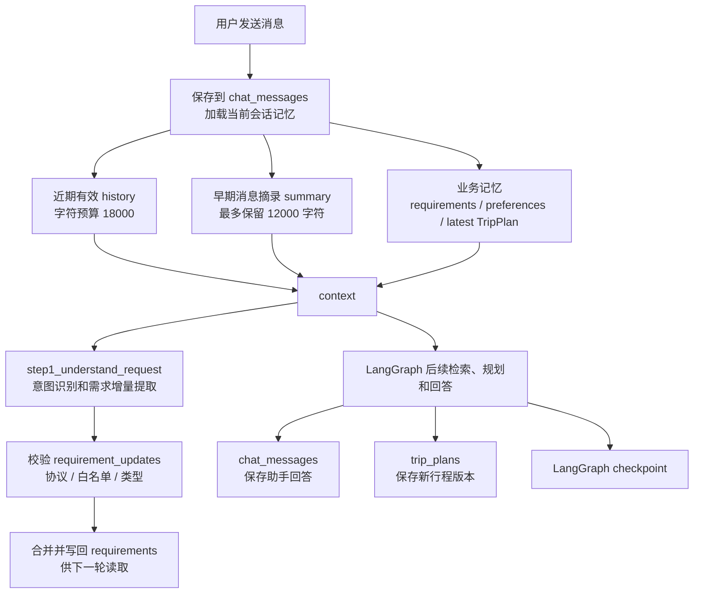

# TripPilot 项目记忆管理机制说明

## 1. 总体设计

TripPilot 没有把全部聊天记录直接塞给大模型，也没有使用一个模糊的“memory 字符串”。准确地说，项目包含 **5 类业务持久记忆、1 个派生上下文窗口和 1 类执行恢复状态**。`history` 是从原始消息实时选出的窗口，不是独立数据库存储；checkpoint 用于恢复程序执行，也不属于用户业务记忆。

| 分类 | 数据项 | 存储或来源 | 作用范围 | 主要用途 |
|---|---|---|---|---|
| 业务持久记忆 | 原始消息 | `chat_messages` | 当前会话 | 展示聊天记录、作为近期上下文的数据源 |
| 业务持久记忆 | 历史摘要 | `travel_sessions.summary` | 当前会话 | 保留超出窗口的早期对话线索 |
| 业务持久记忆 | 结构化旅游需求 | `travel_sessions.requirements` | 当前会话 | 保存目的地、天数、预算、人数等稳定条件 |
| 业务持久记忆 | 用户显式偏好 | `user_preferences` | 当前用户、跨会话 | 保存饮食、住宿、节奏等用户主动设置的偏好 |
| 业务持久记忆 | 行程版本 | `trip_plans` | 当前会话 | 保存最近行程以及历史版本 |
| 派生上下文 | 近期 `history` | 每轮从 `chat_messages` 按 18000 字符预算生成 | 本轮模型调用 | 理解最近几轮对话和指代 |
| 执行恢复状态 | LangGraph checkpoint | PostgreSQL 或 SQLite checkpoint | 当前会话执行线程 | 任务中断恢复和图状态续跑 |

核心原则是：**原始消息负责可追溯，`history` 是原始消息的近期视图，摘要负责保留早期线索，`requirements` 负责本次旅行状态，`preferences` 负责跨会话偏好，`TripPlan` 负责方案版本，checkpoint 只负责执行恢复。**

## 2. 一轮对话中的记忆流程



### 2.1 一次完整多轮对话的记忆存储时序

下面以一个真实多轮咨询为例：

```text
第一轮：我想去北京玩两天
第二轮：两个人，预算三千
第三轮：安排轻松一点，故宫必须保留
第四轮：第二天下午换成室内景点
```

#### 阶段一：创建会话

用户新建对话时，系统创建一条 `ChatSession`：

```json
{
  "summary": "",
  "summary_through": 0,
  "requirements": {},
  "active_run_id": null
}
```

此时没有会话历史、摘要和行程。如果该用户以前显式保存过 `Preference`，这些用户级偏好仍然存在，并会在后续加载上下文时读取。

#### 阶段二：用户消息先落库

用户发送“我想去北京玩两天”后，API 在同一个数据库事务中完成：

1. 写入一条 `role=user`、`status=completed` 的 `Message`；
2. 创建本轮 `ChatRun`；
3. 创建持久化 `WorkItem`；
4. 将 `ChatSession.active_run_id` 设置为本轮运行 ID；
5. 提交事务后投递 Celery 任务。

因此，即使消息队列临时断开，用户原文和待执行工作也已经保存在 PostgreSQL 中，不会因为只存在于 Redis 而丢失。

#### 阶段三：Worker 创建助手消息占位

Worker 领取任务后，把 `ChatRun` 改成 `running`，并创建：

```json
{
  "role": "assistant",
  "content": "",
  "status": "generating"
}
```

这条记录是助手回答的持久化占位。模型流式返回内容时，Worker 约每 0.25 秒把当前文本写回该消息，因此页面刷新或 SSE 重连后仍可恢复已生成部分。

#### 阶段四：组装本轮记忆上下文

进入 `step1_understand_request` 后，系统调用 `step1_load_conversation_context`，一次性组装：

```json
{
  "history": "当前会话最近的有效消息",
  "summary": "被移出近期窗口的早期消息摘录",
  "requirements": "当前会话已经确认的旅行条件",
  "preferences": "当前用户跨会话的显式偏好",
  "previous_plan": "当前会话最近一个行程版本",
  "current_message_id": "本轮用户消息ID"
}
```

第一轮中，`history` 只包含“我想去北京玩两天”，其他会话级记忆为空。

#### 阶段五：提取并保存结构化需求

意图模型输出本轮增量：

```json
{
  "intent": "plan",
  "requirement_updates": {
    "destination": "北京",
    "days": 2
  }
}
```

服务端先执行协议、字段白名单和类型校验，再与原有 `requirements` 合并：

```json
{
  "destination": "北京",
  "days": 2
}
```

合并结果立即写回 `ChatSession.requirements`。它不需要等待整条回答生成结束，因此后续节点检索、规划和预算校验都使用同一份结构化条件。

#### 阶段六：生成回答并完成本轮存储

检索、工具调用和规划结束后，Worker：

1. 将完整回答和引用写入助手 `Message`；
2. 将助手消息状态改成 `completed`；
3. 如果生成了行程，向 `TripPlan` 新增一个版本；
4. 把本轮 `intent`、最终 `requirements`、校验问题和工具结果写入 `ChatRun.result`；
5. 将 `ChatRun` 和 `WorkItem` 改成 `completed`；
6. 清空 `ChatSession.active_run_id`。

LangGraph 同时使用 `session_id` 作为 `thread_id` 保存 checkpoint。它用于恢复节点执行，不代替消息、需求或行程表。

#### 阶段七：下一轮读取并增量更新

第二轮用户说“两个人，预算三千”时，新消息先写入 `chat_messages`。随后上下文加载器读到：

```json
{
  "history": [
    {"role": "user", "content": "我想去北京玩两天"},
    {"role": "assistant", "content": "上一轮回答"},
    {"role": "user", "content": "两个人，预算三千"}
  ],
  "requirements": {
    "destination": "北京",
    "days": 2
  },
  "previous_plan": "上一版北京两日计划"
}
```

模型本轮只需返回：

```json
{
  "travelers": 2,
  "budget": 3000
}
```

最终会话需求变成：

```json
{
  "destination": "北京",
  "days": 2,
  "travelers": 2,
  "budget": 3000
}
```

第三轮“安排轻松一点，故宫必须保留”继续增加：

```json
{
  "pace": "relaxed",
  "locked_activities": ["故宫"]
}
```

第四轮“第二天下午换成室内景点”会同时使用近期 `history`、完整 `requirements` 和 `previous_plan`，因此可以理解“第二天下午”指的是哪一版行程中的哪个时间段。

#### 阶段八：对话变长后压缩旧消息

每一轮开始时，系统从最新消息向前装入近期窗口。超过 18000 字符的早期消息会移出 `history`，按“消息序号 + 角色 + 前 200 字符”追加到 `summary`。

```text
旧消息 ──摘录──> ChatSession.summary
新消息 ──完整保留──> 本轮 history
```

`summary_through` 记录已经压缩到哪条消息。下一轮只处理该序号之后的新消息，避免重复追加。摘要累计最多保留最后 12000 字符。

#### 阶段九：异常内容隔离

不同异常情况的处理方式如下：

| 情况 | 页面是否可见 | 是否进入后续 `history` | 是否进入 `summary` | 是否更新 `requirements` |
|---|---:|---:|---:|---:|
| 正常完成的旅游问答 | 是 | 是 | 超出窗口后会进入 | 仅合并明确更新 |
| 非旅游 `out_of_scope` 问答 | 是 | 否 | 否 | 否 |
| 模型生成失败 | 是 | 用户消息进入，失败的助手消息不进入 | 用户消息以后可以进入，失败的助手消息不进入 | 视失败发生位置而定 |
| 用户取消的助手回答 | 是 | 用户消息进入，被取消的助手消息不进入 | 用户消息以后可以进入，被取消的助手消息不进入 | 视取消发生位置而定 |

失败和取消的助手消息因为状态不是 `completed`，不会被当成可信答案；对应的用户问题已经以 `completed` 状态保存，仍会保留在后续上下文中，便于用户重试或继续补充。非旅游问答则通过 `ChatRun.result.intent` 同时排除用户问题和助手拒答。

需要注意：`requirements` 在意图理解阶段就会写回。如果后续回答生成失败，已经通过校验的需求增量可能仍然保留。这保证下一次重试可以继续使用用户已经明确提供的条件。

#### 阶段十：新会话与删除会话

创建另一个新会话时：

- 不继承原会话的 `history`；
- 不继承原会话的 `summary`；
- 不继承原会话的 `requirements`；
- 不继承原会话的 `TripPlan`；
- 会读取同一用户的 `Preference`。

删除会话时，后台任务删除该会话的消息、运行记录、行程版本和 LangGraph checkpoint，并清空摘要与结构化需求；用户级 `Preference` 继续保留。

## 3. 原始消息记忆

每条用户消息和助手消息都保存到 `chat_messages`：

```text
session_id       属于哪个对话
client_message_id 防止客户端重复提交
seq              会话内顺序
role             user 或 assistant
content          原始内容
citations        引用证据
status           completed / generating / failed / cancelled
```

用户消息提交后立即入库。Worker 开始处理时先创建一条 `generating` 状态的助手消息，流式输出期间每隔约 0.25 秒更新内容，成功后改成 `completed`。

构造下一轮上下文时，只读取 `status == "completed"` 的消息。因此失败或取消的助手输出不会作为可信答案进入后续模型上下文。

## 4. 近期上下文窗口

入口函数是：

```python
step1_load_conversation_context(db, session, current_message_id)
```

它按照消息顺序读取当前会话中尚未摘要的有效消息，然后从最新消息向前选择，默认字符预算为：

```text
TRIP_CONTEXT_CHAR_BUDGET = 18000
```

最终生成的 `history` 形态如下：

```json
{
  "history": [
    {"role": "user", "content": "我想去深圳玩三天"},
    {"role": "assistant", "content": "请问几人出行？"},
    {"role": "user", "content": "两个人，预算五千"}
  ]
}
```

本轮用户消息已经位于 `history` 最后一条，不会额外再拼一个“当前问题”字段。

## 5. 长对话摘要

超出 18000 字符窗口的早期消息不会直接丢弃，而是写入 `ChatSession.summary`。

当前摘要不是再调用一个大模型自由总结，而是使用确定性摘录：

```text
[1 user] 我准备十月去深圳……
[2 assistant] 可以先确认人数和预算……
```

每条旧消息最多摘录前 200 个字符，并保留消息序号和角色。累计摘要只保留最后 12000 个字符，`summary_through` 记录已经处理到的消息序号，避免重复摘要。

这样做的优点是不会让另一个摘要模型把猜测写进用户记忆；限制是特别长的早期内容只能保留摘录，不能保证所有细节都长期存在。

## 6. 结构化旅游需求记忆

自然语言历史适合理解指代，但预算、人数、目的地等条件需要稳定保存。因此项目使用 `ChatSession.requirements` 保存结构化会话状态。

当前允许字段：

| 字段 | 含义 |
|---|---|
| `destination` | 目的地 |
| `departure` | 出发地 |
| `start_date`、`end_date` | 出行日期 |
| `days` | 行程天数 |
| `travelers` | 出行人数 |
| `budget`、`budget_scope` | 预算及预算口径 |
| `pace` | 舒缓或紧凑 |
| `interests` | 兴趣偏好 |
| `diet` | 饮食要求 |
| `hotel_area`、`rooms` | 酒店区域和房间数量 |
| `locked_activities` | 修改行程时必须保留的活动 |

模型每一轮只输出本轮明确变化的 `requirement_updates`。服务端随后执行：

```text
模型输出 requirement_updates
    ↓
字段白名单检查
    ↓
数值、列表、日期、pace 等类型校验
    ↓
过滤与旧值完全相同的字段
    ↓
step2_merge_explicit_requirements
    ↓
写回 ChatSession.requirements
```

未在本轮提及的条件继续沿用；本轮明确提供的新值覆盖旧值。下一轮加载上下文时，会重新从数据库读取完整 `requirements`。

### 示例

第一轮：

```text
用户：我想去北京玩两天。
requirements = {destination: 北京, days: 2}
```

第二轮：

```text
用户：两个人，预算三千。
requirement_updates = {travelers: 2, budget: 3000}
requirements = {destination: 北京, days: 2, travelers: 2, budget: 3000}
```

第三轮即使只说“安排轻松一点”，模型仍然可以从 `requirements` 得知北京、两天、两人和预算三千。

## 7. 切换目的地时如何防止旧记忆污染

如果旧目的地是北京，本轮明确改成西藏，`step3_is_destination_switch` 会识别目的地变化。

项目会清理这些地点绑定字段：

```text
start_date
end_date
days
hotel_area
locked_activities
```

预算、人数、节奏、兴趣和饮食等可以跨目的地复用的条件继续保留；旧的 `previous_plan` 从本轮上下文中移除。如果用户没有重新说明天数，系统会追问新的游玩天数。

## 8. 跨会话长期偏好

`Preference` 表以 `user_id + key` 唯一保存显式偏好，例如：

```json
{
  "diet": "不吃辣",
  "hotel_style": "偏好安静、靠近地铁"
}
```

它与 `requirements` 的差别是：

| 项目 | `requirements` | `preferences` |
|---|---|---|
| 绑定对象 | 会话 | 用户 |
| 是否跨会话 | 否 | 是 |
| 写入方式 | 模型抽取后经协议校验 | 用户通过偏好接口显式保存 |
| 典型内容 | 本次去北京、两天、预算三千 | 长期不吃辣、喜欢安静酒店 |

相关接口：

```text
GET    /api/v1/users/me/preferences
PUT    /api/v1/users/me/preferences/{key}
DELETE /api/v1/users/me/preferences/{key}
```

当前对话不会把模型猜测的性格、经历或偏好自动写入长期偏好表。

## 9. 行程版本记忆

生成成功的计划会保存到 `trip_plans`，每次产生新版本时 `version + 1`。上下文加载阶段读取当前会话最新版本，并放入：

```json
{
  "previous_plan": {}
}
```

因此用户说“第二天换成室内景点”“保留故宫，其他安排轻松一点”时，Agent 可以在上一版计划基础上修改，而不是从零生成。

行程版本与普通聊天摘要分离，避免完整结构化计划被压缩成不稳定的自然语言片段。

## 10. 无关问题为什么不会进入记忆

如果某轮被识别为 `out_of_scope`：

1. 服务端强制把 `tools`、`domains`、`requirement_updates` 和检索词清空；
2. 不更新旅游 `requirements`；
3. 把 `intent=out_of_scope` 写入该轮 `ChatRun.result`；
4. 下一轮构造上下文时，找到所有 `out_of_scope` 运行；
5. 同时排除对应的用户消息和助手拒答消息；
6. 这些消息既不进入近期 `history`，也不进入长期 `summary`。

它们仍可显示在聊天页面中，但不会污染后续旅游对话。

## 11. LangGraph checkpoint 与业务记忆的区别

LangGraph 使用会话 ID 作为：

```python
thread_id = session_id
```

生产环境使用 PostgreSQL `PostgresSaver`，非 PostgreSQL 环境使用 `data/checkpoints.sqlite`。它保存图执行到哪个节点、当前状态是什么，Worker 意外退出后可以继续未完成的运行。

checkpoint 解决的是“任务执行恢复”，不是用户长期记忆。真正决定下一轮模型输入的仍然是：

```text
Message + summary + requirements + Preference + latest TripPlan
```

## 12. 会话删除与记忆清理

删除会话后先把会话标记为 `deleted`，再通过持久化清理任务执行：

```text
删除 LangGraph checkpoint
删除 ChatRun
删除 Message
删除 TripPlan
清空 ChatSession.summary
清空 ChatSession.requirements
```

用户级 `Preference` 不随某个会话删除，因为它属于跨会话长期偏好。用户可以通过偏好删除接口单独删除。

## 13. 一句话理解

```text
chat_messages 负责保存“实际说过什么”
history 负责从原始消息中选出“本轮需要看的最近内容”
summary 负责保留“更早说过什么”
requirements 负责记住“本次旅行条件是什么”
preferences 负责记住“这个用户长期喜欢什么”
TripPlan 负责记住“上一版行程是什么”
checkpoint 负责记住“程序执行到哪里”
```

其中 `chat_messages`、`summary`、`requirements`、`preferences`、`TripPlan` 是会落库的业务记忆；`history` 是每轮动态计算的模型输入；checkpoint 是技术运行状态。这种拆分让记忆可以审计、覆盖、清理和恢复，也能避免把所有历史无边界地交给大模型。
