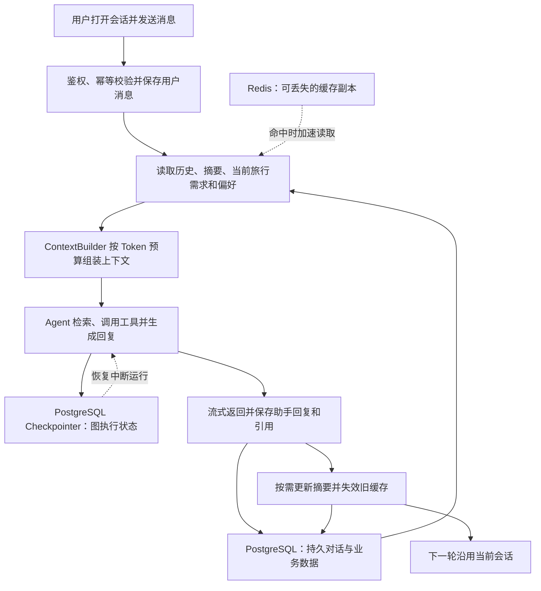
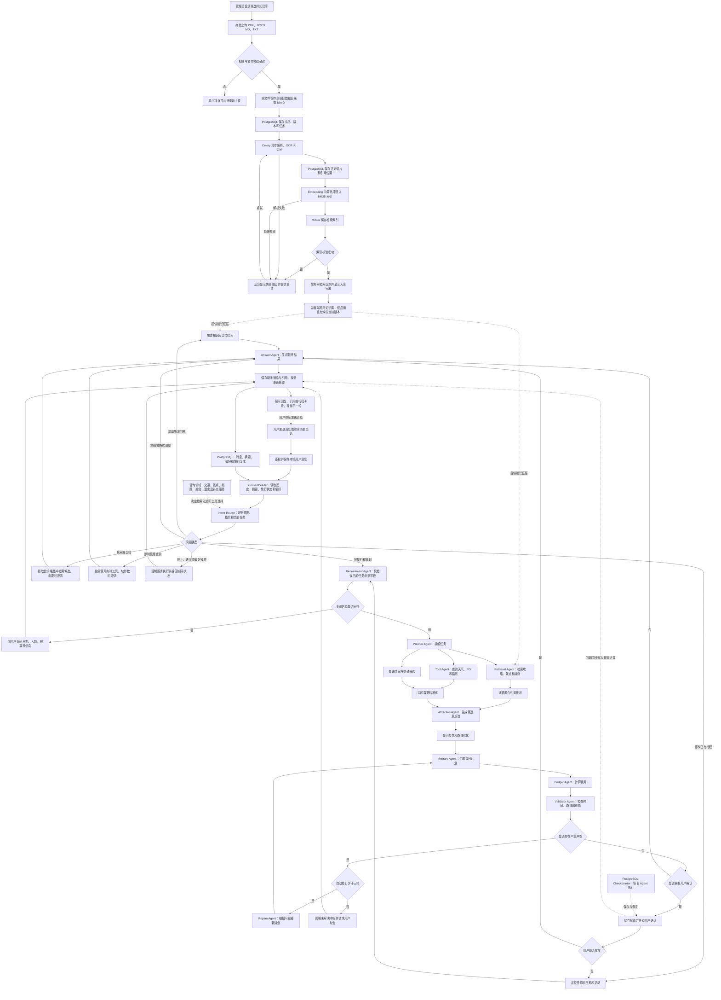

# TripPilot 旅游智能对话助手：Agentic RAG 项目需求大纲

> 文档类型：项目需求与技术设计大纲  
> 适用阶段：求职作品、课程项目、MVP 研发  
> 核心目标：通过持续对话理解并帮助用户完成旅游需求，支持灵感探索、旅游咨询、方案比较、行程规划、行中调整和历史续聊；以 RAG 和实时工具为事实依据。

> 核心咨询范围：交通、景点、线路、美食、酒店五大领域必须全部覆盖，并补充天气季节、预约票务、预算、人群适配、目的地文化和行中服务。具体功能、输入输出和验收见 3.2.2 节。

> 系统组成：管理员知识库后台 + 游客问答与行程规划前台。管理员可以直接拖入文档，系统持久保存原文件并自动完成解析、切分和索引，供游客端 RAG 使用。以下均为待开发的需求设计，不代表功能已经实现。

## 1. 项目概述

### 1.1 项目背景

自由行规划通常需要在攻略网站、地图、天气、酒店和交通平台之间反复切换。传统旅游问答只能给出景点介绍，无法主动补充信息、选择工具、检查行程冲突，也难以在用户修改需求后局部调整计划。

本项目建设一个旅游智能对话助手。用户可以从“周末去哪儿玩”“这个景点值得去吗”等不完整想法开始，逐步明确需求，也可以直接查信息或生成行程。系统需要理解上下文、选择适当的回答方式，按需检索知识、查询实时信息、比较方案、检查约束并调整计划。完整行程规划是助手的一项能力，不能要求每次对话都先填写整套旅行表单。

### 1.2 目标用户

- 国内自由行用户
- 家庭、情侣和朋友出游群体
- 对目的地不熟悉、缺少规划时间的用户
- 希望控制预算、路线强度和行程风险的用户
- 知识库管理员：通过后台上传、查看、更新、停用和删除旅游文档，维护游客端使用的知识内容。

### 1.3 典型场景

用户输入：

> 我从广州出发，国庆去北京玩 4 天，2 个人，预算 6000 元。喜欢历史文化，不想起太早，帮我安排住宿区域和每天的行程。

系统需要提取约束、追问准确日期、查询知识和实时数据、生成候选方案、优化路线、计算费用、检查冲突，并输出每天的时间表、交通、预算、预约事项和证据来源。

### 1.4 项目范围

MVP 支持国内单城市 1～7 天自由行，包括需求澄清、旅游问答、景点推荐、多日行程、天气与路线查询、住宿区域建议、预算估算、冲突检查和局部重规划。多城市联程、真实下单、支付、签证及出入境政策作为后续功能。

用户端以聊天为统一入口。MVP 必须覆盖交通、景点、线路、美食、酒店五类资料咨询，并支持目的地未定时的候选推荐、知识问答、方案比较、连续追问、约束修改、历史续聊、行程保存和行中建议。跨城市候选可以比较，但多城市联程排程属于后续功能。首版支持文字输入；图片、语音和游客附件作为扩展，界面不显示尚未支持的入口。所有数值指标均为设计目标，需开发完成后实测验收。

管理员端属于 MVP 必做范围：后台登录、创建知识库、拖拽批量上传、原文件持久保存、异步解析入库、状态查看、文档与切片预览、失败重试、更新版本、启停删除、检索测试。游客端使用管理员发布的公共知识库；游客私有附件上传作为后续独立功能。

## 2. Agentic RAG 的业务闭环

首先建设知识入库链路：管理员登录 → 选择知识库 → 拖入文档 → 原文件持久保存 → 解析和切分 → 生成向量与关键词索引 → 检查入库结果 → 发布可检索版本。文件上传成功只表示原文件已保存；处理状态达到 `READY` 且版本已发布，才表示可以用于 RAG。

传统 RAG 的主要链路是“检索资料 → 生成回答”。本项目增加自主决策和执行闭环：

1. 识别本轮意图、上下文指代及当前旅行任务。
2. 提取本轮所需信息，仅对阻塞当前任务的缺失条件追问。
3. 选择直接回答、知识检索、实时工具、方案比较或行程规划；多任务再按需拆解。
4. 汇总证据，生成候选景点和初始行程。
5. 使用确定性规则与算法校验时间、距离和预算。
6. 发现严重冲突后自动重新规划，最多执行三轮。
7. 涉及关键取舍时暂停并等待用户确认。
8. 保存最终结果，支持后续局部修改。

## 3. 功能需求与实现设计

本章按照实际使用者分为**管理端**、**用户端**和**其他共用支撑模块**。管理端负责把旅游资料变成可检索知识；用户端以对话完成旅游咨询和行程；共用模块提供任务编排、检索和实时数据能力。以下均为待开发的需求设计。

### 3.1 管理端：知识库与内容维护

管理员在后台完成知识库创建、文档拖入、原文件持久保存、异步入库、检索测试、版本更新与停用删除。以下保留操作、数据位置、状态、接口和开发顺序的详细设计。


#### 3.1.1 实际业务场景

管理员准备好《北京景点预约指南.pdf》《北京地铁出行攻略.docx》《亲子景点推荐.md》，登录后台，进入“知识库管理 → 北京旅游知识库”，将三个文件拖入上传区域，填写城市、分类和资料来源，点击“开始上传并入库”。

系统先保存原文件，随后后台任务解析文档、生成切片与向量。管理员可以关闭页面，稍后回来查看处理结果。处理成功的文档显示“可检索”，游客问“北京有哪些适合亲子的景点”时，系统就能召回这些文档中的片段，回答并标注文件名和页码或章节。

#### 3.1.2 后台页面与操作

| 页面 | 管理员看到的内容 | 必须实现的操作 |
|---|---|---|
| 管理员登录 | 账号、登录状态 | 登录、退出；后台接口校验管理员身份 |
| 知识库列表 | 名称、描述、文档数、可检索文档数、更新时间 | 创建知识库、编辑名称描述、进入知识库 |
| 文档上传 | 拖拽框、待上传列表、城市、分类、来源、有效期 | 拖入多个文件、点击选文件、移除未上传文件、开始入库 |
| 文档管理 | 文件名、大小、上传人、版本、处理状态、是否启用、切片数 | 搜索筛选、查看详情、更新文件、重试、启停、删除 |
| 文档详情 | 原文件入口、解析文本、切片、处理日志、错误原因 | 下载原文件、查看文本和切片、重新处理 |
| 检索测试 | 测试问题、召回片段、文件名、页码或章节、得分 | 指定知识库和 Top K，验证新文档能否被检索 |

页面布局示意：

```text
管理员后台 / 知识库管理 / 北京旅游知识库

[文档列表] [上传文档] [检索测试] [知识库设置]

城市：北京    分类：旅游攻略    来源：管理员填写
资料发布日期：[可选]    有效期：[可选]

┌──────────────────────────────────────────────┐
│ 将 PDF、DOCX、MD、TXT 拖到这里，或点击选择文件 │
│ 单个文件最大 20 MB；每批最多 10 个             │
└──────────────────────────────────────────────┘
[开始上传并入库]

文件名               传输进度   入库状态     操作
北京景点预约指南.pdf    100%     正在解析     查看进度
北京地铁出行攻略.docx   100%     可检索       详情 / 停用
亲子景点推荐.md         100%     处理失败     原因 / 重试
```

#### 3.1.3 上传规则与前端实现

- 第一版支持 `.pdf`、`.docx`、`.md`、`.txt`；旧版 `.doc` 提示先转成 DOCX 或 PDF。网页导入、独立图片和其他格式作为扩展。
- 单文件 20 MB、每批 10 个、并发上传 3 个作为项目初始限制，前后端配置保持一致。
- 采用 Vue 3 + Element Plus 的 `el-upload`，开启 `drag`、`multiple`，设置 `auto-upload=false`。管理员选好文件和元数据后再统一提交。
- 每个文件独立发起一次请求，携带同一 `batch_id`；一个文件失败不回滚其他已上传文件。
- 自定义 `http-request` 使用 XMLHttpRequest 上报真实字节传输进度；传输完成后改为显示服务端处理阶段，不把上传 100% 当作索引完成。
- 前端轮询任务状态，每 2 秒一次；页面关闭不取消已入队任务，重新进入时从服务端恢复状态。
- 浏览器负责辅助检查格式和大小，后端再次校验实际文件内容、大小和知识库权限。后端生成存储路径，原始文件名只用于展示。

Element Plus 支持点击和拖拽上传及自定义上传请求，具体属性以官方文档为依据：[Upload 组件](https://element-plus.org/en-US/component/upload.html)。上述大小、数量和轮询间隔属于本项目的设计值。

#### 3.1.4 文档具体保存在哪里

“把文档存入项目”需要同时保存原文件、管理记录、解析切片和检索索引。管理员通过网页完成上传，无须手工复制到服务器。

| 保存内容 | 保存位置 | 用途 |
|---|---|---|
| 原始 PDF、DOCX、MD、TXT | 本地开发默认使用项目 `data/knowledge/`；部署可切换 MinIO | 长期保存、下载、重新解析 |
| 文件和版本记录 | PostgreSQL | 文件名、存储标识、知识库、上传人、哈希、版本、状态 |
| 解析文本和结构信息 | 与原文件同一存储后端的 `parsed/` | 预览、保留页码章节、排查解析问题 |
| 切片正文及元数据 | PostgreSQL `knowledge_chunks` | 文本审查、引用定位、索引重建 |
| 切片文本副本、Dense 向量、BM25 字段 | Milvus | 混合检索；通过 `chunk_id` 关联原文 |
| 任务和错误记录 | PostgreSQL `ingestion_jobs` | 页面状态、重试次数和失败原因 |
| 任务消息 | Redis/Celery | 调度后台任务；业务状态以 PostgreSQL 为准 |

建议的本地开发目录如下，仅为规划路径，本次更新需求文档不会创建这些运行数据：

```text
D:/codex_pro/RAG/data/knowledge/
  <knowledge_base_id>/
    <document_id>/
      <version_id>/
        original/source.pdf
        parsed/document.json
        parsed/content.md
```

上传时通过 `StorageService.save()` 统一写入，下载通过 `StorageService.open()` 读取。配置 `STORAGE_BACKEND=local` 时使用以上目录；设为 `minio` 时改用对象存储，数据库保存 `bucket/object_key`。同一次上传只使用一个选定后端，不强制同时保存两份。

本地数据目录加入 `.gitignore`；Docker 部署将数据目录挂载到持久卷，不能只保存于容器临时层。原文件和 PostgreSQL 需要备份，Milvus 索引可基于已保存切片重建。

#### 3.1.5 后端入库处理流程

| 顺序 | 实现模块 | 输入与处理 | 输出及完成条件 |
|---|---|---|---|
| 1 | 管理员上传接口 | 校验身份、知识库、文件大小与类型 | 合法上传请求 |
| 2 | StorageService | 流式保存原文件并计算 SHA-256；检查同库重复文件 | 存储标识、大小、哈希 |
| 3 | DocumentService | 创建文档、版本、任务记录和待投递事件 | `document_id`、`version_id`、`job_id` |
| 4 | 任务派发器 | 持久任务事件投递 Celery；失败可重试投递 | 后台任务已排队 |
| 5 | ParserService | PDF 用 PyMuPDF，DOCX 用 python-docx，MD/TXT 读取文本；扫描 PDF 进入 OCR | 带页码或章节的解析结果 |
| 6 | ChunkService | 清洗、按标题与长度切分；继承城市、来源和有效期 | PostgreSQL 切片记录 |
| 7 | EmbeddingService | 批量生成 Dense 向量；记录模型、维度和切分配置版本 | 每个切片对应的向量 |
| 8 | IndexService | 按稳定 `chunk_id` upsert Milvus，建立 Dense 与 BM25 检索字段 | 当前版本的可查询索引 |
| 9 | PublishService | 核验非空文本、切片数、索引数及检索可见性 | 版本设为 `READY`，更新当前发布版本 |

FastAPI 接口使用 `UploadFile` 接收文件，使用 `Form` 接收 `knowledge_base_id`、城市、分类等元数据，请求为 `multipart/form-data`，不能把这些字段当作同一请求的 JSON Body。需要安装 `python-multipart`。[FastAPI 文件上传](https://fastapi.tiangolo.com/tutorial/request-files/)、[表单与文件组合](https://fastapi.tiangolo.com/tutorial/request-forms-and-files/)

接口在原文件和任务记录持久保存后返回 `202 Accepted`，解析和向量化由 Celery 执行。数据库事务无法包住磁盘或 MinIO 写入，因此失败时清理无记录的临时文件，并通过待投递事件补偿队列投递失败。

扫描 PDF 的 OCR 作为后台解析能力，采用 PaddleOCR；无法提取有效文本、加密文件或解析异常返回具体原因。不得以“零切片”状态发布成功。无页码的文件使用标题路径和段落号定位。

#### 3.1.6 状态、发布和重试

文件传输进度归前端上传任务管理；服务端处理状态单独记录：

```text
STORED → QUEUED → PARSING → CHUNKING → EMBEDDING → INDEXING → READY
                        任一处理阶段失败 → FAILED → 重试相应任务
```

- 文档另设 `enabled` 和 `deleted_at`，版本另设 `active_version_id`。处理成功、启用和未删除同时满足，才可进入生产检索。
- 新文档默认在处理成功后自动发布；管理员可随时停用。更新旧文档时，旧版持续可用，新版 READY 后再切换当前版本。
- 每个任务展示 `stage`、`processed_chunks`、`total_chunks`、`error_code`、`error_message`。总片段数未知时只显示阶段，不伪造精确百分比。
- 同一知识库内相同哈希返回“文件已存在”及已有文档 ID。同名但内容不同需要选择“作为新文档”或“更新原文档”，不直接覆盖。
- 用户重试时保留原文件，按 `version_id + processing_revision` 控制任务幂等，稳定切片 ID 避免重复向量。
- 任务执行过程中重新检查删除和停用状态；已删除文档的迟到任务不得重新发布内容。

#### 3.1.7 文档管理与删除规则

| 操作 | 管理员效果 | 后端处理 |
|---|---|---|
| 查看原文 | 打开 PDF 或下载原文件 | 受权限控制的文件接口；DOCX 提供下载和解析文本预览 |
| 查看切片 | 看到每段正文、页码、章节、字符数 | 查询 PostgreSQL 切片表 |
| 更新文档 | 上传修订后的文件 | 新建版本并处理，成功后切换发布版本 |
| 停用 | 文档暂时不参与问答 | 更新启用状态并失效相关检索缓存 |
| 重建索引 | 使用已有文件重新解析或向量化 | 创建新的处理版本，成功后切换 |
| 删除 | 列表移除且不能被新请求使用 | 先逻辑删除并使缓存失效，再异步清理原文件、切片与向量 |

PostgreSQL 是知识库授权、启用和版本状态的权威来源。检索先限定知识库，再对召回片段复核当前版本、启用与删除状态，过滤后不足时继续补召回。不能仅凭 Milvus 中“仍有向量”认定文档可用。生成前再次检查证据是否有效，避免异步删除期间的新回答引用已停用内容。

#### 3.1.8 与用户端 RAG 的连接

管理员上传并发布《北京亲子景点推荐.md》后，游客提出问题，`RetrievalAgent` 在已授权知识库内查询已发布版本。返回的每段证据包含 `knowledge_base_id`、`document_id`、`version_id`、`chunk_id`、文件名、页码或章节和正文。

LLM 根据这些证据组织回答，引用跳转到权限允许的文档片段。管理员上传资料默认标为 `admin_upload`，不能仅凭上传行为自动授予“官方来源”或最高可信度。来源类型和有效期需要管理员填写与核实。

上传资料中的文字是待引用的知识内容，不得作为修改 Agent 权限或执行工具的系统指令。引用接口只返回用户有权查看的内容，不暴露服务器磁盘路径。

#### 3.1.9 本模块开发顺序

1. 建立知识库、文档、版本、切片和任务表，完成管理员接口鉴权。
2. 实现本地 StorageService、上传和下载，让管理员先能拖入文件并持久保存。
3. 实现 Celery 任务、解析、切分和处理状态查询。
4. 接入 Embedding、Milvus Dense/BM25 索引与发布校验。
5. 完成文档列表、切片预览、检索测试、重试与版本更新。
6. 将 RetrievalAgent 接到已发布知识库，打通上传文档到带引用回答的闭环。
7. 完成停用删除、权限过滤、缓存失效和重启恢复验收。

### 3.2 用户端：旅游智能对话助手

用户通过一个对话入口咨询交通、景点、线路、美食和酒店，也可探索目的地、比较方案、生成或修改行程。会话历史、已确认需求和偏好贯穿多轮对话。以下按用户实际使用顺序组织功能。

#### 3.2.1 对话历史、上下文与长期记忆

##### 3.2.1.1 业务场景与存储结论

用户第一轮说：“两个人去北京玩四天，预算六千元。”第二轮说：“第二天安排轻松一点。”系统应能根据同一会话的历史与已保存行程，识别“第二天”指北京行程第二天，保留人数和预算，仅修改对应活动。刷新页面、关闭浏览器或服务重启后，应仍能继续该对话。

本项目明确采用 **PostgreSQL 持久保存历史消息、摘要、用户偏好和 Agent 检查点；Redis 只做可丢失缓存；每轮调用模型前由 ContextBuilder 组装上下文**。上下文是本次交给模型的数据集合，历史消息存在数据库里并不意味着模型自动读取了它。

| 数据类别 | 具体内容 | 存在哪里 | 如何使用 |
|---|---|---|---|
| 会话列表 | 会话名称、所属用户、创建时间、当前行程 | PostgreSQL `travel_sessions` | 左侧历史会话列表、权限判断 |
| 原始聊天记录 | 用户消息、助手回复、引用和消息状态 | PostgreSQL `chat_messages` | 展示历史、恢复上下文、定位原话 |
| 当前会话摘要 | 已确认需求、未解决问题、重要决策 | PostgreSQL `conversation_summaries` | 长对话时压缩早期内容 |
| 当前旅行状态 | 日期、人数、预算、锁定景点、当前行程版本 | PostgreSQL `travel_requests`、`trip_plans` | 作为当前有效约束参与规划 |
| Agent 执行状态 | 当前节点、工具结果、待确认事项、运行消息 | PostgreSQL 中由 LangGraph Checkpointer 管理的表 | 中断恢复、人工确认和任务继续 |
| 跨会话偏好 | 喜欢历史景点、通常少步行等用户明确保存的偏好 | PostgreSQL `user_preferences` | 新会话中提供可覆盖的默认偏好 |
| 热上下文缓存 | 最近消息、摘要和结构化约束的缓存副本 | Redis | 降低读取延迟，缓存失效后回源数据库 |
| 管理员旅游知识 | 上传攻略、景点资料的检索索引 | Milvus，原文按 3.1 节保存 | 给回答提供旅游事实证据 |

MVP 不把聊天历史写入管理员公共知识库。聊天历史用于理解用户，旅游知识库用于提供事实证据；用户的历史推测和模型旧回答不能自动成为已验证的旅游事实。

##### 3.2.1.2 用户界面要求

- 左侧提供“新建对话”和历史会话列表，支持重命名、删除与分页加载。
- 点击会话后，根据 `session_id` 从服务器读取历史消息；刷新时恢复当前会话。
- 消息区展示用户消息、助手回复、引用与生成中、已完成、失败或已取消状态。
- 输入框支持连续追问；停止生成后保留已接收内容并显示“已停止”，不能作为完整答案展示。
- “我的偏好”页面支持查看、修改和删除已保存偏好；“新建对话”清空当前旅行上下文，但可读取用户选择保留的长期偏好。
- Pinia 管理当前页面状态，浏览器本地最多保存当前会话 ID 和草稿；历史消息以服务器为准。

##### 3.2.1.3 一轮对话的实际读写顺序

1. 前端发送 `session_id`、`client_message_id` 和本轮 `content`。用户身份由后端从登录态取得，不能信任前端传入的 `user_id`。
2. 后端检查会话归属，利用 `(session_id, client_message_id)` 唯一约束防止重发产生重复消息；在一个业务事务中保存用户消息、创建本轮运行记录与待处理任务。
3. ContextBuilder 读取该会话已完成的历史轮次、有效摘要、最新需求和行程，以及与本次任务有关的用户偏好；失败或中断的助手输出只作为带状态的记录，不默认视为已确认结论。
4. 组装本轮上下文，提取并合并最新用户约束。例如“预算改成八千”覆盖原来的六千，同时记录来源消息和需求版本。
5. LangGraph 执行检索、工具、规划和回答节点，Checkpointer 持久化运行状态。将消息 ID、运行 ID、行程版本关联起来。
6. 助手回复通过 SSE 输出；服务端定期保存部分输出。生成完成后保存完整回复、引用、Token 用量与完成状态，再发 `completed` 事件。
7. 完成后按长度阈值更新早期对话摘要、递增会话上下文版本并失效缓存。下一轮读取更新后的数据。

追问、澄清和用户确认也都是对话消息，需要写入 `chat_messages`，不能只保存在图中的临时变量里。所有入口，包括行程修改和确认接口，都必须经过同一会话服务记录用户操作。

##### 3.2.1.4 每轮交给模型的上下文

```text
系统指令与可用工具说明
+ 当前有效旅行需求与行程摘要
+ 相关的用户长期偏好
+ 早期会话摘要
+ 摘要之后的最近完整对话轮次
+ 本轮用户消息
+ 本轮节点需要的知识库证据和实时工具结果
```

采用模型实际 Token 计数控制输入长度：`历史可用预算 = 模型上下文上限 - 最大输出预留 - 系统与工具说明 - 当前需求及本轮问题 - 检索和工具结果预留 - 安全余量`。最近 10 轮可作为初始候选窗口，最终按 Token 预算裁剪，不是固定把全部历史拼接进去。

摘要保存 `covered_through_seq`，只总结已经完成的消息前缀。上下文使用“摘要 + 序号大于覆盖边界的原始消息”，避免重复计算。摘要更新失败继续使用旧摘要和后续消息；不能先删除原文。需要精确原话时按消息 ID 回查历史。

当前明确指令优先于同一字段的旧需求和长期偏好。例如用户本次说“想走紧凑路线”，覆盖“平常喜欢轻松”的默认偏好。金额、日期、人数、锁定活动以有来源和版本的结构化需求为准，不靠摘要猜测。若这些必要信息本身超出上下文预算，需拆分任务或澄清，不能直接裁掉。

工具结果只保留本节点需要的字段，并保留来源和查询时间。旧聊天里的天气、价格或库存到期后必须重新查询，不能因为“有历史记忆”就当作当前值。

##### 3.2.1.5 LangGraph 检查点与聊天记录的分工

本项目使用 `langgraph-checkpoint-postgres` 的 `AsyncPostgresSaver` 保存图状态；数据库连接采用 `psycopg` 异步连接池，启动时完成受控的表结构初始化。具体表结构由组件管理，文档中的 `agent_checkpoints` 仅是逻辑类别，不要求开发者手写一张同名表替代它。

LangGraph 的 Checkpointer 按 `thread_id` 保存会话范围内的状态；跨会话信息需要独立的长期存储。本项目选择业务表 `user_preferences` 存用户偏好，由 MemoryService 调用，不额外重复维护一份 Store 偏好库。[LangGraph 持久化说明](https://docs.langchain.com/oss/python/langgraph/persistence)、[数据库持久化记忆示例](https://docs.langchain.com/oss/python/langgraph/add-memory)

后台生成全局唯一 `graph_thread_id` 并存入 `travel_sessions`，同一会话的续聊与恢复使用该 ID；`run_id` 表示其中某一轮执行。不能用 `user_id` 作为 `thread_id`，否则同一用户不同对话会混在一起。读取检查点前同样校验会话归属，ID 本身不是权限凭证。

`chat_messages` 是面向产品的完整消息记录；检查点是恢复 Agent 执行所需的状态。为避免重复拼接，本项目在新轮开始时构建独立 `context_messages` 字段并整体替换；工具交互使用本轮独立的 `working_messages`。恢复中断运行时沿用检查点内容，不重新提交整段历史。若使用 `add_messages` reducer，必须按稳定消息 ID 更新，不能把数据库全量历史再追加一遍。

##### 3.2.1.6 长期偏好如何写入与修改

- 用户明确说“记住我喜欢历史景点”，或在偏好页面保存时，写入 `user_preferences`，记录来源消息、更新时间和适用范围。
- “这次预算六千、十月一日出发”保存为当前旅行需求，不能自动成为所有旅行的默认设置。
- 推断出的偏好可暂用于本次会话；需要跨会话保存时让用户确认。自动画像作为后续扩展，MVP 先实现明确保存的偏好。
- 用户删除偏好后更新偏好版本、失效缓存，并使检查点中旧的偏好副本在下一次上下文构建时失效。
- 删除偏好不会改写用户可见的旧聊天，但上下文过滤该项已撤回偏好；除非用户再次明确提出，不能从旧历史或旧摘要自动恢复它。

##### 3.2.1.7 缓存、并发、恢复与删除

Redis 热上下文建议缓存 30 分钟，键包含用户、会话、`context_revision` 与 `preference_revision`，例如 `chat:context:{user_id}:{session_id}:{context_revision}:{preference_revision}`。缓存过期或 Redis 不可用时回源 PostgreSQL，不能导致历史丢失。上述 TTL 是初始项目配置。

同一会话同时只允许一轮会修改方案的 Agent 运行，通过数据库运行状态和唯一约束控制。进度查询和取消走控制接口，不等待原生成结束；新修改请求由前端保留为待发送草稿，提示“停止当前生成并使用新要求”，用户选择后先取消旧运行再提交。发生竞争时后端返回 409，前端保留输入，不能静默丢消息。处于等待确认状态时，明确确认接口向原运行提交结果；自然语言补充或异议先记录，再判断是恢复当前流程还是重新规划。

业务消息写入与框架检查点写入不是同一事务，因此用 `run_id`、稳定消息 ID 和幂等完成写入对账。崩溃后检查未完成运行：能从检查点恢复则继续；不能安全恢复时标记中断并允许重试。不能因重试重复插入用户消息或完整回复。

删除会话先将其标记为不可访问，取消正在运行的任务，再清理消息、摘要、缓存、检查点与会话专属派生数据。迟到任务写回前复核会话状态，防止已删除聊天再次出现。独立保存的行程和长期偏好分别提供管理入口，删除对话时说明其保留范围。日志、追踪和备份中的副本按明确保留期限清理，不能宣称单删消息表即已清除全部副本。

##### 3.2.1.8 对话记忆流程图



#### 3.2.2 旅游咨询：五大核心领域与补充能力

##### 3.2.2.1 范围与统一处理要求

交通、景点、线路、美食、酒店均为必做咨询领域，每类至少实现资料问答、条件筛选、候选比较、上下文追问和加入或修改行程。首版不能仅支持景点问答和行程生成，忽略餐饮、住宿和交通咨询。

每次回答按用户问题选择详细程度。涉及推荐时，说明推荐理由和匹配条件；涉及事实时，附对应来源；涉及价格、班次、营业或可订状态时，说明查询时间与是否核实。没有实时供应商的领域仍可提供知识资料、参考建议和官方查询入口，但不得标为实时库存服务。

##### 3.2.2.2 交通咨询

**用户可以问：**

- 广州到北京坐飞机还是高铁合适？总耗时与预算差多少？
- 到机场后怎么去酒店？夜间还有哪些交通方式？
- 从当前景点去下一个景点怎么走？哪个换乘少、步行少？
- 带老人和行李适合公交、打车还是包车？
- 从机场落地到下一班车之间的时间够不够？

**输入：** 出发地、目的地、日期、起终点、交通偏好；涉及接驳时增加落地时间、航站楼或站点、取行李和步行缓冲。根据问题按需询问，不强制每次补全全部字段。

**实现：** 知识库提供机场车站介绍、交通卡、换乘规则等资料；地图工具提供地理编码与城市内路线。城际交通通过独立供应商适配器查询，接口未接入时返回交通方式比较和官方入口。比较耗时必须包含到站、等候、换乘与抵达后交通，不能只比较车辆行驶时间。

**输出：** 交通方案、起终点、分段方式、预计时长、换乘次数、步行距离、费用类型、末班或接驳风险、来源。缺少可靠班次或运行状态时标记待核验，不承诺赶得上。

**追问示例：** “换个便宜点的”“不想换乘”“晚上十点还有吗”沿用原起终点，更新对应条件再查询。

##### 3.2.2.3 景点咨询

**用户可以问：**

- 某景点有什么看点、值得去吗、需要玩多久？
- 开放时间、闭馆日、预约方式、门票和优惠规则是什么？
- 附近有哪些适合带孩子、老人或雨天游玩的景点？
- 两个景点只能选一个，哪个更适合我的偏好？
- 有没有无障碍通道、寄存或休息设施？

**输入：** 景点名称或城市区域、兴趣和同行人群；涉及开放与预约时需要游玩日期。通过标准 POI ID 和别名表解决同名景点、简称、错别字与跨城市歧义。

**实现：** 混合检索召回景点介绍、建议时长和规则；地图确认位置，官方公告核验临时变更。按兴趣、时间、距离和可访问性筛选候选；“网红”“热门”等资料标签不能替代对用户的适配判断。

**输出：** 景点简介、匹配理由、建议停留时间、位置、开放与预约信息、门票口径、适用人群、来源和更新时间。无障碍、优惠条件等细节没有证据时明确未知。

**追问示例：** “那个要预约吗”“附近还能去哪”“换成免费的”必须关联到当前景点或候选集合。

##### 3.2.2.4 线路咨询

**用户可以问：**

- 半天、一日或多日怎么安排顺路？
- 这些景点怎样排序，能不能安排成步行或自驾线路？
- 博物馆、美食、拍照、亲子主题线路怎么选？
- 我已经去了第一个景点，剩下的路线怎么改？
- 下雨了、堵车了、起晚了，还能保留哪些活动？

**输入：** 起终点、可用时间、必去与排除点、交通方式、强度偏好；完整执行方案增加抵离窗口与日期。

**实现：** 先从知识库与 POI 获取候选，再用地图耗时、开放时间窗、用餐与休息缓冲编排。基础版本采用规则与启发式排序，高级版本使用 OR-Tools。旅游线路指一天或多天的活动安排，交通路线指两个地点之间如何移动，两者的数据与输出需要区分。

**输出：** 活动顺序、时间段、停留时长、各段交通、总移动时间、费用、备选活动和待确认项。行中修改以当前时间和已完成活动为边界，避免安排已经过去的时间段。

**追问示例：** “少走一点”“把美食安排在晚上”“第二天留半天自由活动”，生成变更说明并保留旧版本。

##### 3.2.2.5 美食与餐饮咨询

**用户可以问：**

- 当地有哪些特色菜、小吃、伴手礼或美食街？
- 景点或酒店附近有什么适合两个人、预算一百元的餐厅？
- 不吃辣、素食、带孩子或者需要清真饮食有什么选择？
- 哪家适合午餐，哪家晚上还营业，需要预约吗？
- 两家店如何比较，能顺路加入行程吗？

**输入：** 城市或附近位置、菜系和口味、人数、预算口径、用餐时间；用户提出饮食限制时记录其适用范围。

**实现：** 知识库检索地方菜系、食俗和美食街资料；餐饮 POI 工具搜索位置与基本信息；营业时间、人均消费和预约能力从已接入的商户或供应商数据获取。评分、评价和推荐语保留平台及日期，不能编造评价，也不能将“人均参考消费”当作固定套餐价。

**输出：** 推荐菜品或餐厅、地址、距当前位置的距离、预算类型、营业与预约核验情况、适配理由、行程衔接建议和来源。没有餐厅实时数据时可先推荐街区和菜品，说明具体商户信息待确认。

**边界：** 食物过敏不能仅依赖菜名或评论判断安全。对用户明确过敏原，保留限制并建议向商户确认食材及交叉接触情况；不承诺某餐厅一定安全。

**追问示例：** “不要辣的”“就选第二家”“能安排在故宫后面吗”，分别更新筛选条件、选中餐厅或触发行程局部修改。

##### 3.2.2.6 酒店与住宿咨询

**用户可以问：**

- 第一次去北京住哪个区域方便，各区域有什么区别？
- 离地铁近、适合带孩子、安静一点的酒店怎么选？
- 两晚预算八百元，有哪些合适的选择？
- 两家酒店离景点、机场或车站哪个更方便？
- 能提前入住、寄存行李、加床吗？退订政策是什么？

**输入：** 城市、入住和离店日期、房间数、住客数、每晚或全程预算、位置与设施偏好。住宿晚数根据入住离店日期计算，不能直接使用旅行天数代替。

**实现：** 知识库提供住宿区域特点和选择建议；地图确认酒店 POI、位置和通勤成本；实时供应商按日期、房型、入住人数和价格方案返回价格与库存。仅凭地图能找到酒店不能说明该酒店当晚可订。

**输出：** 推荐区域或酒店、位置、到主要活动区域的交通、房型和入住限制、每晚及总费用口径、税费是否包含、早餐和取消规则、查询时间和来源。未知税费或退改条件明确列为待确认，不默认免费取消。

**追问示例：** “换个便宜的”“住三晚呢”“把酒店换到东城区”，沿用当前入住条件并重查价格和受影响路线。库存与价格只代表查询时点，MVP 提供官方或供应商跳转，不代替真实预订。

##### 3.2.2.7 补充旅游能力

| 补充领域 | 用户需求 | 实现与结果要求 |
|---|---|---|
| 天气与季节 | 穿什么、是否适合户外、雨天怎么玩 | 实时预报与历史季节特点分开；超出预报范围明确说明 |
| 门票与预约 | 预约入口、提前多久、优惠条件、改退规则 | 优先官方规则；具体日期库存需实时供应商，未核验不保证有票 |
| 预算与消费 | 总预算怎么分、哪部分可以省、两方案差多少 | 明确人数、天数、晚数、币种及是否含大交通，代码计算费用 |
| 人群适配 | 亲子、老人、独行、行动不便 | 结合步行、休息、设施和兴趣筛选；未验证设施注明未知 |
| 文化与节庆 | 当地习俗、博物馆背景、近期活动 | 常识用知识库；具体活动日期及取消信息查实时官方来源 |
| 行前准备 | 预约清单、证件、行李、充电和通信 | 按已确定行程生成清单，避免把通用建议表述成强制规则 |
| 行中服务 | 寄存、厕所、服务中心、药店等附近设施 | 用户提供或授权位置后查 POI，不声称已获取未授权定位 |
| 购物与伴手礼 | 特色产品、方便购买的区域 | 提供品类和地区建议，价格与营业状态按证据标注 |
| 无障碍和休息安排 | 少台阶、轮椅通行、休息点 | 优先具体设施资料，未知处提示向场所核实 |
| 旅行复盘 | 整理去过的地点、实际花费和下次注意事项 | 根据用户提供的真实经历整理，不补造到访记录 |

##### 3.2.2.8 跨领域对话与组合任务

示例：“住在王府井，明天下午去博物馆，晚上想吃不辣的，怎么安排比较顺？”系统需要识别酒店位置、具体日期、博物馆对象、餐饮偏好和下午至晚间时间窗口。博物馆未明确时先澄清；明确后分别查询开放规则、路线与餐厅候选，再组合输出活动顺序和费用。

不要求用户分别进入五个表单或重新描述背景。酒店、餐厅和景点统一使用可定位的实体 ID，活动类型区分 `attraction`、`meal`、`transport`、`hotel_checkin`、`rest`。更新酒店后重算相关出行段，选中餐厅后只重算相邻活动和时间窗。

对话路由应同时输出“任务意图”和“旅游领域”：`intent=compare_plan`、`domains=[hotel, transport]` 可以表示比较两个酒店的交通便利性。无需为每种组合建立一个 Agent；共享知识检索、工具调度、条件筛选和回答节点即可。

##### 3.2.2.9 五大领域数据与工具映射

| 领域 | 知识库资料 | 工具/业务服务 | 统一结果对象 |
|---|---|---|---|
| 交通 | 站点介绍、交通方式、换乘说明 | geocode、route_query、transit_query；intercity_search 为待接入适配器 | TransportOption |
| 景点 | 介绍、开放与预约规则、人群适配 | poi_search、ticket_search、官方公告查询 | AttractionInfo |
| 线路 | 主题线路、参考攻略 | ItineraryService、route_query、Validator | ItineraryPlan |
| 美食 | 菜系、特色菜、美食区域 | restaurant_search；使用餐饮 POI 或已接入商户数据 | RestaurantOption |
| 酒店 | 住宿区域、设施与选择建议 | hotel_search、route_query；无价格接入时仅返回基础资料 | HotelOption |

所有结果对象携带 `entity_id`、`source_refs`、`fetched_at`、`valid_until`、`verification_status` 和 `missing_fields`。价格对象额外保存 amount、currency、unit、price_type、适用日期及人数房数；没有证据的字段返回 null，不补默认值。

管理员上传时分类扩展为交通、景点、线路、美食、酒店、天气季节、票务、文化和综合攻略；一份文档可有多个标签，切片继承并补充其主题。原始 metadata 需要记录城市、实体名称、资料适用日期及来源，支持按领域召回。

##### 3.2.2.10 必做验收对话

| 验收场景 | 通过条件 |
|---|---|
| “机场到酒店怎么走”→“少换乘” | 保留起终点并重新比较方案；未接入班次时不造班次 |
| “介绍这个景点”→“明天要预约吗” | 关联同一景点并核验适用日期规则，未知时明确提示 |
| “安排一天”→“下午少走路” | 对受影响线路调整并校验时间，保留已锁定活动 |
| “附近有什么好吃的”→“不吃辣，人均一百” | 保留位置，更新口味与预算筛选，参考消费标签正确 |
| “住哪里方便”→“两个人，两间房，住三晚” | 不把人数误当房间数，不把天数误当晚数；价格未接入时说明 |
| “比较两家酒店，哪家去景点方便” | 综合酒店资料和交通结果给比较依据 |
| “换了酒店，晚饭还去原来那家” | 更新相关路线并保留已选餐厅，不重新随机推荐 |
| “帮我订酒店和门票” | 明确当前只能提供查询与跳转，不返回虚假订单 |
| 五类资料各上传一份后连续咨询 | 各领域都能命中文档并引用正确来源，跨领域追问不串对象 |

#### 3.2.3 对话场景、状态与响应策略

##### 3.2.3.1 交互目标与优先级

助手应先解决用户当前提出的旅游问题，并在需要时推进到下一步。每轮展示与问题匹配的结果：短问短答、比较给出差异、行程使用卡片或时间线，存在决定性不确定项时提出简短问题。

P0 必做：管理员入库、登录与会话历史、知识问答、意图路由、上下文理解、需求澄清、实时查询降级、初始行程、修改与版本管理、来源引用和基本评测。P1 在 P0 跑通后补齐：高级候选评分、OR-Tools 优化、自动画像、多城市联程及多模态。用户明确保存的少量偏好属于 P0，自动推断画像属于 P1。

##### 3.2.3.2 场景决策表

| 用户情况与示例 | 系统应如何处理 | 输出与状态变化 |
|---|---|---|
| 寒暄：“你好” | 简短介绍能帮助的旅游事项，邀请描述想法 | 不检索、不强制创建旅行任务 |
| 目的地未定：“周末想出去散散心” | 问出发地和可接受出行范围；已在当前需求中确认的信息不重复问 | 给少量候选及理由，状态为探索 |
| 信息很少：“北京怎么玩” | 先给玩法方向；需要具体行程时再问天数、偏好 | 允许先提供有用内容，避免连续填表 |
| 简单问答：“故宫在哪” | 提取景点并检索位置资料；名称有歧义才追问城市 | 简洁回答和来源，不问人数预算 |
| 完整需求：“北京四天，两人六千元” | 提取字段，识别预算范围及抵离信息等真正缺口 | 可先给示意安排，缺日期时标记日期未定 |
| 一轮多问：“查天气，再推荐雨天景点” | 拆成有依赖的子任务，能并行的并行 | 分条回答；天气不可得时仍可提供通用雨天选项 |
| 连续追问：“那个要预约吗” | 根据最近提到的景点解析指代 | 唯一对象直接查询；多个对象时问具体哪一个 |
| 对比：“北京和西安哪个更适合带老人” | 按用户关注维度比较，缺条件时说明假设 | 比较步行强度、交通和兴趣，不直接宣判唯一答案 |
| 否定推荐：“不喜欢这些，再换一批” | 记录本轮排除候选，追问或从理由识别偏好 | 新候选避开已拒绝项，不自动写长期画像 |
| 修改条件：“预算改成八千” | 生成需求变更集，确定作用于当前旅行 | 更新预算版本并重算受影响部分 |
| 模糊修改：“第二天轻松一点” | 根据当天步行、交通和活动数调整；必要时询问最想保留的活动 | 给修改前后差异，保留未受影响日期 |
| 自相矛盾：“只有两天，又必须去十个远距离景点” | 运行约束检查，明确冲突和可选取舍 | 不输出不可执行方案，不擅自删必去项 |
| 撤销：“还是按刚才那个方案” | 查找最近方案版本，目标不唯一时澄清 | 创建引用旧方案内容的新版本，保留审计记录 |
| 换目的地：“不去北京了，去成都” | 替换目的地并失效景点与路线；人数预算可保留但说明沿用 | 天气、交通、开放时间重新查询 |
| 插入另一话题：“顺便问下杭州有什么好吃的” | 暂时回答副话题，不改当前北京行程 | 主旅行任务保持，记录临时话题对象 |
| 新旅行：“下个月再安排一趟杭州” | 新建旅行任务，显式切换 active_trip_id | 不将北京景点合并进杭州方案 |
| 返回旧计划：“继续刚才的北京方案” | 根据历史定位旅行任务和版本 | 恢复对应需求，已过期实时信息重新获取 |
| 不想回答：“你先推荐吧” | 采用可撤销、低影响的显式假设 | 输出参考方案；未知日期、票价不伪装已确认 |
| 询问进度：“还要多久” | 查询运行阶段，独立于 LLM 长任务 | 返回实际阶段；没有统计依据不编造剩余秒数 |
| 暂停或取消：“先停一下” | 记录控制意图，取消或暂停可恢复任务 | 保留已有消息，未完成方案标为草稿 |
| 工具失败：“查不到路线怎么办” | 尝试有限重试和可用备用源 | 明确哪些已知、哪些未核验，不把直线距离当交通耗时 |
| 信息找不到：“这个新开的景点要预约吗” | 检索改写一次并尝试授权实时搜索；仍无证据则说明未知 | 提供官方核查入口，不补造规则 |
| 数据冲突：“官网和攻略说的不一样” | 比较来源权威性、日期、适用条件 | 展示冲突并以适用的较新官方信息为优先；无法判断则标记待确认 |
| 超出预报范围：“三个月后会下雨吗” | 检查供应商可查询日期范围 | 不给确定天气；可提供明确标为历史季节特点的资料 |
| 要求订票：“帮我订两张” | 识别交易意图与当前能力范围 | MVP 提供官方入口和所需步骤，不声称下单成功 |
| 途中变化：“现在下雨了，我在景点门口” | 用户提供或授权获取当前位置、当前时间，重新评估剩余行程 | 给可达替代活动，不改已完成活动 |
| 纠正助手：“不是两个人，是三个” | 以最新用户明确纠正更新字段，必要时指出费用影响 | 更新人数和费用，不反复沿用旧摘要 |
| 询问记忆：“你记得我的预算吗” | 从当前旅行结构化需求读取并注明适用行程 | 若未提供则明确说未记录，不猜测 |
| 要求记住或忘记偏好 | 调用 MemoryService 更新用户偏好并清除缓存 | 确认具体保存或删除的内容 |
| 无关问题或超出支持范围 | 简洁说明能力边界并允许回到旅游问题 | 不强行召回不相关旅游资料 |

##### 3.2.3.3 澄清策略与动态字段要求

| 任务 | 最少需要的信息 | 可以延后确认的信息 |
|---|---|---|
| 景点知识问答 | 明确问题与对象；歧义时需要城市 | 出行人数、预算、日期 |
| 目的地探索 | 出发地或大致区域、时间长度或出行半径 | 精确日期、住宿标准 |
| 两个目的地比较 | 两个对象、主要比较维度 | 实时交通价未知时可先做体验层面对比 |
| 天气查询 | 地点、查询日期 | 人数与预算 |
| 城市内路线 | 起终点、交通方式；特定班次还需日期时间 | 兴趣偏好 |
| 初步多日安排 | 目的地、天数 | 未定日期可生成标注未核验营业日的草案 |
| 可执行行程与总预算 | 目的地、日期、抵离窗口、人数、预算范围、已确定住宿或交通 | 未决定事项需明确列出待定项 |
| 局部修改 | 当前方案、修改对象与希望改变的内容 | 不重复询问已确认且未受影响条件 |

通常每轮只问 1～2 个影响最大的缺失条件。能先回答的部分先回答，问题后给可选方向；用户拒绝补充时允许停留在参考建议阶段。明确区分总预算与人均预算、是否含大交通和住宿、房间数与人数、旅行天数与住宿晚数。

“下周五”“十一”按用户时区和请求时间归一化，回复展示具体日期；存在年份或出发日期歧义时澄清。过去日期区分回顾咨询与未来规划，不自动改成年份不同的新日期。

##### 3.2.3.4 对话与旅行状态

对话容器、旅行任务和运行任务分别管理：`session_id` 表示聊天窗口，`trip_id` 表示一趟旅行，`run_id` 表示一次正在执行的请求。同一会话可讨论多个旅行任务，通过 `active_trip_id` 确定当前操作对象。

建议状态字段：

```text
DialogueState
  session_id, active_trip_id, run_id
  primary_intent, secondary_intents
  phase: exploring / clarifying / answering / planning /
         awaiting_user / revising / completed
  requirements, requirement_revision
  current_plan_version, locked_activity_ids
  mentioned_entities, rejected_candidates
  pending_question, pending_action
  assumptions, unresolved_conflicts
  context_revision, last_processed_message_id
```

`mentioned_entities` 帮助解析“那个景点”；`pending_question` 记录上一轮到底问了什么，避免把“可以”“两个人”当作独立新问题；`pending_action` 保存待确认操作、目标版本、选项和有效期。没有明确待确认对象时，单独一句“可以”不能触发实际操作。

任务有新进展时只给用户显示业务状态，例如“正在核对开放时间”“正在调整第二天”。不显示模型内部推理过程。对话状态由规则与结构化模型输出共同驱动，不能用 LLM 一句话替代服务端授权、版本和任务状态校验。

##### 3.2.3.5 需求合并、修改范围与方案版本

每个需求字段记录 `value`、`source_message_id`、`scope`、`confirmed` 和 `updated_at`。合并优先级为本轮明确纠正 → 当前旅行已确认需求 → 用户长期偏好默认值；系统假设优先级最低。对于重要冲突，应澄清而不是猜测覆盖。

修改节点输出 `ChangeSet`：目标旅行、基础方案版本、更新字段、受影响日期和活动、可保留内容。影响范围举例：

- 只改第二天下午景点：更新该活动及前后路线，校验当天与全程预算。
- 改人数：更新住宿和交通需求、按人收费项目与总费用，不必重查无关历史介绍。
- 改日期：重新检查开放日、预约、天气可用性和价格；原日期数据失效。
- 改目的地：重新召回当地知识、景点和交通，旧目的地活动不可保留。
- 仅改变回答格式：“简单点”：重新组织已有结果，不重跑所有工具。

每次成功改动生成新 `plan_version`；提交带 `base_plan_version`，版本已变化时返回冲突并刷新方案，避免多个页面覆盖修改。用户锁定活动若与新要求冲突，说明原因并询问取舍；未获同意不得自动移除。

##### 3.2.3.6 证据、工具与输出约束

问答路由按问题判断是否需要证据：寒暄、文本格式调整可直接处理；景点规则从知识库检索；实时状态通过工具查询；混合问题结合两者。检索设置有效来源过滤、有限查询改写和无答案出口；召回分数的阈值需要数据集调参，不能把未校准的分数当事实置信度。

天气、交通和酒店适配器返回 `status`、`data`、`source`、`fetched_at`、`valid_until`、`supported_date_range` 和 `error_code`，让上层区分查询成功、部分成功、暂无数据、不支持和超时。地图能力不能代替门票库存或酒店真实成交价；只有已获授权、完成联调的供应商才能标为实时接入，演示数据必须标识。

回复统一携带 `answer_type`、`content`、`citations`、`assumptions`、`unknowns`、`follow_up_question`、`trip_id` 和 `plan_version`。可核验事实附来源，估算费用标明口径与时间；有引用链接不等于已证实，需检查引用片段是否支持对应结论。过期证据不能直接重复使用。

健康、签证、极端天气等影响出行的重要问题优先查询适用官方来源。若用户描述正在发生的人身危险，优先建议联系当地紧急服务和现场人员，不继续常规景点推荐。不向用户承诺没有工具证据支持的安全状况、预订状态或价格。

##### 3.2.3.7 MVP 用户端页面

| 页面或组件 | 必做内容 |
|---|---|
| 对话主页 | 会话列表、输入框、连续追问、流式回复、停止生成、失败重试 |
| 旅行需求摘要 | 当前目的地、日期、人数、预算口径；区分已确认与假设，支持修改 |
| 推荐与比较卡片 | 候选理由、差异、引用、选择或排除入口 |
| 行程卡片 | 每日时间线、费用、待确认项、局部修改、锁定活动、保存方案 |
| 来源详情 | 文件名、页码章节或网页、有效时间、对应片段 |
| 我的行程 | 保存的旅行、方案版本、重新打开并继续讨论 |
| 我的偏好 | 用户明确保存的偏好，支持修改与删除 |

##### 3.2.3.8 本模块实现顺序

1. 先实现会话、消息、旅行任务和运行记录，打通用户发消息到助手回复持久保存。
2. 实现 ContextBuilder、历史摘要和当前旅行状态读取，验收刷新续聊和跨会话隔离。
3. 实现 IntentRouter、指代解析、字段提取和需求合并，再增加动态澄清。
4. 接入已发布知识库和实时工具，完成直接问答、检索问答、工具查询三类出口。
5. 增加候选推荐、方案比较、行程生成与校验，再实现修改影响分析和版本管理。
6. 补齐中途取消、工具失败、无证据、冲突和撤销场景，使用多轮脚本验收。

#### 3.2.4 多轮需求收集

##### 功能要求

系统需要从自然语言中提取以下信息：

| 字段 | 示例 | 要求 |
|---|---|---|
| 出发地 | 广州 | 涉及出发交通、周边游或全程预算时需要 |
| 目的地 | 北京 | 生成指定目的地行程时需要；探索推荐时可为空 |
| 开始日期 | 2026-10-01 | 查询具体日期信息或生成可执行日历行程时需要 |
| 结束日期或天数 | 4 天 | 多日行程需要其中一种；计算后校验一致性 |
| 出行人数 | 2 人 | 总费用、房间数和人群适配时需要 |
| 总预算 | 6000 元 | 建议填写 |
| 同行人员 | 情侣、老人、儿童 | 建议填写 |
| 兴趣偏好 | 历史文化、美食 | 建议填写 |
| 出行强度 | 轻松、均衡、紧凑 | 建议填写 |
| 交通偏好 | 地铁优先、少步行 | 可选 |
| 住宿偏好 | 三星级、地铁附近 | 可选 |
| 特殊限制 | 无障碍、饮食禁忌 | 可选 |

##### 实现方式

使用 Pydantic 定义统一状态对象，LLM 通过结构化输出填写字段：

```python
class TravelRequest(BaseModel):
    departure_city: str | None
    destinations: list[str]
    start_date: date | None
    end_date: date | None
    travelers: int | None
    total_budget: float | None
    interests: list[str]
    travel_pace: Literal["relaxed", "balanced", "intensive"]
    transport_preference: list[str]
    accommodation_preference: dict
    special_requirements: list[str]
```

`RequirementAgent` 按当前意图检查所需字段，规则详见 3.2.3 节。知识问答不要求日期和人数；目的地未定时先帮助探索。用户表达“不要太贵”等模糊条件时保留为待确认项，不擅自填写金额。用户修改条件后，系统更新会话状态并标记受影响的日期和活动。该模型是字段示意，工程实现需补充用户时区、预算币种与范围、抵离时间、来源消息 ID、字段确认状态和需求版本。

#### 3.2.5 意图识别与任务路由

##### 支持的意图

- `travel_qa`：景点、城市和交通知识问答
- `create_trip`：创建完整行程
- `modify_trip`：修改已有行程
- `compare_plan`：比较多个方案
- `budget_query`：查询或调整预算
- `realtime_query`：天气、路线、开放状态等实时查询
- `destination_explore`：目的地未定时探索和推荐
- `trip_status`：询问正在执行任务的进度或当前方案
- `conversation_control`：新话题、撤销修改、取消、继续和清除本次条件
- `preference_manage`：保存、修改或撤回长期偏好
- `social_or_out_of_scope`：寒暄或与旅游无关的问题

##### 实现方式

`IntentRouter` 先接收 ContextBuilder 提供的上下文，输出主要意图、次要意图、目标行程 ID、指代对象、待澄清字段和建议下一步。意图分类分数只能辅助判断，不视为经过校准的概率；存在多个合理解释且会影响结果时，才询问用户。明确的暂停、取消、确认操作先走控制处理；简单问答进入直接回答或检索，完整规划进入任务规划，修改请求进入影响范围分析。

#### 3.2.6 景点候选生成

`AttractionAgent` 根据兴趣、知识证据、开放时间、天气、距离和预算生成候选池。示例评分：

```text
候选得分 =
0.30 × 兴趣匹配度
+ 0.20 × 检索相关度
+ 0.15 × 来源可信度
+ 0.15 × 路线便利度
+ 0.10 × 天气适配度
+ 0.10 × 预算适配度
```

权重保存在配置中心，支持通过离线评测和用户反馈调整。用户标记“必去”的景点设置 `user_locked=true`，后续重规划不得自动删除。

#### 3.2.7 行程生成与路线优化

##### 每日输出

- 活动起止时间和建议停留时长
- 景点顺序、坐标和区域
- 景点间交通方式、距离和预计耗时
- 午餐、晚餐和休息时间
- 当日预计费用
- 天气提醒与雨天备用方案

##### 硬约束

- 景点闭馆或到达时间晚于停止入园时间
- 同一时间安排多个活动
- 路程耗时导致无法按计划到达
- 总费用超过用户预算且未提示
- 加入用户明确排除的活动
- 不满足老人、儿童或无障碍等明确限制

##### 软约束

- 单日步行过多
- 连续安排多个高强度景点
- 用户不喜欢早起但安排过早
- 景点之间距离较远
- 用餐、休息时间不合理

##### 实现方式

1. 根据经纬度对景点聚类，同一天尽量安排同一区域。
2. 将开放时间转换成可访问时间窗。
3. 通过地图 API 获得真实路线耗时矩阵。
4. 使用贪心算法生成初始路线。
5. 使用 OR-Tools 求解带时间窗的路线与活动顺序。
6. LLM 根据算法结果生成自然语言说明和当地文化提示。
7. `ValidatorAgent` 再次执行确定性校验。

LLM 负责理解偏好、选择候选和解释方案；代码规则与 OR-Tools 负责时间、距离、费用和路线计算，避免让模型凭语言感觉计算行程。

#### 3.2.8 预算管理

预算按城际交通、住宿、门票、市内交通、餐饮和预留资金拆分。每笔价格注明数据类型：实时查询价、官方固定价、历史参考价或系统估算价。

```python
remaining_budget = (
    total_budget
    - intercity_transport_cost
    - hotel_cost
    - ticket_cost
    - local_transport_cost
    - food_cost
)
```

超出预算时，`BudgetAgent` 依次尝试调整住宿区域或等级、替换高价交通方案、替换兴趣匹配较低的收费景点、缩减低优先级活动。仍无法满足时说明最低可行预算和差额，不伪造低价。

#### 3.2.9 行程校验与反思

`ValidatorAgent` 返回结构化校验结果：

```json
{
  "is_valid": false,
  "score": 72,
  "issues": [
    {
      "type": "opening_hours_conflict",
      "day": 2,
      "activity": "故宫",
      "severity": "high",
      "reason": "计划到达时间晚于可入园时间",
      "suggestion": "调整到上午"
    }
  ]
}
```

校验内容包括日期、营业时间、路线时间、重复景点、单日强度、预算、天气适配、特殊人群要求、用餐休息和引用完整性。存在严重问题时返回规划节点，最多自动重规划三次；三次后仍失败则输出问题和需要用户决定的取舍。

#### 3.2.10 用户确认与局部重规划

以下情况进入人工确认节点：

- 最终候选方案选择
- 需要超过原预算
- 需要删除用户锁定的必去景点
- 需要使用信息不足的替代方案
- 未来接入下单后，执行任何预订或支付

LangGraph 保存检查点并暂停执行，收到用户选择后从当前状态继续。用户修改“第三天下午换成室内景点”时，只重新检索第三天下午候选、查询路线、重排第三天、重算费用并校验第三天，其余日期保持不变。

#### 3.2.11 结果展示

最终结果包含：

- 行程概要和住宿区域建议
- 每日时间轴与地图路线
- 交通方式和预计耗时
- 预算明细和剩余金额
- 天气、预约和携带物品提醒
- 雨天或闭馆备用方案
- 数据查询时间、引用来源和待确认事项

建议统一返回结构：

```json
{
  "trip_summary": {},
  "accommodation_advice": [],
  "daily_itineraries": [],
  "budget_summary": {},
  "weather_summary": [],
  "booking_checklist": [],
  "alternative_plans": [],
  "citations": [],
  "warnings": []
}
```

### 3.3 其他：共用支撑模块

以下能力为管理端入库和用户端对话共同依赖的服务实现，单列说明其职责和技术边界；它们不是额外面向用户的独立页面。

#### 3.3.1 任务规划 Agent

`PlannerAgent` 根据用户目标生成有依赖关系的任务列表。例如完整行程可拆成目的地知识检索、天气查询、景点召回、住宿区域分析、路线查询、日程编排、预算计算和方案校验。

```json
{
  "goal": "生成北京四日自由行计划",
  "tasks": [
    {"id": "t1", "type": "retrieve_knowledge", "depends_on": []},
    {"id": "t2", "type": "query_weather", "depends_on": []},
    {"id": "t3", "type": "search_poi", "depends_on": ["t1"]},
    {"id": "t4", "type": "build_itinerary", "depends_on": ["t2", "t3"]},
    {"id": "t5", "type": "validate_itinerary", "depends_on": ["t4"]}
  ]
}
```

没有依赖关系的任务通过 `asyncio.gather()` 并行执行。每个任务记录状态、输入、输出、错误和重试次数，便于恢复和观测。

#### 3.3.2 旅游知识库与混合检索

##### 知识内容

- 城市和景点介绍
- 开放时间、闭馆日、预约规则和门票说明
- 建议游玩时长和最佳季节
- 当地交通、住宿区域和餐饮文化
- 机场车站接驳、主题线路、特色菜、美食街、酒店基础资料与设施说明
- 景区官方网站、旅游局资料
- 管理员通过后台拖拽上传的攻略、PDF 和旅游笔记；游客私有附件独立规划

##### 文档元数据

```json
{
  "document_id": "doc_001",
  "chunk_id": "chunk_015",
  "city": "北京",
  "poi_name": "故宫博物院",
  "category": "景点",
  "source_type": "official",
  "source_url": "https://example.com",
  "published_at": "2026-01-10",
  "valid_until": "2026-12-31",
  "trust_level": 5,
  "content": "..."
}
```

##### 入库流程

1. 管理员进入知识库拖拽上传 PDF、DOCX、Markdown、TXT；网页导入作为扩展。
2. 文档解析并去除菜单、广告和重复段落。
3. 根据标题和语义切分 Chunk，建议每段 400～800 个中文字符，保留 80～120 字重叠。
4. 提取城市、景点、类别、日期、来源等元数据。
5. 生成 Dense Embedding。
6. 切片正文存入 PostgreSQL，切片文本副本与检索向量写入 Milvus；原文件已在上传阶段存入本地目录或配置的 MinIO。
7. 核验切片和索引可查询后发布版本，保存有效期和处理状态。完整管理员操作与落库规则见 3.1 节。

##### 检索流程

1. `QueryRewriteAgent` 将上下文问题改写成独立查询。
2. 提取城市、景点、日期和主题过滤条件。
3. Dense 向量检索召回语义相近内容，Top 30。
4. BM25 召回景点名、线路号等精确内容，Top 30。
5. 使用 RRF 融合，保留 Top 20。
6. 使用 BGE Reranker 精排，保留 Top 8。
7. 根据来源等级、发布时间和有效期过滤。
8. 将 5～8 条高质量证据交给生成节点。

稳定知识进入向量库；天气、票价、库存、临时闭馆等易变信息通过实时工具查询。每条关键结论保存 `source_url`、`retrieved_at` 和证据片段，以便前端显示来源。

#### 3.3.3 实时工具调用

| 工具 | 主要输入 | 主要输出 | 用途 |
|---|---|---|---|
| `weather_query` | 城市、日期 | 温度、降雨、天气 | 调整室内外活动 |
| `poi_search` | 城市、关键词 | POI、坐标、类别 | 搜索景点和设施 |
| `geocode` | 地址 | 经纬度 | 统一地理位置 |
| `route_query` | 起终点、交通方式 | 距离、耗时、路线 | 检查移动成本 |
| `transit_query` | 城市、起终点 | 公交地铁方案 | 城市内交通规划 |
| `ticket_search` | 景点、日期 | 价格、预约状态 | 门票和预约提醒 |
| `hotel_search` | 城市、日期、预算 | 酒店候选 | 住宿推荐 |
| `restaurant_search` | 位置、菜系、人数、预算、用餐时间 | 餐饮 POI、参考消费、营业核验状态 | 美食筛选与顺路用餐 |
| `intercity_search` | 城际起终点、日期、偏好 | 班次或交通候选、价格类型、查询状态 | 供应商接入后的城际查询 |
| `web_search` | 查询词 | 最新网页证据 | 临时公告和政策 |

工具统一使用 Pydantic 定义参数和返回值。单次调用超时建议 5～10 秒，失败自动重试两次；天气缓存 30 分钟、POI 缓存 24 小时、路线缓存 10 分钟。无法获得关键实时数据时，结果必须标记“待用户确认”，不能把估算值表述为实时结果。

上述是设计工具合同，功能是否可用以适配器的 capability 配置和实际接入为准。票务、城际班次、酒店库存及商户营业数据没有正式可用接口时返回 `unsupported` 或 `unverified`，由助手给出资料咨询或官方核查入口，不能使用模拟数据冒充实时结果。
## 4. Agent 与节点划分

| Agent/节点 | 业务职责 | 输入 | 输出 |
|---|---|---|---|
| ConversationService（服务） | 管理消息、会话归属、控制操作和运行状态 | 本轮消息、登录用户 | 已持久保存的消息与运行记录 |
| ContextBuilder（服务） | 读取历史与偏好并按预算组装上下文 | 会话和当前旅行 | 模型输入上下文 |
| MemoryService（服务） | 更新摘要和用户明确保存的偏好 | 已完成对话、偏好操作 | 摘要版本和偏好记录 |
| Requirement Agent | 提取需求并检查缺失字段 | 用户消息、历史对话 | `TravelRequest` |
| Intent Router | 识别问答、规划、修改等意图 | 结构化需求 | 路由结果 |
| Planner Agent | 拆解任务并安排依赖关系 | 用户目标 | `TaskPlan` |
| Retrieval Agent | 查询旅游知识库 | 检索问题和过滤条件 | 证据列表 |
| Tool Agent | 调用天气、地图等外部服务 | 工具参数 | 实时数据 |
| Attraction Agent | 生成和筛选候选景点 | 偏好、证据、实时数据 | 候选池 |
| Itinerary Agent | 生成每日活动安排 | 候选池和约束 | 初始行程 |
| Budget Agent | 计算费用并提出调整 | 行程和价格 | 预算报告 |
| Validator Agent | 检查时间、路线和预算 | 完整方案 | 校验报告 |
| Replan Agent | 修复冲突或局部调整 | 原方案、问题列表 | 修订方案 |
| Answer Agent | 组织可读结果和引用 | 方案和证据 | 最终回答 |

这些角色作为 LangGraph 节点实现即可，不需要为每个 Agent 单独部署服务。管理员文档入库使用独立的 Celery 处理流水线，文件保存和索引成功与否通过实际存储结果校验；完成发布后再为 Retrieval Agent 提供数据。

## 5. 总流程图



## 6. 技术栈详细设计

### 6.1 后端与 Agent 编排

| 技术 | 用途 | 选择原因 |
|---|---|---|
| Python 3.12 | Agent、RAG、算法和接口开发 | AI 生态完整，适合异步工具调用 |
| FastAPI | REST API、SSE、鉴权、参数校验 | 原生支持异步，配合 Pydantic |
| Pydantic v2 | Agent State、工具参数和结果模型 | 强类型校验，减少 LLM 输出失控 |
| LangGraph | 节点路由、循环、检查点和人工确认 | 适合有状态 Agent 工作流 |
| LangChain | 模型、Prompt、Retriever 和 Tool 封装 | 降低不同模型与工具适配成本 |
| HTTPX | 调用地图、天气、酒店等 API | 支持异步、连接池和超时控制 |
| SQLAlchemy + Alembic | 会话、消息、知识管理及行程的数据库访问和迁移 | 统一业务表事务与版本演进；检查点表由 LangGraph 组件管理 |
| Celery + Redis | 文档解析、向量化、导出等任务 | 将耗时任务移出 API 请求 |
| SSE | 输出规划过程和最终文本 | 实现简单，适合服务端单向流式推送 |
| OR-Tools | 带时间窗路线优化 | 对路线、时间和容量约束进行确定性求解 |

### 6.2 模型层

| 功能 | 推荐方案 | 说明 |
|---|---|---|
| 主推理模型 | Qwen、DeepSeek 或 OpenAI 模型 | 负责规划、反思和结果生成 |
| 快速模型 | 小参数指令模型 | 负责意图识别、需求抽取和查询改写 |
| Embedding | BAAI/bge-m3 | 适合中文和多语言旅游内容 |
| Reranker | BAAI/bge-reranker-v2-m3 | 对混合召回结果精排 |
| 本地模型服务 | vLLM | 提供 OpenAI 兼容接口和连续批处理 |
| 输出约束 | JSON Schema + Pydantic | 保证 Agent 与工具之间的字段稳定 |

模型服务通过环境变量配置，避免将密钥和地址写入代码：

```env
LLM_BASE_URL=
LLM_API_KEY=
PLANNER_MODEL=
FAST_MODEL=
EMBEDDING_MODEL=BAAI/bge-m3
RERANKER_MODEL=BAAI/bge-reranker-v2-m3
```

### 6.3 数据与存储

| 数据类型 | 推荐组件 | 具体用途 |
|---|---|---|
| 用户、行程、费用 | PostgreSQL | 结构化业务数据和事务 |
| 会话与聊天记录 | PostgreSQL | travel_sessions、chat_messages，支持刷新和历史续聊 |
| 历史摘要与长期偏好 | PostgreSQL | conversation_summaries、user_preferences，由 MemoryService 管理 |
| Dense/BM25 索引 | Milvus | 语义与关键词混合检索 |
| 会话和接口缓存 | Redis | 缓存、限流、任务队列；历史记录以 PostgreSQL 为准 |
| Agent 检查点 | AsyncPostgresSaver + psycopg | langgraph-checkpoint-postgres 保存会话范围内图状态，支持中断恢复 |
| 原始文档与解析产物 | 本地数据目录 / MinIO | StorageService 选择后端；开发默认项目 data/knowledge，部署可用 MinIO |
| 知识库管理与切片 | PostgreSQL | 文档、版本、切片正文、发布状态和任务记录 |
| 调用链与 Prompt | Langfuse | 模型输入输出、Token、耗时和评分 |
| 指标链路 | OpenTelemetry | 统一 Trace、Metric 和 Log |
| 可选知识图谱 | Neo4j | 多城市、区域和景点关系查询 |

MVP 使用 PostgreSQL、Milvus、Redis 和本地持久化文件存储；原文件存储可通过配置切换 MinIO。只有出现稳定的多跳关系查询需求后再引入 Neo4j。

### 6.4 前端

| 技术 | 用途 |
|---|---|
| Vue 3 + TypeScript | 页面与交互 |
| Element Plus | el-upload 拖拽多文件上传，以及文档表格、状态标签、表单和时间线 |
| XMLHttpRequest | 自定义上传请求并跟踪文件传输进度 |
| Pinia | 会话、行程和筛选条件状态 |
| 高德地图 JS API | 景点标点与路线展示 |
| ECharts | 预算和活动类型统计 |
| EventSource | 接收 SSE 规划事件 |
| Markdown Renderer | 展示回答、提醒和引用 |

### 6.5 工程、测试与部署

| 技术 | 用途 |
|---|---|
| Docker Compose | 本地启动应用和中间件 |
| Nginx | HTTPS、静态文件和反向代理 |
| pytest | Agent 节点、工具适配器和 API 测试 |
| GitHub Actions 或 GitLab CI | 自动测试和镜像构建 |
| Prometheus + Grafana | QPS、耗时、错误率和资源监控 |
| Sentry | 前后端异常追踪 |
| RAGAS + 自定义评测 | 检索、忠实度和任务完成质量评估 |

## 7. 核心数据模型

### 7.1 知识库与入库数据模型

| 表 | 关键字段 | 职责 |
|---|---|---|
| `knowledge_bases` | id、name、description、visibility、created_by | 管理知识库与访问范围 |
| `knowledge_documents` | id、knowledge_base_id、title、active_version_id、enabled、deleted_at | 管理文档与当前有效版本 |
| `knowledge_document_versions` | id、document_id、original_filename、sha256、size_bytes、storage_backend、storage_key、parsed_key、city、category、source_type、source_url、published_at、valid_until、uploaded_by、status、processing_revision、embedding_model、embedding_dimension、chunk_config_version | 保存每次上传版本、来源与处理配置 |
| `knowledge_chunks` | id、version_id、chunk_index、content、page_start、page_end、heading_path、char_count | 保存切片和引用位置；版本与片段序号唯一 |
| `ingestion_jobs` | id、version_id、stage、processed_chunks、total_chunks、attempts、error_code、error_message、created_at、finished_at | 持久记录异步处理进度 |
| `ingestion_outbox` | id、job_id、event_type、delivered_at、retry_count | 保证任务记录提交后可重试投递队列 |

Milvus 每条记录以 `chunk_id` 为主键，包含 `knowledge_base_id`、`document_id`、`version_id`、`city`、`text`、`dense_vector` 和 BM25 检索字段。向量维度必须匹配实际 Embedding 输出；更换模型或维度时重建版本及匹配的索引，不能混用不同向量空间。

### 7.2 对话历史与记忆数据模型

| 表 | 关键字段 | 约束与用途 |
|---|---|---|
| `travel_sessions` | id、user_id、title、graph_thread_id、active_trip_id、context_revision、created_at、updated_at、deleted_at | graph_thread_id 唯一；所有读写校验 user_id |
| `chat_messages` | id、session_id、run_id、seq、client_message_id、role、content、citations、status、created_at | session_id 与 seq 唯一；用户消息幂等；按序分页读取 |
| `conversation_summaries` | id、session_id、summary_text、covered_through_seq、source_context_revision、version、updated_at | 记录摘要覆盖边界；过期异步任务不能覆盖较新的摘要 |
| `user_preferences` | id、user_id、key、value、scope、source_message_id、confirmed_at、revision、deleted_at | 同用户同字段同范围仅一个有效值；明确保存或撤回 |
| `chat_runs` | id、session_id、user_message_id、status、checkpoint_ref、base_plan_version、started_at、finished_at、error_code | queued/running/awaiting_user/completed/failed/cancelled；控制同会话并发 |
| `chat_run_outbox` | id、run_id、event_type、delivered_at、retry_count | 用户消息提交后可靠派发后台运行 |

Agent 检查点表由对应组件初始化和维护，不替代以上消息与运行表。SSE 事件带 `run_id`、`message_id` 和递增事件序号；重新连接时读取持久消息与运行快照，再接收增量，避免重复渲染 Token。

### 7.3 游客与行程数据模型

建议的数据表：

```text
users
travel_requests
trips
trip_plans
trip_days
trip_activities
poi_snapshots
price_snapshots
retrieval_evidence
tool_call_logs
user_feedback
```

`trips` 保存一趟旅行的归属和状态；`travel_requests` 以 `trip_id` 关联结构化需求及版本；`trip_plans` 以 `trip_id + plan_version` 唯一保存方案版本，包含 `base_plan_version` 和变更说明。`travel_sessions.active_trip_id` 指向当前讨论对象，同一聊天可切换多趟旅行。

`trip_activities` 关键字段：

```text
id, trip_day_id, poi_id, start_time, end_time,
duration_minutes, transport_mode, transport_minutes,
estimated_cost, price_type, source_type, status, user_locked
```

## 8. 核心接口与事件

### 8.1 REST API

```http
POST  /api/v1/sessions
GET   /api/v1/sessions
GET   /api/v1/sessions/{session_id}/messages
PATCH /api/v1/sessions/{session_id}
DELETE /api/v1/sessions/{session_id}
POST  /api/v1/chat
GET   /api/v1/chat/runs/{run_id}
GET   /api/v1/chat/runs/{run_id}/events
POST  /api/v1/chat/runs/{run_id}/cancel
POST  /api/v1/chat/runs/{run_id}/resume
GET   /api/v1/users/me/preferences
PUT   /api/v1/users/me/preferences/{key}
DELETE /api/v1/users/me/preferences/{key}
GET   /api/v1/trips
POST  /api/v1/trips/plan
GET   /api/v1/trips/{trip_id}
GET   /api/v1/trips/{trip_id}/versions
POST  /api/v1/trips/{trip_id}/restore
PATCH /api/v1/trips/{trip_id}/requirements
POST  /api/v1/trips/{trip_id}/replan
POST  /api/v1/trips/{trip_id}/confirm
GET   /api/v1/trips/{trip_id}/events
GET   /api/v1/trips/{trip_id}/evidence
POST  /api/v1/feedback
```

`POST /chat` 接收本轮内容、session_id、client_message_id，返回 202 与 run_id、user_message_id；不要求前端回传全量历史。消息列表采用 seq 游标分页。`resume` 携带明确待确认动作 ID 和预期版本，过期确认返回冲突。`restore` 按目标历史版本生成新方案版本。所有行程与运行接口均校验归属。

管理员端入库接口统一放在 `/api/v1/admin` 下：

| 方法与路径 | 输入或操作 | 输出 |
|---|---|---|
| `POST /api/v1/admin/knowledge-bases` | 名称、描述、访问范围 | 知识库 ID |
| `GET /api/v1/admin/knowledge-bases` | 分页与筛选 | 知识库列表 |
| `POST /api/v1/admin/knowledge-bases/{kb_id}/documents` | multipart：file、batch_id、city、category、source_type、source_url、valid_until | 202：document_id、version_id、job_id、status |
| `GET /api/v1/admin/knowledge-bases/{kb_id}/documents` | 分页、文件名、状态 | 文档管理列表 |
| `GET /api/v1/admin/documents/{doc_id}` | 文档 ID | 元数据、版本、当前状态 |
| `GET /api/v1/admin/documents/{doc_id}/original` | 文档 ID，可选 version_id | 受控原文件下载 |
| `GET /api/v1/admin/documents/{doc_id}/chunks` | version_id、分页 | 切片正文和引用位置 |
| `GET /api/v1/admin/ingestion-jobs/{job_id}` | 任务 ID | 阶段、进度、错误信息 |
| `POST /api/v1/admin/ingestion-jobs/{job_id}/retry` | 幂等请求标识 | 重试任务 ID |
| `POST /api/v1/admin/documents/{doc_id}/versions` | multipart：更新文件和元数据 | 新版本 ID 与任务 ID |
| `POST /api/v1/admin/documents/{doc_id}/reindex` | 新的处理配置 | 新处理版本及任务 ID |
| `PATCH /api/v1/admin/documents/{doc_id}` | enabled、title 等 | 更新后的文档状态 |
| `DELETE /api/v1/admin/documents/{doc_id}` | 文档 ID | 已停用及待异步清理状态 |
| `POST /api/v1/admin/knowledge-bases/{kb_id}/retrieval-test` | query、top_k | 命中文本、分数、文件、版本与位置 |

每个接口均检查管理员身份和对应知识库权限。上传相同文件返回已有记录及 `duplicate=true`，不再次创建任务；类型错误返回 415，超出大小限制返回 413，权限不足返回 403。游客引用预览使用单独的授权只读接口，不调用管理员文件管理接口。

### 8.2 SSE 事件

```text
message_saved
context_ready
requirement_extracted
planning_started
knowledge_retrieved
tool_called
candidate_generated
itinerary_created
validation_failed
replanning
waiting_for_confirmation
message_delta
message_completed
cancelled
completed
failed
```

## 9. 非功能要求

- 第三方 API 调用必须设置超时、重试、熔断和缓存。
- 所有工具调用和生成结果需要 Trace ID。
- API Key 只通过环境变量或密钥服务注入。
- 用户位置、行程和偏好需要权限控制与脱敏日志。
- 实时价格、营业信息必须显示数据来源和查询时间。
- 完整规划失败时返回已完成步骤、失败原因和可恢复入口。
- 普通知识问答首个 Token 目标不超过 3 秒；完整规划在 2 秒内返回首个进度事件。

## 10. 评估与验收

### 10.1 RAG 指标

- Recall@K：标准证据是否被召回
- MRR/NDCG：正确证据是否排在前面
- Faithfulness：回答是否得到证据支持
- Citation Accuracy：引用是否对应结论
- Freshness Accuracy：是否使用有效期内信息

### 10.2 Agent 指标

| 指标 | 目标值 |
|---|---:|
| 必填字段提取准确率 | ≥ 95% |
| 工具选择准确率 | ≥ 90% |
| 任务完成率 | ≥ 85% |
| 严重时间冲突率 | ≤ 2% |
| 超预算未提示率 | 0 |
| 无效工具参数率 | ≤ 3% |
| 局部修改内容保留率 | ≥ 90% |
| 自动重规划次数 | ≤ 3 次 |

### 10.3 核心测试用例

- 用户给出两人六千元北京行程后追问“第二天轻松点”，保留人数预算并只修改受影响内容。
- 用户刷新、重新登录或服务重启后仍可读取消息并续聊；清空 Redis 不丢历史。
- 用户问景点位置时直接回答，不追问不相关的旅行日期和预算。
- 用户尚未确定目的地时先推荐候选，不把目的地缺失当成无法服务。
- 多个景点同时出现后说“那个”，应澄清对象；唯一对象时正常续问。
- 插入杭州美食问答不覆盖当前北京计划；明确新建旅行后隔离两趟需求。
- 用户说“预算改八千”，最新字段覆盖旧摘要；用户说“撤销”能回到正确内容版本。
- 多轮长对话在摘要后仍保留预算和锁定景点，且同一消息不在上下文中重复追加。
- 同一用户两个聊天不串历史；不同用户不能读取对方会话、检查点或偏好。
- 重复提交同一个 client_message_id 只记录一次；生成中取消后迟到结果不能发布新方案。
- “三个月后的天气”不输出虚构预报；工具超时或无检索证据时能说明未知并保留已完成部分。
- 偏好只在明确保存后跨会话使用；删除后不从旧摘要自动恢复。
- 原始完整消息和中断状态可查看；不将失败的半段回复误当作已完成的方案。

- 管理员一次拖入 PDF、DOCX、MD 和 TXT，原文件均保存且处理状态分别可见。
- 关闭浏览器并重启应用后，原文件仍能下载，任务状态可恢复；下载文件哈希与上传内容相同。
- 以包含唯一测试句的文档入库，确认检索测试能命中，游客端回答引用对应文件及页码或章节。
- 传输进度为 100% 但解析未完成时，页面不能显示“可检索”。
- 格式错误、超限、加密 PDF、零有效文本或模型服务失败时能看到明确原因，重试不产生重复切片。
- 同库重复上传命中已有文件；同名新内容通过版本流程更新，更新失败时旧版仍可用。
- 停用或删除后，即使向量尚未异步清理，新请求也不能召回该文档；重启后仍保持状态。
- 普通游客不能访问管理员接口，不能检索无权访问的知识库。
- 缺少日期时能否正确追问。
- 景点闭馆时能否替换并解释原因。
- 两个景点距离过远时能否重排。
- 预算不足时能否给出具体差额和调整方案。
- 用户锁定景点后，局部修改是否保留该景点。
- 天气工具失败时是否标记待确认，而不是编造天气。
- 检索内容与实时接口冲突时是否优先使用带时间戳的实时数据。

## 11. 实施顺序

### 11.1 第一阶段：可运行 MVP

1. 创建 FastAPI 项目、配置管理和 PostgreSQL 数据模型。
2. 建立管理员登录、知识库列表、拖拽上传页面和本地持久化存储。
3. 建立文档、版本、切片、任务表，完成 Celery 异步解析、切分和状态展示。
4. 接入 Embedding 和 Milvus Dense 检索，完成后台切片预览与检索测试。
5. 实现重试、版本更新、启停删除，验收“拖入文档 → 重启后仍存在 → 可以检索并引用”。
6. 建立用户登录、会话列表、消息持久化、ContextBuilder、摘要与持久检查点，验收连续追问和重启续聊。
7. 实现动态意图路由、指代与需求合并，完成探索推荐、旅游问答、比较和澄清，将 RetrievalAgent 接入已发布知识库。
8. 接入天气、POI、地理编码和路线工具，覆盖超时、无数据与过期信息，再串联行程规划节点。
9. 实现基础行程、预算校验、旅行任务切换、方案版本和局部修改，支持取消、继续与撤销。
10. 完成聊天界面、行程卡片、来源详情和偏好管理，使用 3.2.3 节的场景表验收多轮对话。
11. 为交通、景点、线路、美食、酒店分别准备资料和多轮测试，按 3.2.2 节验证独立咨询、跨领域追问和无实时数据时的回答边界。

MVP 阶段可先验收 Dense 检索，第二阶段再补齐 3.3.2 节要求的完整混合检索；管理员拖拽上传和文档持久保存必须在第一阶段完成。

### 11.2 第二阶段：提高规划质量

1. 增加 BM25、RRF 和 Reranker。
2. 使用 OR-Tools 优化带时间窗路线。
3. 增加局部重规划和用户锁定活动。
4. 增加 LangGraph 检查点和人工确认。
5. 建立离线 RAG 与 Agent 测试集。
6. 接入 Langfuse 和系统监控。

### 11.3 第三阶段：产品化

1. 在用户明确保存偏好的基础上，增加可解释、可撤回的自动画像功能。
2. 支持多城市联程和团队协作。
3. 接入酒店、车票或机票供应商正式 API。
4. 增加 PDF、日历和分享链接导出。
5. 完善权限、隐私、审计和支付流程。

## 12. 项目亮点

- 管理员通过拖拽上传实现原文件持久保存、异步入库、文档管理和检索验证。
- LangGraph 构建有状态、可暂停、可恢复的 Agent 工作流。
- Dense + BM25 + RRF + Reranker 构成完整混合检索链路。
- 知识库和实时工具分工明确，减少过期旅游信息。
- LLM 与 OR-Tools、预算规则协作，提高行程可执行性。
- Validator 与 Replan 构成自动检查和修复闭环。
- 支持人工确认、证据引用、局部重规划和全链路观测。

该项目能够同时展示 Agent 编排、RAG、工具调用、后端服务、约束优化、评测和工程部署能力，适合作为 Python AI 应用或 Agent 开发岗位的核心作品。
